# 模块 DAG 与并行生成

本图描述**课程组合生成/实验验证的硬依赖**。推荐知识前置另列在各 prompt 与 modules.json 中，供学习者决定阅读顺序；它不意味着独立课的代码生成必须串行。

19 个根节点没有硬前置，可各自生成完整课程。后续只在已验证的机制需要组合，或需要共享基础设施接入契约时才连边。例如 M21 必须核对 error/defer/panic 与实库事务的前置，M30 必须核对真实 Tx 和 Kafka 的边界。没有为了编号相邻而加依赖。

## 按拓扑分层的保守并行批次

| 层 | 这一层可并行生成的模块 | 数量 |
| --- | --- | --- |
| 0 | M00、M01、M02、M03、M04、M05、M06、M07、M08、M09、M10、M11、M12、M13、M14、M17、M31、M34、M35 | 19 |
| 1 | M15、M18、M20、M25、M28、M29、M33 | 7 |
| 2 | M16、M19、M21、M24、M27 | 5 |
| 3 | M22、M23、M26、M30、M32 | 5 |
| 4 | M37 | 1 |
| 5 | M38 | 1 |
| 6 | M39 | 1 |

这是便于展示的分层，**不要求等一整层全部完成才开始下一层**。某节点的直接硬前置全部完成就可以启动；例如 M20 完成且 M05/M06/M07 已完成，即可开 M21，无须等待 M28/M29。M28 也不会阻止 Kafka 主线综合项目。

没有硬前置可并行不等于必须一次开 19 个执行者；实际并行度按工具额度、人员阅读能力与服务器容量确定。本次只交付 prompt，没有启动并行课程任务。

## 精确依赖图

```mermaid
flowchart TD
  M00["M00 工具链、项目地图与共享基础设施入口"]
  M01["M01 快速补齐业务代码语法、包与依赖管理"]
  M02["M02 值、指针、结构体与方法"]
  M03["M03 slice、map、string 与闭包"]
  M04["M04 interface、typed nil、embedding 与可替换依赖"]
  M05["M05 error 链、分类和重试边界"]
  M06["M06 defer、return 与资源释放的精确时间线"]
  M07["M07 panic/recover"]
  M08["M08 JSON、金额、时间与业务数据边界"]
  M09["M09 读框架必需的泛型、函数选项、迭代器与反射"]
  M10["M10 Go 测试、调试与错误路径的独立证据"]
  M11["M11 goroutine 的启动、阻塞、完成与回收"]
  M12["M12 channel/select"]
  M13["M13 context、取消、超时与整条调用链预算"]
  M14["M14 Mutex、atomic、sync.Map 与内存可见性"]
  M15["M15 组合并发"]
  M16["M16 Timer/Ticker、后台任务与优雅停机"]
  M17["M17 net/http"]
  M18["M18 Gin 路由、middleware、绑定与请求作用域"]
  M19["M19 构造、配置与复杂仓库的真实业务调用链"]
  M20["M20 database/sql、真实 MySQL 与连接池生命周期"]
  M21["M21 事务、defer、panic 和 Commit 错误的实库交叉实验"]
  M22["M22 MySQL 隔离、行锁、死锁与并发库存"]
  M23["M23 GORM"]
  M24["M24 表结构、索引、分页与安全演进"]
  M25["M25 真实 Redis、go-redis、TTL 与命令原子边界"]
  M26["M26 缓存一致性、singleflight、热点与降级"]
  M27["M27 Redis 锁、租约、fencing 与限流"]
  M28["M28 RabbitMQ"]
  M29["M29 Kafka"]
  M30["M30 MySQL + Kafka"]
  M31["M31 gRPC/Protobuf"]
  M32["M32 真实微服务框架"]
  M33["M33 超时、重试、熔断、限流和资源隔离"]
  M34["M34 日志、指标、trace、pprof 与慢请求定位"]
  M35["M35 性能与运行时"]
  M37["M37 综合业务"]
  M38["M38 故障演练"]
  M39["M39 陌生 Go 仓库接手、AI 代码审查与小改动交付"]
  M11 --> M15
  M12 --> M15
  M13 --> M15
  M14 --> M15
  M15 --> M16
  M17 --> M18
  M04 --> M19
  M18 --> M19
  M00 --> M20
  M20 --> M21
  M05 --> M21
  M06 --> M21
  M07 --> M21
  M21 --> M22
  M21 --> M23
  M20 --> M24
  M00 --> M25
  M25 --> M26
  M15 --> M26
  M21 --> M26
  M25 --> M27
  M13 --> M27
  M20 --> M27
  M00 --> M28
  M00 --> M29
  M21 --> M30
  M29 --> M30
  M19 --> M32
  M31 --> M32
  M13 --> M33
  M17 --> M33
  M08 --> M37
  M19 --> M37
  M23 --> M37
  M26 --> M37
  M30 --> M37
  M31 --> M37
  M37 --> M38
  M33 --> M38
  M34 --> M38
  M32 --> M39
  M38 --> M39
```

## 需要保留的组合前置

- M15 组合四种并发机制，M16 再组合任务停止和定时/服务生命周期。
- M18 对照标准 HTTP 接入 Gin，M19 再组合接口和装配，M32 对照装配/RPC 阅读真实框架。
- M20/M25/M28/M29 共用 M00 的基础设施接入约定，分别拥有自己的安装/数据范围，不共写 Go 源码。
- M21 将 error、defer、panic 与真实 SQL 合起来；M22/M23 基于其事务不变量，M24 可以在 M20 后独立开展。
- M26 组合真实 Redis、MySQL 事务与已验证的并发机制；M27 组合 Redis、context 与真实 MySQL fencing 校验，二者互不依赖。
- M30 组合 SQL 与 Kafka 的失败窗口；M37 组合数据契约、装配、GORM、缓存、outbox、RPC。
- M38 在完整业务上加依赖治理、诊断与应用进程故障，M39 再示范陌生代码的框架阅读、故障定位与最小修复。实验环境的安装与运行按基础设施约定准备。

## 并行写入和 Git 约定

每个模块创建独立嵌套 module 并只写本目录；默认不修改根 go.mod/go.sum、README、其他模块、原示例或共享 go.work。依赖来源通过自己的 go.mod 本地 replace 或明确运行命令表达，生成前置不会授权改动其目录。

独立 worktree 更适合不同对话同时交付 Git 变更；共享 checkout 也应确保路径互不重叠，不在其他任务运行时切其分支、重置文件、提交全仓库或清理它的配置/进程。统一索引和代码集成应由一次明确的收尾执行。

本次规划的 files/ 是用户新复制的未跟踪材料，不能当成其他模块执行者的临时产物。学习过程中生成的凭据/日志/端点配置也不能因被忽略就随意删除。

端口优先动态分配或登记模块专属端口；Redis key/DB schema/vhost/topic/consumer group 按模块和 run 隔离。并行 Go 构建无需锁整仓库；共享服务器的安装、迁移及配置变化需要单一执行者协调。正常独占数据实验不应因此全局串行。

## 后续调度判断

1. 读取 modules.json 中的 hard_dependencies。
2. 检查直接前置课程 STATUS 的关键验收、接口/配置版本和当前有效性；文件存在或旧 PASS 不足以代表兼容。
3. 仅对缺失/变化部分核验；不重复全部历史课程。
4. 启动该节点的独立生成任务，完成后在它自己的 STATUS 记录结果。
5. 资源不足/硬前置未完成时保持其关键验收未完成，其他已就绪节点继续。

依赖图已按全部 39 个节点、42 条边做拓扑校验，无环，共 19 个根节点、7 层。调度状态尚未建立；JSON 的 wave 是规划层，不是完成状态。
