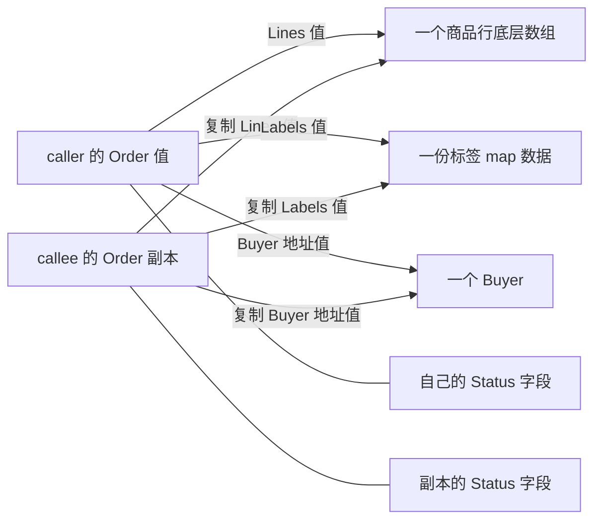
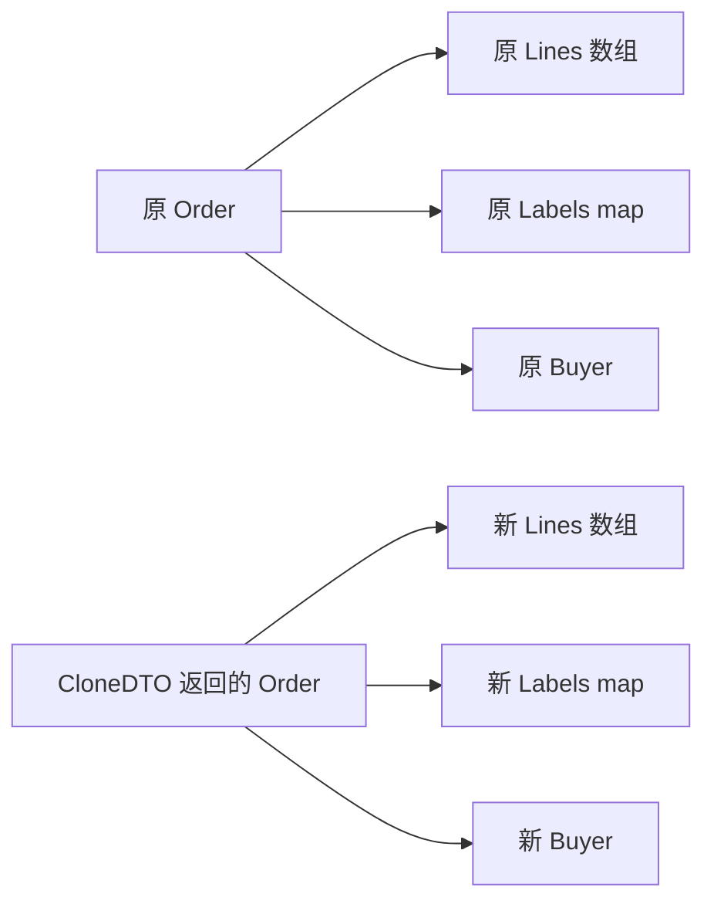

# M02：值、指针、结构体与方法——谁被复制，谁会改变

订单业务常常把对象交给校验器、计价函数或下游 DTO。这里最容易误判的事是：一个函数明明收到 `Order`，修改商品数量却影响了原订单；另一个函数收到 `*Order`，给它换一个订单却没有改变调用方的指针。判断这两种行为，要分别看**传入的值是什么、复制到哪里、复制后的字段通向哪个对象**。

本课独立 module 为 `go-demo/lessons/m02_values_methods`，没有硬前置、外部依赖和中间件。入口、业务模型、正常修复、危险反例和独立断言全部在这个目录内。源码带中文注释，直接沿调用链读即可；原理、反例结果和修复已给全，不保留待完成 exercise。

## 先运行核心实验：10～20 分钟

在仓库根目录运行下面的命令。嵌套 module 需要 `go -C`；根目录的 `go test ./...` 不会顺便测试它。

```powershell
go -C lessons/m02_values_methods run ./cmd/demo -case core
go -C lessons/m02_values_methods test -run TestValuePointerAndRebind -v -timeout 20s ./internal/lesson
```

本次独立 worktree 的完整路径是：

```text
C:/Users/Lenovo/.codex/worktrees/go-course-m02/go-demo/lessons/m02_values_methods
```

也可从任意目录运行：

```powershell
go -C 'C:/Users/Lenovo/.codex/worktrees/go-course-m02/go-demo/lessons/m02_values_methods' run ./cmd/demo
go -C 'C:/Users/Lenovo/.codex/worktrees/go-course-m02/go-demo/lessons/m02_values_methods' test -v -timeout 20s ./...
go -C 'C:/Users/Lenovo/.codex/worktrees/go-course-m02/go-demo/lessons/m02_values_methods' vet ./...
```

`cmd/demo` 默认顺序运行 E01～E06；用 `-case methods/allocation/clone/counter/nil` 可以逐段阅读。这里的斜杠表示不同可选值，实际命令一次只传一个，如 `-case methods`。未知值会返回 error，由 `main` 输出到 stderr 并以 2 退出。

现在必须掌握：所有参数传值、顶层复制与内部共享、方法接收者、方法值绑定时机、map 元素不可寻址、同步对象不可随意复制、nil 接收者的 API 契约。逃逸优化、对象布局、GC、复杂嵌入方法提升和完整接口机制可以遇到相关源码时再查；GC 深入内容留给 M35。

## 文件职责与完整调用链

| 文件 | 阅读职责与关键符号 |
| --- | --- |
| `cmd/demo/main.go` | `main → flag.Parse → lesson.Run`，选择正常实验并处理路由 error |
| `internal/lesson/demo.go` | `Run → runCore/runMethods/runAllocation/runClone/runCounter/runNil`，输出真实对象变化 |
| `internal/lesson/order.go` | `Order/Line/Buyer`、`NewOrder`、三个修改函数、`ShallowClone/CloneDTO` |
| `internal/lesson/methods.go` | `StatusText/BuyerName/SetStatusOnCopy/SetStatus/SafeStatus`，接收者和方法集 |
| `internal/lesson/allocation.go` | `LocalOrder` 返回局部地址，`observePanic` 的有界恢复边界 |
| `internal/lesson/counter.go` | 修复后的 `Counter.Add/Value`；所有方法用 `*Counter` 共享同一锁 |
| `internal/lesson/order_test.go` | 独立检查订单变化、双向克隆隔离、方法绑定、map 写回和 nil 风险 |
| `internal/lesson/counter_test.go` | `TestCounterConcurrent`，4 个 worker 累加后 owner 等待完成，断言 1000 |
| `testdata/copylocks/main.go` | 显式复制锁反例，运行时状态与 `vet -copylocks` 两条证据 |
| `cmd/nilpanic/main.go` | 显式未恢复的 nil panic 入口，真实非零进程退出 |
| `STATUS.md` | 当前工具链、已运行命令、精确输出、清理和未验证范围 |

串行实验的调用链是 `main → Run → 当前 runX → 业务函数/方法 → 当前 runX 打印状态 → Run → main`。打印不代表持久提交；本课真实副作用是**同一进程内的订单字段、数组元素、map 键值和计数**。没有数据库、网络、文件或服务端写入。

## E01：参数始终传值，指针值也会复制

共同输入由 `NewOrder` 创建：`ORDER-1001 / created / Qty=1 / review=pending / Buyer=Alice`。`ID` 和 `Status` 是普通字段；`Lines` 是 slice；`Labels` 是 map；`Buyer` 是 `*Buyer`。

下面的关系图表示复制后的对象身份，不表示 Go 的固定内存布局：



`ModifyValue(order Order)` 把四类修改放在一起。`order.Status = "paid"` 修改参数副本；`order.Lines[0].Qty = 2` 通过 slice 找到共享的数组元素；`order.Labels["review"] = "ok"` 改共享 map 数据；`order.Buyer.Name = "Bob"` 通过复制的地址改同一个 Buyer。函数返回那个 Order 副本，让 caller 可以同时检查它和原订单。

| 时间 | 当前参与者与函数 | 改变的对象 | 返回后证明点 |
| --- | --- | --- | --- |
| 1 | `runCore → NewOrder` | 创建原订单及本次独立的内部数据 | 初始 Qty=1、review=pending、Buyer=Alice |
| 2 | `runCore → ModifyValue` | callee 顶层副本 Status=paid；共享内部数据变化 | caller Status=created，Qty=2、review=ok、Buyer=Bob |
| 3 | `runCore → ModifyPointer(pointer)` | 参数复制地址值；写入其指向的原订单 | caller Status=shipped，Qty=3、review=sent、Buyer=Carol |
| 4 | `runCore → RebindPointer(pointer)` | callee 指针变量改存新订单地址 | caller 指针仍指原订单，返回值指向 replacement |
| 5 | caller 执行 `pointer = replacement` | caller 自己的指针变量换目标 | 新目标 ID=ORDER-REPLACEMENT；旧 Order 仍存在 |

本次输出的关键部分是：

```text
top-level-distinct=true line-shared=true buyer-shared=true
after ModifyValue caller id=ORDER-1001 status=created qty=2 review=ok buyer=Bob
after ModifyValue returned-copy id=ORDER-1001 status=paid qty=2 review=ok buyer=Bob
after ModifyPointer caller id=ORDER-1001 status=shipped qty=3 review=sent buyer=Carol
after RebindPointer caller-still-original=true returned-new-target=true
caller assigned return: target=ORDER-REPLACEMENT old-order=ORDER-1001
```

地址日志中 `&order` 是原 struct 的地址，`pointer` 是指针中保存的目标地址，两者相同；`&pointer` 是**指针变量自身**的地址，类型是 `**Order`。`changedCopy` 的顶层地址不同，但 `&order.Lines[0]` 与 `&changedCopy.Lines[0]` 相同，Buyer 指针也相同。日志打印的是 caller 接收返回值后的变量地址，不能冒充 callee 参数存储地址。具体十六进制地址每次运行会变化，不用于断言。

三个修改函数给出的修复选择有不同业务含义：想返回一个新值时，接回函数结果；想改共同对象时传 `*Order`；想让 caller 换指针目标时返回新指针并在 caller 赋值。`**Order` 也可以让 callee 通过解引用修改 caller 的指针变量，但它传入的依然是值，且会增加所有权理解成本；本课选择显式返回新指针。

最后的数组对照输出 `original-qty=1 copied-qty=7 element-distinct=true`。数组 `[1]Line` 的赋值复制元素，slice `[]Line` 的赋值复制 slice 值并共享数组。若数组元素自己含指针，复制那些元素仍会共享指针目标，不能推广成“数组的任何内部数据都会深克隆”。

Java 自己也是参数传值：对象参数复制的是引用值，callee 重新绑定参数不会替 caller 重新绑定变量。Go 更需要判断静态类型：`Order` 参数复制 struct，`*Order` 参数复制普通的类型化地址值。不要把两者称作“Go 的引用传参”。

## E02：接收者、自动取址、方法值绑定时机

运行 `go -C lessons/m02_values_methods run ./cmd/demo -case methods`，按 `runMethods → methods.go` 的顺序读。

`func (order Order) StatusText() string` 的接收者是一份 Order 值；`func (order *Order) SetStatus(status string)` 的接收者是一份地址值。接收者就是方法调用时送入的那项数据。`SetStatusOnCopy("paid")` 返回 paid，却留住 caller 的 created；通过 `*Order` 调用这个值方法也不会改变这一条复制规则。

以下调用位置需要分开判断，语言规则核对入口是 [方法声明](https://go.dev/ref/spec#Method_declarations)、[方法集](https://go.dev/ref/spec#Method_sets) 与 [方法调用](https://go.dev/ref/spec#Calls)。

| 位置 | 能否调用 `SetStatus` | 原因与本课对照 |
| --- | --- | --- |
| 可寻址局部变量 `order` | 能 | 调用可改写为 `(&order).SetStatus(...)` |
| `pointer`，类型 `*Order` | 能 | 已有目标地址，不需要再取得地址 |
| slice 元素 `items[0]` | 能 | slice 元素可寻址，自动取址改该元素 |
| `map[string]Order` 的元素 | 不能 | map 下标不可寻址；取出副本、修改、整项写回 |
| `map[string]*Order` 的元素 | 能 | 元素本身已是 `*Order`；map 下标依然不可寻址 |
| `NewOrder()` 的临时返回值 | 不能 | 临时 struct 返回值不可寻址；先放变量或返回指针 |

map 元素**允许作为整项赋值左侧**，这不等于可以 `&orders[key]` 或直接写 `orders[key].Status`。本次输出先显示 `map value before writeback=paid temporary=shipped`，随后显示 `map value after writeback=shipped`。只改普通字段必须写回；取出的 Order 副本内部仍共享 slice/map/指针字段，`TestMapWritebackBoundary` 另行证明“尚未写回时 Qty 已能泄漏”。

自动取址只是特定调用位置的语法便利，不会把 `SetStatus` 加入 `Order` 的方法集。`StatusSetter` 需要 `SetStatus(string)`，因此 `*Order` 实现它，而 `Order` 不实现它。编译期断言放在 `methods.go`；错误声明留在代码注释里，不破坏正常编译。

方法值与方法表达式的时间线是本段核心：

| 步骤 | 实际语句/状态 | 保存或使用什么 |
| --- | --- | --- |
| 1 | `valueMethod := order.StatusText`，当时 Status=interface-write | 立即保存 Order 接收者副本 |
| 2 | `buyerMethod := order.BuyerName` | 同样保存副本，其中 Buyer 地址仍共享 |
| 3 | 修改原 Status=latest、原 Buyer.Name=UpdatedBuyer | 不改旧副本 Status；改到共享 Buyer |
| 4 | 调用两个方法值 | 返回 interface-write、UpdatedBuyer |
| 5 | `Order.StatusText(order)` | 方法表达式的第一个显式实参是现在的 Order，返回 latest |
| 6 | `boundSetter := current.SetStatus`，current 当时指 first | 立即保存 first 的地址值 |
| 7 | `current = &second` 后调用 `boundSetter(...)` | 仍然修改 first，不追踪 current 变量的未来值 |
| 8 | `(*Order).SetStatus(current, ...)` | 表达式在此次调用接收 second 地址，修改 second |

因此方法值不是“以后再去查这个变量”的闭包，也不是通用深快照。它保存接收者值；接收者值本身可以含共享对象。规范核对入口是 [方法值](https://go.dev/ref/spec#Method_values) 与 [方法表达式](https://go.dev/ref/spec#Method_expressions)。

`Order.StatusText` 的函数类型是 `func(Order) string`；`(*Order).SetStatus` 是 `func(*Order, string)`。`Order.SetStatus` 不能通过自动取址成立，因为这里写的是类型上的方法表达式。`(*Order).StatusText` 则合法，调用时读目标并复制成值接收者；nil 目标会失败，见 E06。

实际业务类型若表示共同的可变实体、含锁或有不能复制的身份，应统一指针接收者，包括读取方法。小且天然可复制的数值对象可以用值接收者。选择依据是修改/共享/复制语义和接口契约，性能需要实际测量；不能凭“指针一定快”或“读方法一定用值”决定。指针本身也不带并发安全，仍要同步访问共享目标。

## E03：局部地址、new/make 与零值

运行 `go -C lessons/m02_values_methods run ./cmd/demo -case allocation`，读 `runAllocation → LocalOrder`。函数返回以后，局部变量名字离开作用域，但目标对象仍能读取与修改。输出 `local address remains usable: ... status=after-return` 和独立测试证明这个行为；它不是 C 的悬空局部指针。不要从 `new(...)` 或 `&local` 直接断言目标在堆；存储位置和分配消除是编译器优化层的问题。

本课在 Go 1.27.0 实测，同时保留旧代码常见形式。`new(表达式)` 从 Go 1.26 起支持，[Go 1.26 发布说明](https://go.dev/doc/go1.26#language) 和当前 `go doc builtin.new` 均已核对。旧项目不应为这一种便利写法擅自升级语言版本。

| 写法 | 返回类型与初始内容 | 本课实际观察 |
| --- | --- | --- |
| `new(Order)` | `*Order`，目标为 Order 零值 | Status=""，Lines/Labels/Buyer 为 nil |
| `new(Order{Status: "initialized"})` | `*Order`，目标用表达式值初始化 | Status=initialized |
| `new(42)` | `*int`，未定型常量取默认 int | `*answer=42` |
| `new(base)` | `*Order`，顶层新变量按 base 值初始化 | 内部商品行仍共享，修改后原 Qty=8 |
| `new([]int)` / `new(map[string]string)` / `new(chan int)` | 分别是 `*[]int` / `*map[...]...` / `*chan int` | 指向的容器值都为 nil |
| `make([]int, 2, 3)` | `[]int`，新底层数组，len=2、cap=3 | `[0 0]` |
| `make(map[string]string)` | map 值，已初始化可写 | state=ready |
| `make(chan int, 1)` | channel 值，容量为 1 | 当前 goroutine 一发一收后关闭，收到 7 |

旧版本初始化指针可写 `value := 42; pointer := &value` 或 `pointer := new(int); *pointer = 42`；初始化 struct 也可写 `&Order{...}`。`make` 只用于 slice、map、channel，不能写 `make(Order)`。`new(expr)` 的初始值同样按正常赋值复制，不自动深克隆。规范核对入口为 [Allocation](https://go.dev/ref/spec#Allocation) 和 [Making slices, maps and channels](https://go.dev/ref/spec#Making_slices_maps_and_channels)。

“零值存在”与“业务操作可用”要分别看类型和操作。nil slice 可以读长度、range、append，但不能直接下标访问不存在的元素；nil map 可以读取、range、delete，写入会 panic；nil channel 的直接发送/接收会一直等待，所以示例只打印它，不进行这种等待；`Counter` 的零值可加锁和计数。`new(Order)` 并不满足 `ModifyValue/ModifyPointer` 的非空商品行、已初始化 map、非 nil Buyer 输入契约。

`observePanic` 先注册 defer，再调用 nil map 写入；panic 发生时执行 defer，其中直接 `recover`，随后返回其 caller。caller 用 `make` 初始化 map，再写入得到 fixed。channel 的创建者 `runAllocation` 负责发送完以后关闭；它容量为 1，只发送一次再接收一次，所有操作当时已可进行，没有等待另一个 goroutine，没有 sleep。关闭后排空接收的 `open=false` 证明发送结束。

## E04：DTO 克隆究竟隔离哪一层

运行 `go -C lessons/m02_values_methods run ./cmd/demo -case clone`，按 `runClone → ShallowClone/CloneDTO → ModifyValue` 读。

浅复制将 Status 留在副本，但原对象变成 `created / Qty=2 / review=ok / Buyer=Bob`，这可能在真实业务里造成审核函数修改待提交订单、日志快照跟随之后的修改变化。修复 `CloneDTO` 先复制顶层，再给 Lines 新数组、Labels 新 map、Buyer 新对象：



实际输出为 `deep line-distinct=true buyer-distinct=true`，原对象保留 `created / 1 / pending / Alice`；克隆后的修改副本变为 `paid / 2 / ok / Bob`。map 的身份不能用普通 `==` 比较，本课用双向新增键/修改键值验证隔离，而非凭地址打印代替状态证明。nil 与初始化的空容器也分别断言，避免克隆顺便改变 DTO 意义。

这里每个 Line 仅有 string/int，Buyer 仅有 string，map 键值仅为 string，因此按当前字段复制足以隔离可变数据。增加 `Line.Options map[...]...` 后必须补新的复制策略；若有环、多条路径共享同一子对象或资源句柄，不能直接拿这个函数当通用深克隆。包含锁的业务对象不要用 DTO 克隆策略整体赋值复制，而要在原锁下读出单独的可复制快照。

`CloneDTO` 不负责同步。原对象必须在复制期间稳定；可以由单个 goroutine 独占，或在保护原对象的同一把锁下复制。它对两个对象隔离的证据不能证明“并发克隆任意对象都安全”。

额外的 append 对照刻意使用 len=cap=1 的样本，第二项必然需要新数组，所以 `copy-len=2 / copy-qty=99` 时原 `len=1 / qty=1`。有余量时 append 可以继续共享旧数组；不接回 append 返回值也不会更新 caller 的 slice 字段。这种偶然扩容不是可靠克隆策略。

## E05：复制锁的两种坏法与同一对象修复

先运行正常修复，再显式运行故障入口与诊断。`testdata` 默认被 `./...` 忽略，故意坏例不会让正常课程的 vet 必然失败。

```powershell
go -C lessons/m02_values_methods run ./cmd/demo -case counter
go -C lessons/m02_values_methods run ./testdata/copylocks
go -C lessons/m02_values_methods vet -copylocks ./testdata/copylocks
```

最后一条**预期非零**：本次退出码 1，报告 `Add passes lock by value` 和 `assignment copies lock value to copiedAfterUse`。这是反例成功定位的事实，不能写成正常 vet 没通过的待修复缺口；正常 `go vet ./...` 已通过。

第一种错误：反例 `Counter.Add` 用值接收者复制了 mutex 和 int。两次内部输出都是 `local=1`，caller 最后是 `0 expected=2`。锁的配对用法看起来齐全，却只锁本次副本，修改也落在副本。这个“计数丢失”在单 goroutine 下就能证明，无需靠调度复现。

第二种错误：`SharedCounter` 里面 `count` 是指针，复制后 count 目标共享，mutex 存储却不同。代码先 Lock/Unlock 原锁，再**故意**复制已使用的对象，然后原锁持有期间尝试副本的非阻塞 `TryLock`。本次观察 `shared-count=true distinct-lock=true copy-acquired-while-original-held=true count=9`。没有两个 goroutine 竞争 int，但已能看清“两把锁保护同一个目标”的错误对象关系。

该赋值违反首次使用后不可复制的库契约，不能把 `TryLock=true` 当成语言对所有实现保证；不同实现可能表现不同甚至失败。示例用 TryLock 避免对复制的锁执行可能无限等待的 Lock，所有成功取得的锁都释放。不建议在生产代码中“先复制再看看是否可用”。

```text
坏对象 1 ──自己的 mu──┐
                     ├──共同 count 指针目标（两把锁没有共同保护边界）
坏对象 2 ──自己的 mu──┘

修复 caller A ──*Counter──┐
                         ├──同一个 Counter：同一 mu + 同一 value
修复 caller B ──*Counter──┘
```

修复后的 `internal/lesson.Counter` 所有方法用 `*Counter`，普通变量和 alias 都指向同一实例。`Add` 锁成功后注册 `defer Unlock`，退出时释放同一锁；`Value` 也用指针接收者读快照，避免只读方法把锁复制掉。输出 `fixed caller=2 expected=2 alias-target-same=true`。

方法修好仍不能允许 caller 写 `copied := counter` 或 `copied := *pointer`。当前 `sync` 的 `Mutex`、`RWMutex`、`WaitGroup`、`Once`、`Pool`、`Cond`、`Map` 都规定首次使用后不可复制；新式 atomic 包的包装类型也有这类约束。含这些字段的 struct、参数、返回值、range 变量、整体赋值都需要核对。契约见 [sync 官方文档](https://pkg.go.dev/sync)，本次另读了本机 Go 1.27.0 的 `D:/Go/src/sync/{mutex,rwmutex,waitgroup,once,pool,cond,map}.go` 对应注释。不要依赖 vet 检出每一种别名或动态复制，API 本身要表达对象身份。

有限并发测试不是日志模拟：`TestCounterConcurrent` 实际创建 4 个 worker，每个调用 Add 250 次，独立断言最终 1000。其参与者与清理如下：

| 时间 | 参与者与实际等待点 | 状态变化与完成证明 |
| --- | --- | --- |
| 1 | 测试 owner 在启动每个 worker 前 `workers.Add(1)` | 统一 WaitGroup 计数，尚未复制任何同步对象 |
| 2 | 4 个 worker 等待 `<-start` | owner 拥有 start；不会用 sleep 猜 worker 顺序 |
| 3 | owner `close(start)` | 所有 worker 有机会继续，每个调用 Add 250 次 |
| 4 | worker 在 `counter.mu.Lock()` 必要时等待 | 同一锁串行保护同一 int；Add 返回前 defer 解锁 |
| 5 | worker 返回，defer `workers.Done()` | 等待 goroutine 的 `workers.Wait()` 在全部完成后返回 |
| 6 | 等待 goroutine 关闭 finished；owner 等 `<-finished` | owner 此时才读 Value，断言 1000，停止计时器 |

owner 有 3 秒观察上限，普通测试使用 `go test -timeout 20s`，race 复验使用 `-timeout 40s`，对锁死回归另有限制。正常测试不遗留 worker；具体 worker 顺序、锁公平性与精确耗时不保证。普通测试和实际 `-race` 复验均已通过，9 个测试全部 PASS；race 能说明本次真实测试路径没有报告数据竞争，不代表覆盖所有未来访问路径。

本机初次 race 被默认 32 位 GCC 阻断，主 agent 随后统一提供 WinLibs GCC 16.2.0，实测 target 为 `x86_64-w64-mingw32`，只在课程命令进程内指定 CC/CXX 和 PATH。失败和修复后的成功证据都保留在 STATUS。已有兼容 C 工具链时直接运行：

```powershell
go -C lessons/m02_values_methods test -race -v -count=1 -timeout 40s ./...
```

当前 Windows 学习机从仓库根目录可以读取课程统一工具链记录，临时设置后恢复环境：

```powershell
$m02Toolchain = Get-Content -LiteralPath '.local/course-orchestrator/toolchain.json' -Raw | ConvertFrom-Json
$m02SavedCC = $env:CC
$m02SavedCXX = $env:CXX
$m02SavedCGO = $env:CGO_ENABLED
$m02SavedPath = $env:PATH
try {
    $env:CC = (Resolve-Path -LiteralPath $m02Toolchain.cc).Path
    $env:CXX = (Resolve-Path -LiteralPath $m02Toolchain.cxx).Path
    $env:CGO_ENABLED = '1'
    $env:PATH = (Resolve-Path -LiteralPath $m02Toolchain.bin_dir).Path + [IO.Path]::PathSeparator + $m02SavedPath
    go -C lessons/m02_values_methods test -race -v -count=1 -timeout 40s ./...
} finally {
    $env:CC = $m02SavedCC
    $env:CXX = $m02SavedCXX
    $env:CGO_ENABLED = $m02SavedCGO
    $env:PATH = $m02SavedPath
}
```

该 JSON 是本机共享课程状态，不属于本 module 的源码依赖；其他机器应指定自己实际存在的兼容 64 位 C 编译器。不要用 `CGO_ENABLED=0` 假装完成 race 检查，也不要为一课修改全局 Go 配置。

## E06：nil 接收者能进入方法，访问目标仍可能失败

```powershell
go -C lessons/m02_values_methods run ./cmd/demo -case nil
go -C lessons/m02_values_methods run ./cmd/nilpanic
```

第一条正常退出，日志为 `guarded nil status=<missing-order>`，无守卫指针方法与 nil 转值接收者都显示 `panicked=true`。第二条是显式故障入口，会输出真实 nil pointer panic，并以非零退出结束；Go 编译了它并不证明它安全。

`SafeStatus` 的业务约定允许 nil 代表未找到订单，因此先判断 nil，再读字段；`SetStatus` 的约定要求有订单，nil 可以作为 *Order 接收者进入方法，但 `order.Status = ...` 才开始解引用并 panic。`StatusText` 是值接收者，nil *Order 无法提供要复制的目标 Order，取目标时就会失败；不能给值方法内部加 nil 守卫来修复这个调用。

正常入口的恢复链是 `runNil → observePanic → action → SetStatus panic → observePanic 注册的 defer 直接 recover → observePanic 返回 → runNil 输出下一条日志`。恢复不会从 SetStatus 的出错语句之后继续，也不会捕获别的 goroutine 的 panic。本课只用这个边界观察危险输入；实际业务应按 API 契约选择“允许 nil 且守卫”“明确 error”或“禁止 nil 并在上层校验”，不要到处吞掉 panic。

## 对原资料的纠正与版本边界

已读取指定的 pointers、pointermemory、structs、struct-pointer-selector、methods-embedding 现有示例，以及 `files/基础语法/go语言指针`、`go语言方法`。材料仅作启发，没有修改或复制整批原材料。

| 原材料容易形成的理解 | 本课对应的精确理解 |
| --- | --- |
| “在变量前加 * 就成为指针变量” | 声明中的 `*Order` 是类型；表达式 `*pointer` 是沿地址读取/写入目标；`&value` 取得地址 |
| “一个指针能指向任何值” | `*Order` 和 `*Buyer` 是不同类型，普通赋值不能随意混用；指针算术也不属于普通 Go 操作 |
| “系统分配内存”就等于调用 OS 或必在堆 | 初始化与生命周期是语义；具体分配由编译器/运行时实现，不从 new/& 推导 |
| 指针大小 4/8 字节可写成永久语言规则 | 它是常见平台实现观察；本课无需依赖具体字节数判断对象关系 |
| new 只能接受类型 | 读旧代码保留 `new(T)`；当前 Go 1.27 还支持 Go 1.26 引入的 `new(expr)` |
| 值和指针在任意位置都能互相调用方法 | 可寻址性、方法集、nil 和表达式形式分别限制；map 元素和临时 struct 有反例 |
| “int 的别名可以加方法” | `type Score int` 是本地定义的新类型；`type ScoreAlias = int` 是内置 int 的另一个名字，不能给 int 加方法 |
| 嵌入是“隐式继承” | 嵌入提供字段/方法提升，不产生 Java 子类型关系；本课主要沿接收者复制解释，嵌入细節延后 |

本课 `go.mod` 为 `go 1.27`，未额外写 toolchain 指令；实测本机 Go 1.27.0、GOTOOLCHAIN=auto。没有第三方模块，不需要 go.sum。公司旧版本项目应以自己的 go.mod、toolchain 和语言能力为准，不能因这课版本更新就批量改生产代码。

## 验证与资源结局

普通入口、独立业务断言、正常 vet、复制锁诊断和真实 nil 故障的结果均见 [STATUS.md](STATUS.md)。本课不占用端口、不保存业务文件、不改变全局 Go 配置；正常实验串行结束，channel 由创建者关闭，测试 worker 全部被 WaitGroup 等待完成，锁与计时器有明确退出清理。危险复制锁程序仅有单 goroutine、无阻塞 TryLock，nil 故障进程已经退出。

读到真实后端代码时，可以直接沿本课四个问题判断：当前传入的静态类型是什么，复制后哪个字段还能通向原对象，修改落在哪个目标，caller 在返回后还持有哪些值或地址。需要隔离时执行字段级复制，需要共享时保留同一对象身份和同一同步边界。
