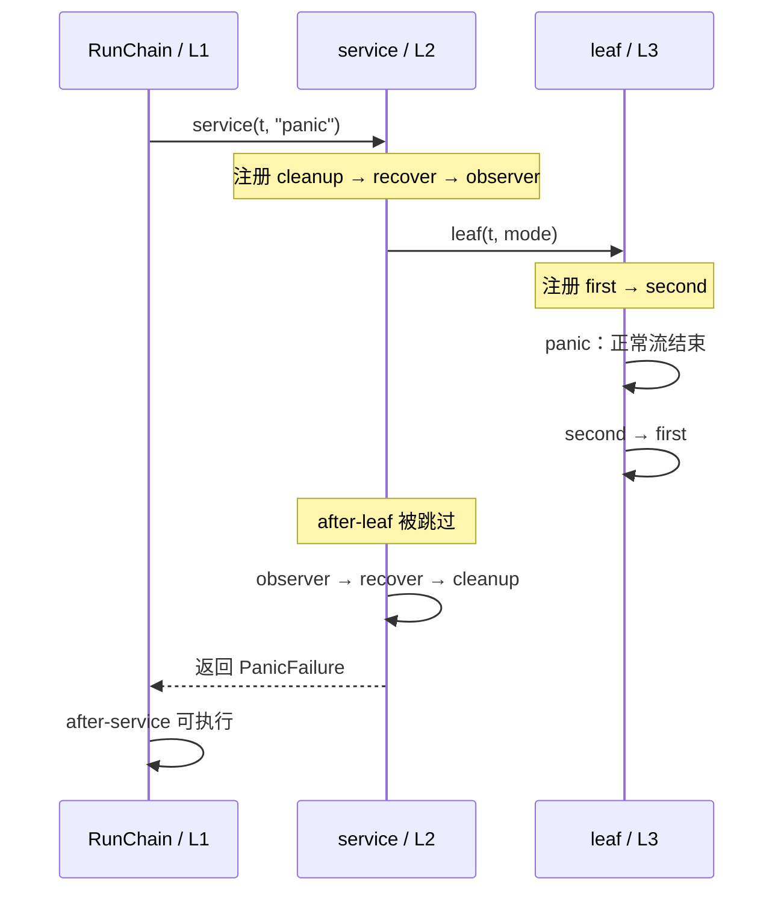

# M07：panic/recover 的恢复边界、返回位置与进程后果

本课用同一个合成订单 `order-7001` 回答一个维护服务时经常遇到的问题：**recover 让哪一个 goroutine 停止展开、哪个函数返回、哪些业务事实已经发生？** 课程包含可运行的错误版本和修复版本，正常入口会完成全部实验。未恢复 panic、错误 goroutine 边界、runtime fatal、`os.Exit` 都在有三秒上限的子进程中运行。

本课独立 module 为 `go-demo/lessons/m07_panic_recovery`，没有硬前置和第三方依赖。M05/M06 能帮助阅读 error/defer，但下面内置必要规则。真实数据库 rollback、提交结果不明和跨系统一致性由 M21/M38 验收；本课的内存事务明确只证明控制流及状态变化。

## 先运行，再沿日志读代码

在**含本课程目录的仓库根目录**运行；各命令的 `-C` 让 Go 进入本课独立 module，根 module 的 `go test ./...` 不会包括它。

```powershell
go -C lessons/m07_panic_recovery run ./cmd/demo
go -C lessons/m07_panic_recovery test -v ./...
go -C lessons/m07_panic_recovery vet ./...
# race 需兼容 amd64 的 C 编译器；本机配置见下段。
go -C lessons/m07_panic_recovery test -race -count=1 -timeout 40s ./...
```

本轮实际实施目录是 `C:/Users/Lenovo/.codex/worktrees/go-course-m07/go-demo/lessons/m07_panic_recovery`。如果终端在其他位置，使用这个绝对目录作为 `-C` 参数即可。主 agent 汇总课程前，不假定主目录已经有这份代码。

当前验证为 Go **1.27.0 windows/amd64**；module 的 `go 1.27.0` 是本课语言/最低工具链版本要求，没有额外 `toolchain` 指令，`GOTOOLCHAIN=auto`。标准库源码核对自 `GOROOT=D:/Go`。`run`、`test`、`vet`、`build` 已实际通过；race 在主 agent 统一提供的 portable amd64 编译器下实际通过，`test -race -count=1 -timeout 40s ./...` 为 exit 0。首次默认 PATH 命中 32 位 `D:/MinGW/bin/gcc.exe` 的失败已解决，保留历史诊断见 [STATUS.md](STATUS.md)。语言保证、库契约和本机运行结果在下文分别说明。

本机 race 复跑先在当前 PowerShell 进程加载以下配置，再执行上面 race 命令；这些环境赋值不写系统/用户全局配置。其他机器需要提供自己的兼容 amd64 编译器，不能假定存在这个已忽略的本机 JSON。

```powershell
$taskToolchain = Get-Content -LiteralPath 'D:/IdeaProject/go-demo/.local/course-orchestrator/toolchain.json' -Raw | ConvertFrom-Json
$env:CC = $taskToolchain.cc
$env:CXX = $taskToolchain.cxx
$env:CGO_ENABLED = '1'
$env:PATH = $taskToolchain.bin_dir + [IO.Path]::PathSeparator + $env:PATH
```

建议用 15 分钟完成核心阅读：先看 E01 的两条时间线，再看 E02 的 helper 反例，最后看 E03 的 `err=nil` 如何让 caller 继续提交。E04–E06 是恢复边界扩展，可分段阅读；正常运行一次仍会执行全部实验，无须另外写练习。

| 阅读顺序 | 文件/符号 | 它负责什么 |
| --- | --- | --- |
| 1 | [cmd/demo/main.go](cmd/demo/main.go)：`main`、`run` | 入口分流，正常课程拥有 context/子进程并检查退出证据 |
| 2 | [lesson/timeline.go](lesson/timeline.go)：`RunChain → service → leaf` | 三层调用、LIFO、具名结果、失败现场栈 |
| 3 | [lesson/recover_rules.go](lesson/recover_rules.go)：`RecoverRules`、`RunRuntimePanic` | 普通调用、转调 helper、直接 named defer、运行时越界 |
| 4 | [lesson/effects.go](lesson/effects.go)：`RunEffects` | 吞 panic、失败仍提交、显式失败与本地清理 |
| 5 | [lesson/worker.go](lesson/worker.go)：`RunWorker → runTask` | 同 goroutine 恢复、共享预占状态、owner 等退出 |
| 6 | [lesson/http.go](lesson/http.go)：`RunHTTP`、`recoveryMiddleware` | 真实本地 TCP/HTTP 请求、响应提交边界与已发生的效果 |
| 7 | [lesson/process.go](lesson/process.go)：`RunChild → RunChildCase` | 三秒子进程、真实退出码和清理哨兵 |
| 8 | [lesson/lesson_test.go](lesson/lesson_test.go)、[lesson/worker_cancel_test.go](lesson/worker_cancel_test.go) | 独立断言返回点、业务状态、协议失败、真实进程，以及启动后取消的有界收尾 |

现在必须理解的是：defer 何时注册、recover 直接调用的条件、返回位置、goroutine 独立调用栈、任务失败和外部效果的区别。runtime 的展开帧实现、生产框架 writer 可选接口兼容、事务未知结果可以等读到相应源码时再深入。下面已给出本课所有错误版本的解析和修复结果。

## 最小 Go 规则：先把“返回”与“展开”分开

`error` 是普通返回值。被调用函数正常返回，caller 执行调用语句之后的代码，并明确决定是否继续。业务输入不合法通常走这个路径，比如 E01 的 `ErrInvalidOrder`。Go 没有因为返回一个非 nil error 自动跳过上层代码的机制。

`panic(value)` 终止当前函数正常执行，进入**当前 goroutine** 的展开过程。当前层已经注册的 defer 按后注册先执行的顺序运行；没有有效恢复则继续到 caller 的 defer，直至该 goroutine 顶层。未恢复的 panic 最终终止整个程序。它不需要一直走到 `main` goroutine；worker 自己的栈顶也能触发进程终止。[语言规范：Handling panics](https://go.dev/ref/spec#Handling_panics)

`recover()` 只有在这个 panicking goroutine 的**直接 deferred function** 中调用，才会取到 panic 值。假设 `G` 注册了恢复函数 `D`：`D` 恢复并正常返回后，`G` 还没执行的较早 defer 继续执行，然后 **G 返回给它的 caller**。发生 panic 的语句之后不会继续，`G` 中被中断调用之后的普通语句也不会继续。E01 运行的事件序列会逐项证明这些返回位置。

defer 是延迟执行函数调用，不是代码块级 `finally`。每个 defer 在执行到该语句时注册；未执行到的 defer 没有清理责任。调用的函数值与普通实参在注册时求值，闭包可以在退出时读取所在函数的变量。正常 `return` 先确定结果变量，再运行 defer，最后把结果交给 caller。[语言规范：Defer statements](https://go.dev/ref/spec#Defer_statements)

对 Java 工程师可以这样对应：栈展开中的 defer 有类似 `finally` 的收尾用途，但作用范围是 Go 函数退出；error 更像一个显式返回协议；recover 的有效调用位置有语言限制，不能把任意 `catch` helper 套法直接搬过来。特别要改变 Java 线程直觉：Java 工作线程的未捕获异常通常只终止那个线程；Go 某一个 goroutine 的未恢复 panic 会结束整个进程。

## E01：三层调用栈在哪里断开、在哪里恢复

入口 `run` 同步调用 `RunChain(mode)`。`RunChain` 是 L1，`service` 是 L2，`leaf` 是 L3。三层都在当前 `main` goroutine，没有启动 worker。`*trace` 是同一请求的共享事件对象，三个函数持有同一个指针；同步追加无需锁。



panic 分支的真实输出：

```text
L1.begin -> L2.begin -> L3.begin -> L3.panic
-> L3.cleanup.second -> L3.cleanup.first
-> L2.observer -> L2.recovered -> L2.cleanup
-> L1.after-service
```

| 阶段 | 当前参与者/位置 | 状态改变 | 下一步为何发生 |
| --- | --- | --- | --- |
| 1 | L1 `RunChain` | 建立请求 trace，记录 `L1.begin` | 同步调用 service，并等待它返回 |
| 2 | L2 `service` | 注册三个 defer，具名结果 `err` 初值 nil | 调用 leaf，暂停 L2 正常流 |
| 3 | L3 `leaf` | 注册 first/second，记录 panic，终止正常流 | 已注册的 second/first 逆序运行 |
| 4 | L2 展开 | `L2.after-leaf` 没有执行；observer 先运行 | 它比恢复 closure 注册得晚 |
| 5 | L2 恢复 closure | 直接 recover 取到 string，生成 `PanicFailure`，给结果 err 赋非 nil | 恢复 closure 正常返回，停止 panic 展开 |
| 6 | L2 较早 cleanup | 仍然运行，不因恢复而跳过 | service 已结束，向 L1 返回结果 |
| 7 | L1 调用点之后 | `L1.after-service` 运行，并拿到失败 error | L1 没有被自己的 defer 恢复，因此正常代码继续 |

这说明恢复返回的位置是 **`RunChain` 中的 `err := service(...)` 完成处**。不是 `leaf` 的 panic 下一句，也不是 service 的 `err = leaf(...)` 之后。leaf 没有正常交付 error；service 的结果 err 来自恢复 closure 的赋值。

error 分支的真实输出中，L3 记录 `L3.return-error` 后执行两项 defer，L2 得到 `ErrInvalidOrder`，**会记录 `L2.after-leaf`**，再执行 observer/cleanup 并向 L1 返回。没有 `L2.recovered`，因为 recover 当前没有 panic，只返回 nil。success 与 error 的控制流形状相同，区别是返回的业务结果。`TestThreeLayerReturnPoints` 分别校验三条完整时间线，避免只用“打印到了某行”猜返回行为。

`service` 的签名 `(err error)` 把 err 声明为结果变量。defer 中的 `err = captureFailure(...)` 修改这个变量；若改成 `err := ...`，就会声明另一个局部变量，让 caller 仍拿到 nil。`captureFailure` 接收的是已经 recover 到的值，只保存栈和任务信息；它不承担 recover。`debug.Stack()` 在恢复现场调用，因此本次记录包含 `lesson.leaf`、`lesson.service.func1` 等真实失败链路。等 service 返回后再打印一个新栈，通常只能看到 caller 当下位置。[runtime/debug.Stack](https://pkg.go.dev/runtime/debug#Stack)

最小 defer 值实验的真实输出为：

```text
defer-values=[closure=finished argument=registered]
```

先注册的函数参数保存 `registered` 这个 string 值；后来闭包注册，退出时先读取已经被赋为 `finished` 的 stage 变量。两个 defer 又修改具名结果 events，所以 caller 最终看到两个事件。这四个时间点要分开：注册 → 实参求值 → 普通 return 确定结果 → 逆序执行 defer。

## E02：recover 的有效性看真实调用关系

`RecoverRules` 的反例都由额外的正确边界收住，不会提前截断正常入口。

| 写法/本课符号 | recover 当次结果 | 原因/返回点 |
| --- | --- | --- |
| 普通函数体 `recover()` | nil | 没有有效的 deferred 调用位置 |
| `indirectInner` 的 defer closure 再调用 `helperRecover()` | nil | recover 藏在普通转调 helper 中，panic 仍继续展开 |
| 外层 `indirectBoundary` 的 defer closure 直接 recover | panic 值 | 到达正确边界，indirectBoundary 返回，RecoverRules 执行调用点之后 |
| `directBoundary` 注册 `defer directRecovery(t)` | panic 值 | directRecovery 本身就是被延迟的函数，在其体内直接 recover 有效 |
| `bareRecoverBoundary` 中 `defer recover()` | 未终止 panic | recover 本身不是被 deferred function 的函数体调用；值也没有承接 |
| `bareRecoverBoundary` 更早注册的有效 closure | panic 值 | 兜住上一项反例，函数返回后 caller 继续 |

实际完整事件：

```text
ordinary=nil -> indirect.helper=nil -> outer.recovered
-> caller.after-indirect -> direct.named=recovered
-> caller.after-direct -> bare.outer=recovered -> caller.after-bare
```

“直接”不表示“只能匿名闭包”，也不表示“所有名字叫 helper 的函数都无效”。关键是函数本身是不是被 defer 调用的那个函数。代码没有通过 `//go:noinline` 改变实验：编译器即便做内联，可观察行为仍须遵守语言规则。

扩展 `RunRuntimePanic` 用变量索引访问长度为 1 的 slice 的下标 2，触发普通运行时 bounds panic。它在自己的直接 defer 中恢复，并保留实现 `runtime.Error` 的动态值及栈。它和 E06 的 mutex fatal 形成真实对照：**运行时产生的普通 panic 可以恢复，runtime fatal 不能用 recover 兜住。** 不把“runtime 出的错误”一律当作同一种机制。

## E03：恢复后返回 nil 和恢复后继续提交都是实际危险路径

调用链是 `RunEffects(policy) → 版本边界 → mutateThenPanic(s)`。同一 `*effectState` 对象先递增 `externalSent`，再递增 `staged`，最后 panic。它模拟“发货已被外部接受，本地记账尚未完成”的窗口；不是数据库、物流接口或 broker 的实证。

| 版本 | 实际展开与返回 | caller 最终看到的事实 |
| --- | --- | --- |
| `swallowFailure` | defer recover，未写结果 err，函数返回初始 nil；RunEffects 看 nil 后调用 commit | external=1、committed=1、err=nil |
| `commitDespiteFailure` | defer recover 设置失败 error，但随后无条件 commit | external=1、committed=1、err 非 nil |
| `reportFailure` | defer recover 设置失败和栈，再人为把自己拥有的 staged 清零并标 rollback | external=1、committed=0、staged=0、rollback=true、err 非 nil |

真实日志对照：

```text
policy=swallow external=1 staged=0 committed=1 rollback=false err=<nil>
policy=commit-defer external=1 staged=0 committed=1 rollback=false err=任务 order-7001 ... panic ...
policy=safe external=1 staged=0 committed=0 rollback=true err=任务 order-7001 ... panic ...
```

第一项“继续提交”发生在 **caller `RunEffects`**，而不是 `swallowFailure` 的 panic 下一句。第二项提交发生在 **正在执行的 deferred closure**，它的正常语句仍会继续；recover 不是“结束当前 defer 的指令”。这两个错误要分开定位，不能只找 panic 之后的普通语句。

修复分别改变两个边界：对外结果必须是明确失败；本地清理必须由拥有者显式执行。修复没有让 `externalSent` 回到 0，仍应查明外部效果、保留幂等键并进入补偿/对账策略。自动重试整个函数可能再次发货，recover 本身不能提供幂等性。`TestEffectsAreNotRewound` 检查这些最终业务状态，而不把“函数没崩”当作成功。

## E04：把恢复放在 worker 自己的调用栈，并等待清理

错误的 goroutine 位置见 E06 的崩溃进程；修复路径是 `RunWorker(ctx, repair) → runWorker → go func → runTask(inventory, repair, hooks)`。`runTask` 的 defer 在 worker 的同一 goroutine 中，恢复后交付 `TaskResult{State: "FAILED", Failure: ...}`。正常入口的 hooks 为 nil；同包测试用 hooks 建立明确屏障，但仍运行同一个 runWorker 实现。

| 参与者 | owner/资源 | 实际等待点与最终状态 |
| --- | --- | --- |
| demo/test caller | 创建三秒 context，调用 RunWorker | 等 RunWorker 返回，再 cancel 释放 timer |
| RunWorker owner | 创建 results、done、共享 inventory 指针；取消后创建独立收尾 timer | select 等结果/等退出；两个取消分支都转 finishCanceledWorker；观察 done 后才读 inventory |
| worker 外层 goroutine | 同步执行 runTask；只有它写 inventory | runTask 返回后向容量 1 的 results 发送；最外层退出清理完成后 close(done) |
| worker 内 `runTask` | 修改预占，拥有本任务失败与清理策略 | panic 后自己的 deferred closure recover，保留现场栈与 FAILED |

时间线：

1. owner 建立两个 channel，创建库存状态对象，启动 worker。`go` 只是创建并发执行者，不会自动等待它。
2. worker 将 state 从 RUNNING 变为预占 1，然后 panic。
3. worker 自己的 defer 把 state 改成 FAILED，记录栈；repair=true 才显式释放预占。
4. runTask 返回失败值，外层发送结果，再执行 close(done)。发送结果、goroutine 退出这两件事分别观察。
5. owner 等结果和 done 后读取共享库存对象。关闭 done 与对应接收提供同步，避免 owner 在 worker 写入时读取。

实际输出：

```text
repair=false task=order-7001 state=FAILED reserved=1 stack-saved=true owner-joined=true
repair=true  task=order-7001 state=FAILED reserved=0 stack-saved=true owner-joined=true
```

仅恢复仍留下共享预占 1，所以下一项任务可能受到不完整状态影响。修复由知道所有权的 worker 显式释放；若无法恢复共享不变量，继续复用该 worker/对象就没有正确性依据，应隔离/重建资源或让更外层按既定故障策略终止。

results 是单个值的缓冲 channel，即使 owner 此刻转入收尾，worker 发送也不会永久阻塞；**缓冲只能避免发送卡住，不能证明清理或退出完成**。ctx 约束业务等待，不会强杀 goroutine，也不会撤销已经发生的效果。只在 ctx 启动前已取消时可以拒绝创建任务；若取消发生在检查之后、任务启动之后，owner 仍承担收尾责任。

取消路径明确调用 `finishCanceledWorker`：

1. 保存原始调用错误。`WithCancelCause` 取消后 `ctx.Err()` 是 context.Canceled，`context.Cause(ctx)` 则可以是指定的订单中止原因；`workerContextError` 用 errors.Join/包装同时保留二者，caller 可用 errors.Is 检查。[context.Cause](https://pkg.go.dev/context#Cause)
2. 从 `context.Background()` 创建新的三秒收尾预算，计时从进入收尾开始。**不能从已取消的 ctx 再派生预算**，否则它会立即取消，owner 又会提前返回。收尾函数释放自己的 timer，worker 不拥有这个 timer。
3. 等 done。若取消发生在等结果阶段，done 关闭后再取缓冲中的唯一结果；若已经收到结果，就保留这份值。结果已发送发生在 close(done) 之前，最终读取不会继续等待业务工作。
4. 观察 done 后，才读取最终 inventory，设置 Joined=true。即使清理成功，返回 error 仍包含调用取消原因；TaskResult 中的 FAILED/panic 栈也仍保留，不转换成业务成功。
5. 如果三秒收尾预算真的耗尽且 done 仍未关闭，返回 `ErrWorkerCleanupTimeout`、原取消原因及独立预算的 DeadlineExceeded，State=CLEANUP_INCOMPLETE、Joined=false。此时不读活跃 worker 的共享 inventory，Reserved 不能被当作最终状态。这个错误承认退出尚未确认，不能声称 context 已把 goroutine 杀掉；上层应按服务的任务隔离/故障处置策略继续处理。

当 done 与预算同时就绪时，代码会再次核实 done，优先确认实际退出。调用取消和正常 done 同时可选时，正常完成分支也会检查已观察到的 ctx.Err，保留取消事实；取消恰好发生在函数返回之后则不改变已经返回的值。

取消实验直接运行下面命令，完整解析已给出，不需要写额外练习：

```powershell
go -C lessons/m07_panic_recovery test -count=1 -v -run 'TestWorker' -timeout 20s ./lesson
```

| 独立断言 | 屏障确定的时间线 | 真实证明点 |
| --- | --- | --- |
| before-result | worker 预占并 panic → 停在释放预占前 → 测试取消调用 ctx → owner 进入收尾 → 测试放行清理 | 调用 ctx 已取消，但 cleanup context 未取消；owner 返回瞬间实际 done/cleanup channel 均已关闭，预占为 0，cause 保留 |
| after-result | task 清理完成并发出结果 → owner 确认收到结果 → worker 停在最外层退出清理 → 测试取消 → owner 收尾 → 放行退出 | 命中第二个 select 的取消分支；收到结果仍不能替代等待 done；owner 返回时已完成退出 |
| cleanup-timeout | worker 停在任务清理 gate → 取消调用 ctx → owner 独立 25ms 预算耗尽 → 返回明确失败 → 测试再放行 gate | 返回时 done/cleanup 未关闭，Joined=false；错误同时保留 cause/Canceled/收尾超时/DeadlineExceeded；随后确实清理并退出，无遗留 worker |
| already-canceled | 调用前取消 ctx → RunWorker 拒绝启动 | cause 保留，结果没有伪造任务或 Joined |

独立观察者在 API 返回的那一刻检查真实 channel，**不是仅检查实现自己填的 Joined 标志**。在释放任务 gate 前，`synctest.Wait()` 让同一测试 bubble 中的其他 goroutine 到达确定的持久阻塞点：正确 owner 应等待 done，worker 应等待 gate。如果 owner 已提前返回，观察者也会完成并把值放入 returned，此时立即检查必然能看到这个错误，避免“刚取消还没调度到 owner”的假证明。`synctest.Test` 还会等 bubble 内所有 goroutine 退出，它只用于这两项同步测试，不是生产服务的全进程快照。[testing/synctest](https://pkg.go.dev/testing/synctest#Test)

测试屏障由测试拥有并通过 sync.Once 无条件释放；失败清理也等真实 done。所有观察有守护 timer 上限，完成证明来自同步事件，没有 sleep 或 goroutine 数量猜测。25ms 是单独故障测试实际耗尽的收尾预算，不是调度顺序假设；正常 owner 策略仍是三秒。

## E05：HTTP 框架恢复保住服务，不代表恢复业务效果

本实验使用 `httptest.NewUnstartedServer` 创建真正的本地 TCP server。临时端口由监听分配，三个场景逐个运行，不固定占用共享端口。客户端是实际 `http.Client`，没有 `ResponseRecorder` 替身。每次请求先将原子计数 external 增为 1，再 panic；计数只是效果模型，网络请求/状态码/截断是真 HTTP 证据。

实际请求调用链：owner `RunHTTP → client.Do` 发出请求；server 自己的 goroutine 运行 `net/http.(*conn).serve → serverHandler.ServeHTTP → handler.ServeHTTP`。middleware 场景在 handler 前加 `recoveryMiddleware` 的 closure，仍在同一个请求 goroutine，没有创建一个可跨栈 catch 的恢复线程。

标准库 net/http 的 Handler 契约是：handler panic 后 server 恢复并记录栈，对 HTTP/1.x 关闭连接，对 HTTP/2 中断 stream。它不承诺自动返回完整 500。本课只验收本地 HTTP/1.1，HTTP/2 的行为来自库契约，未单独跑 HTTP/2 实验。[net/http.Handler](https://pkg.go.dev/net/http#Handler)

| 场景 | 实际响应/日志 | 业务事实 | 恢复边界 |
| --- | --- | --- | --- |
| builtin | client.Do 得 EOF，无响应头，Status=0，server 记录 panic 栈 | external=1 | net/http 的连接 goroutine defer |
| middleware | 完整 Status=500、失败正文、body 读取无错，保存 `PanicFailure.Stack` | external=1 | 自建请求 middleware 的直接 defer |
| partial | 已收到 200 和 `accepted-prefix\n`，读取剩余 body 得 `unexpected EOF`，server 记录栈 | external=1 | middleware 先记失败，再重新 panic，让 net/http 中断连接 |

为什么 partial 的修复不写 500？handler 在 panic 之前已调用 Flush，响应头和前缀已经发送。middleware 的 `responseTracker.committed` 记录这个协议边界，不能撤回字节或把 200 改成 500，也不能再写一段“失败”装作完整成功体。它保存失败后重新 panic，让标准库更外层恢复处理连接。此时 **HTTP 200、已有正文、服务器存活** 三项都不足以证明完整业务成功。

middleware 在还没发送头时可以返回明确 500，但没有外部回滚能力。框架的 Recovery 中间件也遵守同样的效果边界。这个 minimal writer 包装只实现本实验需要的 Write/WriteHeader/Flush；在真实框架中还需维护所需可选接口、信息性状态码及标准库 `http.ErrAbortHandler` 的中止约定，不能直接把本课包装当成生产中间件。

资源结局：每次创建的 server 在实验结束 Close 并等请求退出；response Body 已读/关闭；transport 的 idle connection 收尾；caller 释放截止 timer。日志 buffer 通过 mutex 同步，外部计数通过 atomic 同步，避免把网络上的完成误当成任意内存访问都安全。

## E06：用真实进程检查 goroutine 边界和不可恢复的退出

正常 `run` 通过 `os.Executable()` 得到**当前已编译二进制**，然后 `RunChild` 用 `exec.CommandContext` 启动同一二进制。子进程在 main 业务入口之前读 `M07_CHILD_CASE`，直接进入指定故障，不会递归生成另一组进程。test 用自己的 test 二进制及 `-test.run=^TestChildEntry$` 做相同事情。

每个子进程三秒上限，逐个运行并等待回收。超时被报告为验收失败，不能算作“预期崩溃”。harness 只对自己的子进程设置 `GOTRACEBACK=single` 和 `GODEBUG=panicnil=0/1`，不修改 shell/用户的持久配置。它使用 CombinedOutput 保留 stderr/stdout，依据 `exec.ExitError.ExitCode()` 验证实际退出码及哨兵，而不只看打印是否含 panic。

| 故障选择 | 本机实际退出码 | 实际哨兵/诊断 | 证明的边界 |
| --- | --- | --- | --- |
| unrecovered | 2 | `CHILD_DEFER_RAN` 后出现 `panic: unrecovered-current-goroutine` | 普通未恢复 panic 仍展开当前栈已注册 defer，再终止进程 |
| goroutine | 2 | `WORKER_DEFER_RAN`、`panic: unrecovered-child-goroutine`；无 parent defer/recovered 哨兵 | parent 的恢复点不在 child 调用栈，不会帮它恢复，也不会被迫替它清理 |
| fatal | 2 | `fatal error: sync: unlock of unlocked mutex`；无 FATAL_DEFER_RAN/FATAL_RECOVER | recover 对这个 runtime fatal 无效，用户 defer 也没运行 |
| exit | 17 | `CALLING_OS_EXIT_17`；无 EXIT_DEFER_RAN | os.Exit 直接结束进程，不执行 defer |
| nil，panicnil=0 | 0 | `NIL_RECOVER_TYPE=*runtime.PanicNilError MODERN=true VALUE_NIL=false` | Go 1.27 默认 nil panic 给直接 recover 非 nil 值 |
| nil，panicnil=1 | 0 | `NIL_RECOVER_TYPE=<nil> MODERN=false VALUE_NIL=true` | 兼容模式中直接 recover 仍停止这次 panic，但结果 nil 无法可靠区分有无 panic |

2 是这次 Go 1.27.0/Windows/GOTRACEBACK=single 的实际结果，规范保证未恢复 panic 终止程序，**不保证永远使用 2 这个 OS 退出码**。`go run` 的包装命令通常会报告 `exit status 2` 而自己返回其他非零码，所以我们没有拿包装层退出码冒充故障二进制退出码。

goroutine 反例中的参与者和等待点：

```text
parent：wrongParentRecovery 注册自己的恢复 closure/cleanup
  ├─ 创建 started、done
  ├─ go child
  ├─ <-started 等 child 通知已到入口
  └─ <-done 等待（本反例没人关，父进程不正常返回）

child：close(started) → panic
  └─ 自己的 WORKER_DEFER_RAN → child 栈顶没有 recover → 整个进程终止

parent 的 defer 不是 child 的 caller，parent 并没有进入这次展开。
```

`close(started)` 是通知，不是清理或恢复；parent 收到通知的具体调度时刻与 child 展开的时刻不保证先后。我们只断言同一栈的 LIFO、child 清理哨兵、parent 无恢复哨兵和实际进程退出，没有用 sleep 固定偶然顺序。E04 的修复把 recover 注册在 child 自己调用的 runTask，交付失败结果并让 owner 等其退出。

`panic(nil)` 的现代行为从 Go 1.21 起改变；`GODEBUG=panicnil=1` 可恢复旧行为。[runtime.PanicNilError](https://pkg.go.dev/runtime#PanicNilError) 本课同时跑了两个配置，所以旧公司代码不能只凭新工具链默认行为分析。`panic` 的 value 是 `any`，可以是 string、error 或其他值；它不是 Java 的 Throwable 限制。带动态类型的 nil 指针也不等于 nil interface，这种值读取/打印还要留意对应方法是否支持 nil 接收者。

runtime fatal 的确定触发器是一个从未 Lock 的 `sync.Mutex` 被 Unlock。本机标准库 `internal/sync.(*Mutex).unlockSlow` 调用 fatal，runtime 的 fatal/throw 路径进入 `fatalthrow`，这不是普通 `gopanic`/recover 展开。不要用会破坏机器的 OOM/栈溢出或碰运气的 concurrent map 写来“证明 recover 万能”。`os.Exit` 的不运行 defer 来自其库契约；外部强制结束进程也没有用户清理保证。[os.Exit](https://pkg.go.dev/os#Exit)

单独复现时可运行下面显式入口。命令会以预期非零状态结束；正常默认入口已经提供有界子进程验收，阅读本课不要求手动崩溃当前服务。

```powershell
go -C lessons/m07_panic_recovery run ./cmd/demo --fault=goroutine
go -C lessons/m07_panic_recovery run ./cmd/demo --fault=fatal
```

## 在业务代码里如何选择边界

| 边界 | 可以恢复的理由 | 必须另外做的事 | 不能从恢复推出的事实 |
| --- | --- | --- | --- |
| HTTP handler | 已明确请求隔离策略，希望一个请求失败不立即结束服务 | 记录请求/任务、panic 值和现场栈；未提交响应时给失败；已提交时遵循中断协议 | 外部效果回滚、后台 goroutine 已恢复、客户端没收到任何字节 |
| worker 任务入口 | 任务具有隔离边界，owner 能接收明确 FAILED 并决定后续处理 | 在 worker 自己的栈恢复；等待退出；修复或废弃共享状态，定义重试/幂等 | worker 池和共享缓存仍完整、业务可以默认 ACK/成功 |
| 事务函数 | 可在退出时清理自己持有的 Tx，并按项目策略记录或传递程序故障 | 成功才 Commit；退出前未提交则尝试 Rollback；保留原 panic，必要时重新 panic | Rollback 能撤回已提交/已外发效果、Commit 错误一定没提交 |

E01/E04 的恢复是教学中明确选择的请求/任务隔离策略，不代表所有内部 panic 都该转 error。若 panic 表示共享状态不可判定，吞掉后继续服务可能放大错误；可以在 owned cleanup 后重新 panic，由更外层按服务故障策略处理。反过来，数量为空、库存不足等可预期业务失败应返回 error，不应为了套 Recovery 写成 panic。

事务常见安排是获得 Tx 后立即注册退出清理，正常业务成功才在普通路径 Commit。defer 通常负责未完成资源的收尾，不负责无条件“终于成功提交”。若选择恢复并转 error，要明确具名结果/作用域，不能把 panic 吞成 nil；若只负责清理，就让原 panic 继续展开。这里没有连接实库，因此不声称 Tx 的最终持久事实已验证；接入 M21/M38 后还要查实际表、事务和外部系统事实。

## 原材料核对和查证入口

本轮读取了工作树中的 `examples/basic-syntax/panic-recover/main.go`，以及主目录只读材料 `files/基础语法/go语言异常捕获`。原示例的三层返回位置是正确的，课程保留其核心并增加失败结果、栈、副作用与真实退出证据。材料里的两类绝对化说法在此纠正：

- “有 recover 就不会中断”需要补上有效调用位置、同一 goroutine、deferred function 正常返回条件；函数的正常流已经中断，只是展开在边界停止。
- “panic 一直传到 main，遇到最近 recover 就捕获”需要改为当前 goroutine 的调用栈与最近**有效**恢复点；child goroutine 未恢复会结束进程，父 goroutine 的恢复点没有作用。
- “发生 panic 就继续健壮运行”不能脱离共享状态、失败协议与外部效果；E03/E04 已用真实状态证明吞掉 panic 会产生后续错误。

语言规则查 [Go 1.27 规范的 Handling panics](https://go.dev/ref/spec#Handling_panics) 与 [Defer statements](https://go.dev/ref/spec#Defer_statements)；nil panic 的库版本契约查 [runtime](https://pkg.go.dev/runtime#PanicNilError)；HTTP 处理契约查 [net/http.Handler](https://pkg.go.dev/net/http#Handler)。本机实现路径实际核对了 `D:/Go/src/runtime/panic.go` 的 `gopanic`、`gorecover`、`fatal`、`throw`，`D:/Go/src/internal/sync/mutex.go` 的 `unlockSlow`，`D:/Go/src/net/http/server.go` 的 `(*conn).serve`，以及 `D:/Go/src/runtime/debug/stack.go` 的 `Stack`。源码帧数检查是当前实现，不需要背下来才能依据规范判断恢复位置。

验收直接证据在 [STATUS.md](STATUS.md)。普通测试中的 `TestChildEntry` 会 skip，因为它只为单独故障进程服务；`TestActualProcessExitCodes` 已实际启动它验证全部六种配置，不能把这一条入口 skip 误当成故障实验未执行。
