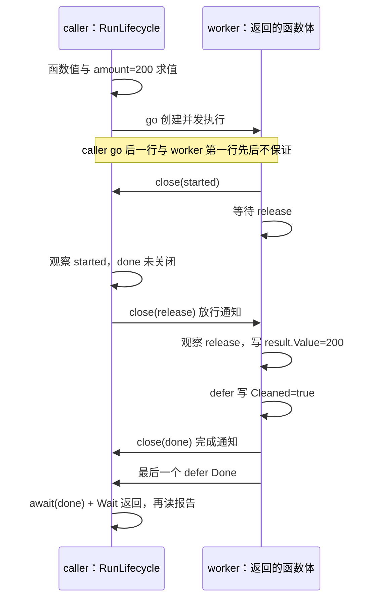

# M11：为每个 goroutine 写出拥有者、等待对象和退出路径

一个订单请求想并发计算金额。`go calculate()` 很容易写，但请求返回以后谁接收结果、谁通知停止、谁确认资源释放，才决定这个程序能否长期运行。本课使用同一批合成订单：O-101 为 2 件、金额 200，O-102 故意价格失败，O-103 为 5 件、金额 500。

交付是一个独立 module `go-demo/lessons/m11_goroutine_ownership`，`go.mod` 声明 Go 1.27，无第三方依赖，没有硬前置。本课所有副作用都是实际的内存报告、channel 通信、服务 ledger、工作令牌和隔离子进程，没有数据库/HTTP 服务，不把合成令牌说成真实连接。实际命令与平台限制见 [STATUS.md](STATUS.md)，本次完整日志见 [evidence/demo.txt](evidence/demo.txt)。

## 先运行，再沿入口读 10～20 分钟

汇总进主仓库以后，从 `D:/IdeaProject/go-demo` 运行：

```powershell
go -C lessons/m11_goroutine_ownership run ./cmd/demo
go -C lessons/m11_goroutine_ownership test -v -timeout 30s ./...
go -C lessons/m11_goroutine_ownership vet ./...
go -C lessons/m11_goroutine_ownership test -race -count=1 -timeout 40s ./...
```

这次实际开发/验收目录是：

```powershell
Set-Location C:/Users/Lenovo/.codex/worktrees/go-course-m11/go-demo
go -C lessons/m11_goroutine_ownership run ./cmd/demo
```

普通 `run` 会完成 E01–E04，再以有界子进程运行 E05 的四种故障。看到子进程的 `fatal error: ... deadlock!` 是预期反例；父进程应继续给出 `M11 PASS`。只复现一种故障也经过同样的 supervision：

```powershell
go -C lessons/m11_goroutine_ownership run ./cmd/demo -fault=no-receiver
go -C lessons/m11_goroutine_ownership run ./cmd/demo -fault=self-wait
go -C lessons/m11_goroutine_ownership run ./cmd/demo -fault=no-join
go -C lessons/m11_goroutine_ownership run ./cmd/demo -fault=early-main
```

请使用公开参数 `-fault`。内部环境变量 `M11_INTERNAL_FAULT` 是 supervisor 给 child 的入口，直接设置它会绕过当前进程的安全包装。

| 读课顺序 | 定位 | 需要在代码旁认出的事实 |
| --- | --- | --- |
| 1，约 2 分钟 | [cmd/demo/main.go](cmd/demo/main.go) 的 `main → runCore` | caller 同步调用各实验；危险任务不在 caller 进程中运行 |
| 2，约 4 分钟 | [lifecycle.go](internal/lesson/lifecycle.go) 的 `RunLifecycle → chooseWorker / evaluateArgument` | 函数/实参求值、创建、body 开始、started、release、结果、清理、done、Wait 分别发生 |
| 3，约 3 分钟 | 同文件 `RunBatch / RunLateAdd` | WaitGroup 是计数完成协议，不携带 error，也不取消兄弟 |
| 4，约 3 分钟 | [request.go](internal/lesson/request.go) 的 `StartRequest → Cancel / Join / Stop` | channel 发送无人接收时卡在哪里，取消通知怎样使它可退出 |
| 5，约 3 分钟 | [service.go](internal/lesson/service.go) 的 `HandleRequest → Submit → loop → process → Shutdown` | 请求结束与服务停止是两个作用域；真实 ledger 何时写入 |
| 扩展 | [faults.go](internal/lesson/faults.go)、[lesson_test.go](internal/lesson/lesson_test.go)、[observe.go](internal/lesson/observe.go) | 反例的等待关系、独立不变量与令牌计数边界 |

现在必须理解 `go` 不等待、信号含义、每个阻塞点的解除者、结果写入先于完成通知，以及取消以后还要 join。调度器 G/M/P、栈增长实现、GC、完整 context 树、任务组错误策略可在遇到相应源码时再深入；取消系统学习在 M13/M15。本课给出全部反例与修复解析，没有留给读者补写的 exercise。

## 最小 Go 规则和 Java 类比的边界

`go f(arg())` 中函数值与实参在当前 caller goroutine 求值，求值结束后启动新的 goroutine。caller 会继续执行，不等待 `f` 完成；新函数体何时获得运行机会，以及 caller 下一行和 worker 第一行谁先执行，没有规定。`f` 的 return 值会被丢弃。本课 worker 返回 999，业务报告却是 200，正是为了区分语言 return 与显式结果传递。[Go 语句规范](https://go.dev/ref/spec#Go_statements)

`main` 返回时进程退出，不会隐式 join 其他 goroutine。一个普通业务函数返回，通常只结束那个函数的调用，已经创建的 goroutine 则仍可运行；这与进程退出是两个不同事件。[程序执行规范](https://go.dev/ref/spec#Program_execution)

| 熟悉的 Java 概念 | 帮助理解的责任 | Go 中必须重新核对的边界 |
| --- | --- | --- |
| `Thread.start()` | 开始并发执行，不等完成 | goroutine 不等于一条 OS 线程；调度规则不能直接照搬 |
| `Thread.join()` / `Future.get()` | caller 要明确等待 | `go` 不返回 Future；需要自行传回结果，并用 channel/WaitGroup 等待 |
| executor/application lifecycle | 后台任务需要服务 owner | Go 不会因创建者函数返回自动取消 worker，也没有自动托管的 executor 生命周期 |
| 虚拟线程 | 每任务启动的成本可以较低 | 低成本仍有栈、调度、引用与业务资源；无法推导“可无限并发” |
| `Thread.interrupt()` | 把停止意图通知任务 | 本课 `cancel()` 关闭 context 的 Done，工作必须自己观察；不是强制终止或等价中断 |
| JMM happens-before | 要有同步才能可靠读共享结果 | 按 Go 内存模型与库契约检查同步边，而非“线程大概跑完了” |

“回收”也要拆开：业务资源清理是我们自己的 `defer`；工作完成是我们的 done/Wait 协议；函数返回后 goroutine 结束；栈、运行时结构、缓存与 GC 的内存处理由 runtime 管理。一次 `NumGoroutine` 读数不能证明所有课程任务已退出，也不能证明内存已回到某个数字。本课明确登记预期工作、核对释放令牌，并由各 owner join。E01 的经典 `defer Done` 说明业务责任已结束，仍不能证明函数尾声/运行时栈已经回收；`WaitGroup.Go` 的库契约则把 `f` 的返回同步到 `Wait` 返回，包装函数也仍可能处于运行时尾声。

## E01：started、release、done 是三个不同事实

调用链是 `main → runCore → RunLifecycle → go chooseWorker(...)(evaluateArgument(...), ...)`。`chooseWorker` 和 `evaluateArgument` 都在 caller 中运行；返回的函数值才在新的 worker goroutine 中执行。`amount` 是 int 值副本，`result` 是同一报告的指针，三个 channel 是共享的同步对象。

| 信号 | 谁创建 / 谁通知 | 谁等待 | 它代表什么 | 它没有证明什么 |
| --- | --- | --- | --- | --- |
| `started` | `RunLifecycle` / worker `close(started)` | caller `await(started)` | worker body 已执行到通知行 | 金额已写、清理完成、函数已返回 |
| `release` | `RunLifecycle` / caller `close(release)` | worker `<-release` | caller 允许这项工作继续 | worker 已观察通知或已经完成 |
| `done` | `RunLifecycle` / worker 退出 defer `close(done)` | caller `await(done)` | 金额与清理已在此前写入 | runtime 已释放栈；其他任务已完成 |
| `group` | `RunLifecycle` / worker 最后的 `Done` | caller `Wait()` | 已登记的工作计数归零 | 业务成功、错误传播、取消兄弟 |

下面按本次日志画出一条观察到的时间线，表内分支边界才是机制保证。之后运行的打印顺序可以有变化。



| 步骤 | 参与者 / 当前等待点 | 状态变化 | 日志与断言 |
| --- | --- | --- | --- |
| 1 | caller 中两个求值函数 | 函数值选好、实参变为 200 | `function-value-evaluated`、`argument-evaluated` 都先于 `body-start` |
| 2 | caller go 返回，worker 有机会执行 | 创建不代表立即执行；worker 注册 defer 并关闭 started | `go-returned` 与 `body-start` 的相对先后不作断言 |
| 3 | worker `<-release`；caller `await(started)` 返回 | release 尚未关闭，worker 不能越过它 | `observed-started; done=false` |
| 4 | caller `close(release)`；worker 接收完成 | 通知先发生，worker 随后观察 | 本次 `release-notified` 先打印；另一次可能 worker 先取得日志锁 |
| 5 | worker 计算 / return / defer | `Value=200 → Cleaned=true → close(done) → Done` | `result-written → cleanup-written → done-notified` |
| 6 | caller `await(done)` / `group.Wait()` | 完成同步后才能读报告 | `caller joined value=200 cleaned=true`，独立测试核对金额与部分顺序 |

`defer` 在函数体内注册，退出时后注册的先运行。代码先注册 `Done`、再注册关闭 done、最后注册清理，因此实际清理先做，通知居中，Done 最后做。不要把 done 放在工作开头，也不要在通知以后继续改业务报告。

结果可见性不是由于“另一条 goroutine 好像退出了”。这里 `result.Value/Cleaned` 写在 `close(done)` 之前，caller 的 `<-done` 因关闭返回，之后再读；关闭与这样的接收之间建立同步关系。`Done` 与它解除的 `Wait` 也有库定义的同步关系。裸 goroutine 结束本身不建立这个保证。[Go 内存模型](https://go.dev/ref/mem#Synchronization)、[WaitGroup 契约](https://pkg.go.dev/sync#WaitGroup)

## E02：WaitGroup 管完成，业务 error 另行管理

`RunBatch(ctx, trace, "classic")` 和 `RunBatch(..., "go")` 使用同样三项输入，每项只写 `results[id]`。数组/slice 的不同元素可以由不同任务各自写，owner 在 Wait 后读取；本课没有多个任务同时改同一个元素。

经典版本的责任顺序是 `owner Add(1) → go worker → worker defer Done → owner Wait`。从零增加的正 Add 必须先于 Wait，通常放在创建 goroutine 之前；负计数会 panic。已经使用的 WaitGroup 不得复制，所以有 group 的句柄返回指针，函数接收 `*sync.WaitGroup`。重用一组 WaitGroup 等待另一批任务时，新的 Add/Go 必须在上一批所有 Wait 返回后进行。

当前 Go 1.27 可用 `group.Go(work)`，此方法从 Go 1.25 开始提供。它登记任务并启动 goroutine，`work` 返回时移除任务。**传入的函数不得 panic**。普通 `error` 不违反此契约，error 应按业务规则处理；不要把它换成 panic 期待 WaitGroup 恢复。owner goroutine 的 recover 也不能恢复另一个 goroutine 的 panic。需要隔离 panic 时必须在该工作自己的函数内部处理，但本课的业务失败使用 error，不展开 M07 的 recover 机制。[官方 sync 文档](https://pkg.go.dev/sync#WaitGroup.Go)

本机 `D:/Go/src/sync/waitgroup.go` 的实际源码已经查看：`Go` 先 Add，随后创建包装 goroutine；包装函数调用 `f`，正常返回后 Done。当前实现还有对逃逸 panic 的处理代码，不能因此忽略 `f must not panic` 的公共契约，更不能把某个 runtime 实现当未来版本保证。

| 时点 | owner | 三个 worker | 业务结果 |
| --- | --- | --- | --- |
| 登记/创建 | 逐项 Add+go 或 Go | body 尚未/已经调度都可能 | 结果仍是零值 |
| 启动屏障 | 接收三条 started | 发 started，随后 `<-release` | 三项尚未处理完 |
| 放行 | close(release)，随后 Wait | 写各自结果；O-102 写 ErrPriceUnavailable | 兄弟仍各自继续 |
| 完成同步 | Wait 返回后收集 | 经典 Done 或 Go 的 f 返回 | `[200 0 500]`，一项失败，两项成功合计 700 |

日志里经典版可能 O-101 先打印，Go 版可能 O-103 先打印。这只是本次调度；测试只断言金额、订单归属和一项错误，不断言 worker 排列。WaitGroup 不返回 error、不选第一个 error、不取消兄弟，也不保证后续副作用成功。你需要另外一套业务结果/错误策略，系统任务组在后续课程展开。

`RunLateAdd` 则确定复现错误写法：worker 先等待 `addAllowed`，owner 在计数仍是 0 时调用 Wait，因此 Wait 必然提前返回。日志是 `Wait-returned; task-unfinished=true`。随后实验救援才关闭 addAllowed、等待 added、关闭 release，再 Wait 和接收 done，把坏实验自身收尾。这个 rescue 不代表错误业务变正确；真正修复是把 Add 放回 go 之前，或者直接使用 `WaitGroup.Go`。不要通过“通常 worker 很快运行”给晚 Add 找借口。

## E03 / E05 no-receiver：无人接收不是已经算完

危险版调用链为 `parent CheckFault → child main → RunFault("no-receiver") → worker results <- Receipt`。`results` 没有缓冲，也没有任何接收者。worker 已构造金额 200，但发送无法完成；defer close(done) 要等 worker 返回；owner 又等 done。实际故障堆栈分别出现 owner 的 `[chan receive]` 和 worker 的 `[chan send]`，父进程继续回收 child。

| 阶段 | owner / worker 等待关系 | 实际观察 |
| --- | --- | --- |
| 到达发送边界 | worker close(attempting)，下一行发送 | marker 表示到达边界；它本身不证明已被 runtime 挂起 |
| 无接收者 | worker 卡在 `results <- Receipt` | 真实 runtime 堆栈显示 `[chan send]` |
| owner 等完成 | owner `<-done`，没有读取 results | 堆栈显示 `[chan receive]`；`SEND_COMPLETED` 未出现 |
| 进程边界 | 当前 runtime 检测全局 deadlock | 本次 child exit=2；supervisor `Run` 已等待回收 |

修复 A 是 `StartRequest(..., buffer=1)` 的单结果邮箱。worker 可以发送一个值到缓冲、释放令牌、发布 done；owner Join 时邮箱仍有一个值，日志 `mailbox-values=1; receiver-business未执行`。本课最后由 owner 排空邮箱。**缓冲接收一个结果不证明消费者执行了业务，也不解决无限流、多个结果或缓冲已满**；后续发送仍可能卡住。结果规模明确且只有一个时才适合这个修复。

修复 B 是请求放弃结果时 `Cancel → Join`。`StartRequest(..., buffer=0)` 用 `select { case results <- receipt; case <-ctx.Done(): ... }`。测试没有接收者，故发送分支不就绪；owner 等 sending 后取消，worker 观察取消，把 `context.Canceled` 写入 outcome，然后 defer 释放资源、close(done)，WaitGroup.Go 的 f 返回，owner Join 返回。

| 顺序 | 实际函数 / 行为 | 证明点 |
| --- | --- | --- |
| 1 | owner `StartRequest`，在 go 前 tracker.acquire | 尚未完成责任 active=1/resource=1 |
| 2 | worker `close(sending)` 后进入 select | 已到发送边界；不依赖 Sleep |
| 3 | owner `Cancel()` | 只使 ctx.Done 就绪，不能据此说完成 |
| 4 | worker 取消分支 | 日志 `cancellation-observed`，outcome.Err=context.Canceled |
| 5 | worker 退出 defer / f 返回 | `resources-released` 在 done 之前；Go 的完成契约在 f 返回后 |
| 6 | owner `Join(ctx)` | `active=0 resources=0 delivered=false`，读取 outcome |

`Join` 的 `waitCtx` 是观察者的预算。若它到期，不能声称工作已结束；本课 owner 的 defer 调 `Stop()`，它继续发取消通知并 Wait 收尾。`Stop` 和 service Shutdown 都不关闭结果 channel，避免 sender 仍在发送时被其他 goroutine 关闭而 panic。所有权协议保证该任务的结果 channel 无外部 closer。

接收结果与取消同时就绪时，select 可以选任一个；所以不能承诺“Cancel 返回以后绝不会发送”。本课无人接收反例里发送不就绪，取消路径才能被确定断言。若真实业务要求严格取消后零副作用，需要另一个受同步保护的业务提交协议。

## E04：请求可以结束，服务接纳的工作另有 owner

`RunServiceScope → NewService → group.Go(loop)` 创建一个应用后台 worker。请求路径是 `RunServiceScope → HandleRequest → service.Submit`；HandleRequest 在实际的 Go 函数边界返回，不额外创建 handler goroutine。Submit 把 O-101 的不可变字符串数据移交给服务，只确认接纳；返回的 job 句柄交给后续收集者观察，执行 owner 仍是 Service。`requestCtx` 用于接纳检查，worker 使用 service.ctx；它不保存 requestCtx，也不保留会随请求改变的指针。

| 时点 | 请求 caller | 服务 worker `loop/process` | 资源和业务状态 |
| --- | --- | --- | --- |
| 服务启动 | 应用创建 Service，持有 cancel/group | 关闭服务 started，等待 jobs 接收 | 一项服务工作令牌登记 |
| 接纳 | HandleRequest 调 Submit 入队，然后真正 return job | 接收 job，close(job.started)，等待 job.release/service.ctx.Done | handler-returned 只确认接纳，不等于业务完成 |
| 请求结束 | caller requestCancel，模拟服务器结束已返回请求的 context | service.ctx 未取消，继续等待 release | 日志 service-active=1/resources=1，ledger 为空 |
| 服务放行 | 实验 driver close(release) | 写 receipt.Amount=200，持锁 ledger append("O-101")，close(job.done) | 真实内存业务记录出现 |
| 结果观察 | job.Result → 接收 done → 读 receipt/ledger | 回到 jobs/ctx 等待 | 日志 ledger=[O-101] |
| 应用关停 | Shutdown 持锁标 stopped，cancel，解锁，Wait | 观察 ctx，结束运行/排队工作，释放令牌后 loop 返回 | active=0/resources=0，owner 已 join |

shutdown 的策略是**取消未完成工作并给每项已接纳 job 一个结果**，并非保证所有排队工作业务成功。测试让 O-101 卡在 release，O-102 真实排队，O-103 因队列满拒绝；Shutdown 在 release 未关闭时取消，O-101/O-102 都发布 context.Canceled，ledger 保持空，O-104 在关停后拒绝。若取消与 release 同时就绪，正在处理的任务可能完成，文档不会承诺相反行为。

队列容量 1 + worker 数 1 限制了服务同时保留的工作：最多一项运行、一项排队。Submit 在 mu 下使用非阻塞发送，满了就 ErrQueueFull；不拿着 mu 等队列，以免 Shutdown 也等 mu 而无法取消工作。服务只在一个 goroutine 中处理 job，不为每项排队任务再创建 goroutine。

这解决的是本进程的服务责任归属。服务 ledger 与队列都在内存，进程崩溃/重启会丢失。若订单必须跨崩溃完成，应让数据和确认协议进入持久队列/事务范围，这不是偷偷将请求改为 fire-and-forget 能解决的。

## 每个课程 goroutine 的等待清单

| goroutine / owner | 启动处 | 实际等待点 | 谁解除等待 | 完成 / 清理 / 最终 waiter |
| --- | --- | --- | --- | --- |
| E01 worker / RunLifecycle | `go chooseWorker(...)(...)` | `<-release` | caller close(release) | 写 result，清理 defer，close(done)，Done；caller await+Wait |
| E02 三个 worker / RunBatch | classic `go` 或 group.Go | `<-release` | RunBatch close(release) | 每项 result/error；Done 或 f 返回；RunBatch Wait |
| late-add worker / RunLateAdd | 错误样式的 go | `<-addAllowed`，再 `<-release` | 实验 rescue 关闭两道屏障 | Done、close(done)；实验 Wait+await |
| E03 request sender / RequestTask 的请求 owner | StartRequest 的 group.Go | `select` 内 send 或 ctx.Done recv | 接收者/邮箱空间，或 owner Cancel | 释放令牌、close(done)、f 返回；Join/Stop |
| E04 service worker / Service 应用 owner | NewService 的 group.Go(loop) | jobs recv；process 的 release/ctx recv | Submit、driver release 或 Shutdown cancel | 每项 job.done、释放服务令牌、loop 返回；Shutdown Wait |
| demo watchdog / main | main 的 go | watchStop/ctx.Done recv | main 正常收尾或 20s 总预算 | close(watchDone)；main 等它；超时 os.Exit 是进程安全边界 |
| E05 early-main worker / 故意失责的 child main | RunFault 的 go | `<-release` 永不解除 | 无 | child main 返回，worker defer 未执行 |
| E05 no-join worker / 遗忘句柄的请求 | RunFault 内请求函数的 go | `<-gate` 永不解除 | 无 | 已登记 outstanding=1；600ms 后 parent 杀并回收进程，非优雅清理 |
| E05 no-receiver worker / child caller | RunFault 的 go | 无缓冲 results send | 本例无人解除 | owner 等 done；runtime deadlock 或监督超时 |
| E05 self-wait worker / child caller | Add 后 go | group.Wait 等含自己的计数 | 需要自己的 Done，而 Done 需 Wait 返回 | 循环依赖；runtime deadlock 或监督超时 |

caller 自身也会等待 started、done、Wait 或 child `cmd.Run`。Trace、Tracker、Service 的 mu 可能使当前 goroutine短暂等待 lock；各持锁段不等待业务 channel，持锁者 Unlock 解除。`fmt` 输出涉及 stdout I/O，但本课不模拟网络/数据库等待，业务 release 只是明确的测试屏障。标准库/runtime 可能还有自己的 goroutine，本课没有把它们算作课程拥有的工作。

## 四个危险反例的完整修复对照

| 反例 | 本次真实 child 结果 | 错误责任 | 实际修复 / 独立验证 |
| --- | --- | --- | --- |
| `early-main` | exit=0，EARLY_READY 有，worker cleanup/completed 无 | 进程 main 返回前没有等必须完成的工作 | E01 等 done+Wait；`TestLifecyclePublication` 核对金额、清理和发布顺序 |
| `no-join` | request-returned outstanding=1，600ms timeout，child 已回收 | 请求不返回停止/完成句柄，服务仍活着，任务永远等 gate | E03 返回 RequestTask，Cancel+Join/Stop；32 次重复独立核对每项归零 |
| `no-receiver` | exit=2，真实 chan send/receive deadlock 栈 | owner 不接收结果却等发送者完成 | E03 单结果邮箱或可取消 send；真实接收值、邮箱残留、取消后资源独立断言 |
| `self-wait` | exit=2，owner/worker 都停在 WaitGroup.Wait | 任务等待含自己的组，自己的 Done 又放在返回 defer 中 | E02 把 Wait 放在外部 owner，worker 只做工作与 Done；两种 API 各自业务验收 |

no-join 的长 timer 只是让模拟服务进程保持存活，避免全局 deadlock 提早结束；它不负责等 worker。父进程自己的 600ms deadline 负责故障上限。其他 child 有 3s deadline，本次 runtime 在 deadline 前已检测 deadlock。`CheckFault` 不经 shell 或再调用 go run，不创建孙进程；`cmd.Run` 等待退出/回收，取消与 timer 均 defer 释放。

runtime 的全局 deadlock 检测和栈文本是当前实现的诊断，不是所有服务泄漏都会出现的警报。实际 Web 服务还有 I/O、timer、其他请求时，泄漏任务可以长期停在 channel，整个进程照样有活跃 goroutine，所以诊断必须追踪自己的任务/请求生命周期。

## 原材料中需要改正的地方

已读取 worktree 原示例 `examples/advanced-syntax/goroutines/main.go`、`goroutines/earlyexit/main.go`、`sync-primitives/waitgroup_once.go`，以及主目录只读材料 `files/语法进阶/Goroutine`。本模块未修改这些文件。

| 材料表达 | 当前课程的准确解释 |
| --- | --- |
| main go 后只打印 end | 这种输出可能发生，裸示例不能保证它；E05 用 started/release 屏障保证 worker 已进入且未完成再返回 main |
| Sleep 2 秒等待 goroutine | Sleep 只延后 caller，不代表目标完成；本课只用信号/Wait，timer 仅为超时边界 |
| Go 并发只会用 goroutine、不需要考虑进程或线程 | goroutine 是 Go 内的并发执行单位；进程隔离、线程约束、系统资源仍存在；本课本身用真实进程隔离危险程序 |
| 小栈意味着可创建十万 goroutine | 精确栈大小、上限和调度属于 runtime/version/platform 实现；它们持有业务资源与引用，生产仍须限制并发和排队 |
| 任务包装成函数并 go 即可 | 创建只是第一步，owner 必须定义停止、结果、完成及资源收尾 |
| channel 完成通知必须缓冲到任务数量 | channel 可无缓冲会合，也可关闭作为广播；选择取决于接收者是否持续存在和协议含义 |

## 独立验收与目前的证明范围

测试直接检查 O-101/O-103 的金额合计 700、O-102 的错误归属、生命周期的保证顺序、真实 channel 接收值、单结果缓冲残留、32 次取消任务逐项清理、请求取消后服务仍完成，以及服务关闭对运行/排队/新任务的不同结果。危险 child 用非完成 marker、真实退出与有界回收来检查，不仅仅匹配一个 PASS 字样。

所有正常等待有明确解除者；观察接收有 context 上限。WaitGroup.Wait 没有 timeout API，正常 worker 的其他等待已被 release/ctx 解除；完整 demo 另有 20s 进程 watchdog，测试命令设 30s 上限。watchdog/故障 child 的强制退出不会被说成正常资源释放。

本机普通 run、test 和 vet 已通过。第一次 `-race` 使用默认 PATH 的 GCC 8.2.0 target=mingw32，无法为 windows/amd64 编译 runtime/cgo，报告 `cc1.exe: sorry, unimplemented: 64-bit mode not compiled in`。该限制已由主 agent 准备的 portable WinLibs GCC 16.2.0 / mingw-w64 14.0.0 解决；本模块仅按以下进程级设置读取共享工具路径，没有安装编译器、修改全局 PATH 或 go env：

```powershell
# 本机共享工具链元数据是忽略的私有协调文件，不是本 module 的依赖文件。
# 在别的机器上使用能生成 windows/amd64 的 C compiler，设置其 CC/CXX 即可。
$m11Toolchain = Get-Content -Raw D:/IdeaProject/go-demo/.local/course-orchestrator/toolchain.json | ConvertFrom-Json
$env:CC = $m11Toolchain.cc
$env:CXX = $m11Toolchain.cxx
$env:CGO_ENABLED = '1'
$env:PATH = "$($m11Toolchain.bin_dir);$env:PATH"
go -C lessons/m11_goroutine_ownership test -race -count=1 -timeout 40s ./...
go -C lessons/m11_goroutine_ownership run -race ./cmd/demo
```

两个 race 命令均已实际返回 0，本次覆盖执行未检出数据竞争。完整记录是 [evidence/race-test.txt](evidence/race-test.txt) 与 [evidence/race-demo.txt](evidence/race-demo.txt)。带 race 的 no-receiver/self-wait child 本次没有打印 runtime deadlock，而由 3s supervisor deadline 终止并回收；普通运行的原始 deadlock 栈仍保存在 demo.txt。两种配置都证明该故障没有完成且不会永久挂住 owner，不把某一种 runtime 诊断文本说成语言保证。child 的 race 警告会被 CheckFault 显式当作额外失败，不能因为“这个例子本来就应失败”而隐藏 detector 报告。

查证记录针对实际 Go 1.27.0：语言规则以 [Go 语句](https://go.dev/ref/spec#Go_statements)、[程序执行](https://go.dev/ref/spec#Program_execution) 为准；同步以 [内存模型](https://go.dev/ref/mem) 和 [WaitGroup 公共契约](https://pkg.go.dev/sync#WaitGroup) 为准；本地实现定位 `D:/Go/src/sync/waitgroup.go`。模块只有 `go 1.27`，未指定 toolchain，实际 `GOTOOLCHAIN=auto` 使用本机 go1.27.0，没有偷偷升级旧项目或依赖版本。
