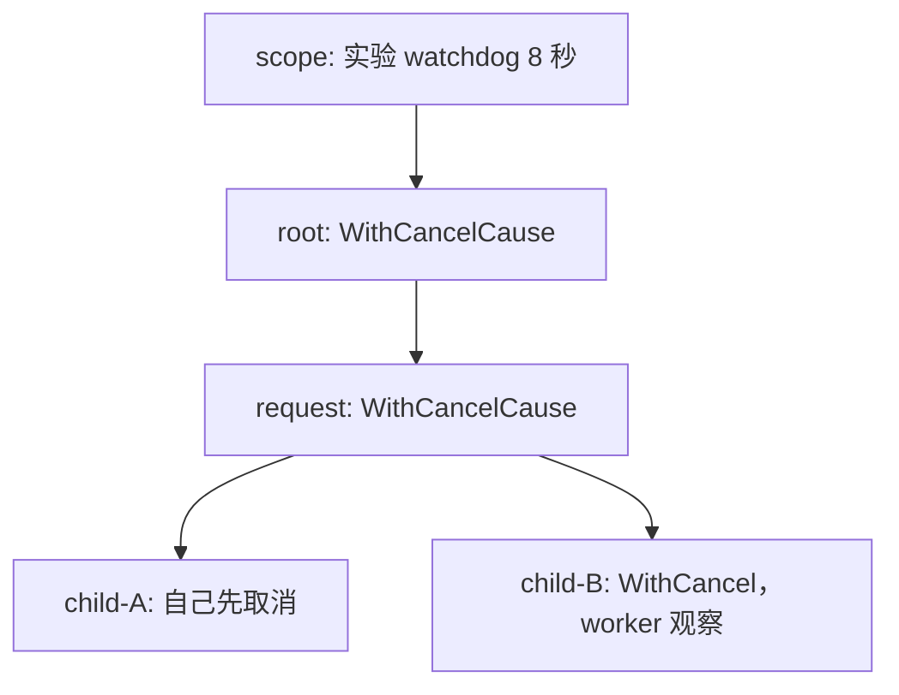

# M13：Context、取消、超时与整条调用链预算

这课用合成订单扣款解释一个真实后端问题：调用方已经超时，扣款到底有没有执行？我们把请求 owner、客户端 I/O、服务端 handler、业务效果和任务清理分别记录。你会亲眼看到：`cancel()` 返回后，worker 仍在清理；HTTP 调用返回 `DeadlineExceeded` 后，服务端仍能扣一次；重试原请求会扣两次，而稳定幂等键使最终效果保持一次。

推荐先用 10～20 分钟读、跑 `-scenario http` 这一组核心实验，再展开其他五组。默认 `all` 在当前机器正常约几秒完成，耗时不是业务承诺。没有练习占位，也不要求自行填代码；所有危险写法、修复写法和断言已经给出。

## 环境、入口与阅读顺序

本次实际工具链是 `go version go1.27.0 windows/amd64`，`GOTOOLCHAIN=auto`，`GOROOT=D:\Go`。模块为 `go-demo/lessons/m13_context_budgets`，`go 1.27.0`，没有 `toolchain` 指令、第三方依赖、`go.sum`、`replace` 或对其他课程的导入。Go 1.27 是本课运行基线；公司旧代码按它自己的版本阅读，不需要为了使用 Context 升级整个项目。`WithCancelCause/Cause` 在 Go 1.20 加入，`WithoutCancel/AfterFunc` 在 Go 1.21 加入。

从仓库根目录复跑：

```powershell
go -C lessons/m13_context_budgets run ./cmd/demo
go -C lessons/m13_context_budgets run ./cmd/demo -scenario http
go -C lessons/m13_context_budgets run ./cmd/demo -scenario budgets
go -C lessons/m13_context_budgets test -count=1 ./...
go -C lessons/m13_context_budgets vet ./...
go -C lessons/m13_context_budgets test -race -count=1 ./...
```

当前交付所在的独立 worktree 是 `C:/Users/Lenovo/.codex/worktrees/go-course-m13/go-demo/`。主 agent 汇总后，上述命令在 `D:/IdeaProject/go-demo/` 使用同一相对模块路径。模块自己的精确工作目录是 `C:/Users/Lenovo/.codex/worktrees/go-course-m13/go-demo/lessons/m13_context_budgets/`，在该目录可直接 `go run ./cmd/demo`。真实命令结果与 race 环境见 [STATUS.md](STATUS.md)。根 `go test ./...` 不会进入这个嵌套 module。

本机默认 `D:/MinGW/bin/gcc.exe` 是32位编译器，不能构建Windows/amd64的race。主agent提供了独立的64位WinLibs工具链，本课已经用它实际通过 `go test -race`。仅为当前PowerShell进程临时设置下面四项，结束后恢复，不改系统环境；在模块目录执行：

```powershell
$m13Toolchain = Get-Content -Raw -LiteralPath 'D:/IdeaProject/go-demo/.local/course-orchestrator/toolchain.json' | ConvertFrom-Json
$m13OldCC, $m13OldCXX, $m13OldCGO, $m13OldPath = $env:CC, $env:CXX, $env:CGO_ENABLED, $env:PATH
try {
    $env:CC = $m13Toolchain.cc
    $env:CXX = $m13Toolchain.cxx
    $env:CGO_ENABLED = '1'
    $env:PATH = $m13Toolchain.bin_dir + ';' + $env:PATH
    go test -race -count=1 ./...
    $m13RaceExit = $LASTEXITCODE
} finally {
    $env:CC, $env:CXX, $env:CGO_ENABLED, $env:PATH = $m13OldCC, $m13OldCXX, $m13OldCGO, $m13OldPath
}
if ($m13RaceExit -ne 0) { throw "M13 race failed: exit=$m13RaceExit" }
```

这个JSON是本机私有工具链索引，并非模块运行依赖；另一台机器用自己已验证的64位C编译器。race通过只证明此次运行未检测到数据竞争，不能替代预算、业务效果和收尾断言。

| 阅读顺序 | 文件/符号 | 要看清的事情 |
| --- | --- | --- |
| 1 | `cmd/demo/main.go:main` | 进程总期限，Run 返回后清理，再选择退出码 |
| 2 | `internal/lesson/suite.go:Run/wait/join/trace.event` | 请求取消与实验 watchdog 分离；日志锁和有界 join |
| 3 | `http_experiments.go:runHTTP/httpLateEffect/httpRetry` | 核心实验的 owner、屏障、效果独立查询 |
| 4 | `http.go:charge/startCharge/handle/ledger.apply/httpLab.close` | HTTP JSON RPC 的真实调用链、Body、listener、效果原子边界 |
| 5 | `budgets.go:budgetCase/budgetUsecase/queueExpiry` | request/service/gateway 同一绝对 deadline，排队预算和执行预算 |
| 6 | `tree.go`、`traps.go`、`send.go`、`lifecycle.go` | 取消树、反例、发送等待、请求外任务和回调收尾 |
| 7 | `contracts.go:ExecSQL`、`lesson_test.go` | SQL 接口阅读契约；真实 HTTP 的独立断言 |

现在必须掌握：谁创建 Context、谁持有 cancel、当前等待是否观察 Done、错误从哪一层回来、业务效果在哪一行发生、最后由谁等待退出。源码内部具体锁布局、Context 的非导出类型和 Transport 内部状态机可以遇到源码时再查。

## 最小规则：Context 是预算与通知，资源 owner 仍是你

`context.Context` 是接口。把 `ctx` 按值传给函数，复制的是接口值；多个函数仍引用同一套取消状态，不会各自复制出新的请求。它允许并发使用，但不让 `Value` 里的可变 map、slice、事务对象自动变得并发安全。`ctx` 放首参数、传 `Background/TODO` 而非 nil，是 API 的约定；它不是语法关键字，也不是 Java 的隐式 ThreadLocal。

| 操作 | 本课对应行为 | 不能据此推出的事实 |
| --- | --- | --- |
| `Background()` / `TODO()` | 根无 deadline，Done=nil，Err=nil | 不是能强杀任务的全局控制器 |
| `WithCancel(parent)` | 派生 child 和 caller 持有的 cancel；parent 取消向下传 | 取消 child 不会取消 parent/兄弟 |
| `WithTimeout(parent,d)` | 相当于请求一个 `now+d` 的绝对 deadline，实际不晚于父 deadline | 不会自动把 d 重新加到整条请求预算上 |
| `WithDeadline(parent,t)` | 请求绝对时间 t；提前主动 cancel 的 Err 是 Canceled | Deadline 方法本身是查询，不是设置 deadline |
| `WithCancelCause` | Err 保留通用分类 Canceled，Cause 保留业务原因；首次取消优先 | 后来的取消不会改写第一次原因 |
| `Done()` | `<-chan struct{}`，取消时关闭，关闭对所有观察者可读 | 不是发送“一条取消消息”，不是任务结果通道 |
| `Err()` / `Cause()` | 取消前 nil；取消后查询结束分类/原因 | 不描述数据库是否提交、远端是否扣款 |
| `cancel()` | owner 通知放弃工作，释放 Context 关联资源 | 不等待工作停止，也不自动关闭你持有的连接/Rows/Tx |

这里依赖的是 [Go 1.27.0 context 公共契约](https://pkg.go.dev/context@go1.27.0)，并核对了本机 `D:/Go/src/context/context.go`。公开 `Context.Done` 契约允许关闭异步发生，因此泛化 API 时不能把 `cancel()` 返回本身当成 Done/任务完成屏障；本课显式接收 Done 或完成 channel。worker 的调度顺序与精确毫秒数属于本次观察。

Java 类比可把 Context 看成显式沿调用链传的 cancellation token + deadline + 少量请求元数据。它不对应 `Thread.stop`，不等于 `Future.cancel` 已结束计算，也不把 Go goroutine 变成 Java 线程。没有观察点的业务函数照常执行；阻塞在锁/裸 channel 上的函数也不会自动跳到取消分支。

## E01：root/request/child 树、原因和清理时间线



运行 `go run ./cmd/demo -scenario tree`。`runTree` 先取消 A，断言 root、request、B 活跃，再启动 B worker，最后取消 root。每个 cancel 由 `runTree` 持有；worker 只读 Context，不取消 owner。

| 顺序 | 参与者/当前等待点 | 状态变化与后继 |
| --- | --- | --- |
| 1 | owner `cancelA(localCause)` | A Err=Canceled/Cause=库存分支主动放弃，父和兄弟不变 |
| 2 | worker `close(ready)` 后 `<-childB.Done()` | ready 只证明 worker 已进入该段执行，不是它已结束 |
| 3 | owner `cancelRoot(rootCause)` | root/request/B 获得父原因；A 仍保留自己第一次原因 |
| 4 | worker 从 Done 返回，关闭 observed | 已经观察通知，现在仍等 `releaseCleanup` |
| 5 | owner 查询 done 未关闭 | 可以证明 cancel 与 observed 均不等于清理完成 |
| 6 | owner 放行 cleanup，worker 执行 defer | 清理日志先发生，后关闭 done；owner 再接收 done |

实际关键日志：`cancel 已返回，worker 已观察，但清理未完成` → `defer：请求专属资源已清理` → `收到 done`。这三条靠屏障顺序成立。`WithDeadline` 给一小时后期限却立刻手动取消，Err=Canceled；另一个 40ms `WithTimeoutCause` 等真正到期，Err=DeadlineExceeded、Cause=报价总预算耗尽。`deadline` 没有杀死 worker，停止来自 worker 当前等待的 Done。

## E02：真实 HTTP 客户端超时后，服务端还能执行吗？

业务输入是 `chargeCommand{Order, IdempotencyKey}`，走真实 HTTP/1.1 的 POST JSON。元数据 `m13-success` 通过私有 Value 访问函数读取后传 `X-Request-ID`。server 和 client 在一个进程只是方便 owner 控制屏障；协议实际经过 `net/http`、Transport 和 loopback TCP，不是函数替身、ResponseRecorder 或 mock。

完整调用链是：

```text
main -> Run -> runHTTP -> httpSuccess/httpActiveCancel/httpLateEffect/httpRetry
  -> httpLab.startCharge [另起 client goroutine，owner 保存 task.done]
      -> httpLab.charge(ctx, op, command)
          -> NewRequestWithContext -> client.Do [连接/发送/等待响应头]
          -> Decode [读响应体] -> defer Body.Close -> result -> task.done
  -- HTTP/1.1 TCP --> net/http 服务 goroutine -> httpLab.handle
      -> 解码 command -> close(started) -> 等 gate / r.Context.Done
      -> ledger.apply [真实合成效果，在 Mutex 内防重并修改计数]
      -> Encode(receipt) -> handler defer -> close(exited)
  -> owner 另查 ledger.count -> cancel/join clients -> lab.close
```

`clientResult.err` 是一次 I/O 的返回；`task.done` 是 client goroutine 结束；`op.exited` 是 handler 结束；`ledger.count` 是业务效果。它们不能互相替代。`httptest.Server` 会创建它自己的服务 goroutine；实验的 server owner 是 `httpLab`，最终 `Close` 等待服务停止。所有 request context 有界，响应 Body 由 `charge` 关闭，listener 和 Transport 由 `httpLab.close` 关闭。

| 子例 | 屏障时间线 | 实际效果与断言 |
| --- | --- | --- |
| success | server started → owner release → apply → response Decode → join | 回执 Order 正确、Total=1；独立 count=1 |
| active-cancel | started → owner cancel，gate 仍不开放 → client 返回、server 观察 Done → exited | client error 匹配 Canceled；count=0、effected 未关闭 |
| late-effect | started → 400ms client deadline → owner 收到失败，handler 尚等 gate → owner release → apply → exited | deadline 后 count 从 0 变 1，证明晚效果 |
| unsafe-retry | 原请求超时仍等 gate → retry 完成一次 → owner 放行原请求 → 原请求又 apply | 最终 count=2，超时重试重复扣款 |
| idempotent-retry | 同样次序，两个请求带同一订单/稳定幂等键 | retry 先做效果，原请求随后命中回执 Duplicate=true；最终 count=1 |

一次真实运行的日志片段如下。URL 端口、毫秒数和客户端/服务端日志先后允许变化：

```text
late-effect/client I/O 函数返回 err=... context deadline exceeded
request-owner      客户端只知道结果 UNKNOWN；本地观察当前 effect=0，handler 尚未退出
late-effect        忽略请求取消后仍执行；此刻入站 Err=context canceled
late-effect        真实效果 order=late-order total=1 duplicate=false
reconciler         独立查询 late-order=1：已执行
unsafe-original    真实效果 order=unsafe-order total=2 duplicate=false
reconciler         unsafe 最终独立查询 effects=2 expected=2
idempotent-original 真实效果 order=idempotent-order total=1 duplicate=true
reconciler         idempotent 最终独立查询 effects=1 expected=1
```

第一条只能证明客户端等待失败。第二条的 count=0 是实验 owner 此刻的本地查询，普通跨服务客户端未必有这个权限；它更不能证明未来不会执行。后面 gate 放行后的 count=1 才证明这次最终已执行。危险 handler 的 `r.Context().Err()` 在两次初跑分别观察到 nil 和 Canceled，正好说明客户端失败与服务端观察断连没有固定同步顺序；我们只断言机制保证的 started → 客户端失败 → release → apply。

修复 handler 把等待写成 `select`，监听请求 Done，并在 gate 分支补读 `ctx.Err()`。本次取消在 apply 前且 gate 不就绪，故能证明零效果。仍不能保证“取消之后绝不写”：gate/Done 同时就绪可能选 gate；检查通过后也可能立刻取消；已经提交的外部写入不会被 Context 自动撤销。需要把幂等键、持久回执、查询/对账和提交状态作为业务协议。

`ledger` 在进程中受一把 Mutex 保护，真实效果是计数变化；**它没有 SQL、磁盘持久化或多实例一致性**。六个并发真实 HTTP 请求的独立测试进一步断言一个效果、五个 Duplicate 回执。生产应把“检查幂等键 → 执行效果 → 保存回执”的原子边界放在持久事务里，并绑定相同业务参数；本课没有承诺跨重启 exactly-once。

危险 retry 在这里是为了复现风险，不能作为通用自动重试策略。原请求 timeout 后应先分类为 UNKNOWN：能通过稳定 operation/idempotency key 查到持久结果则返回结果；业务协议允许相同 key 的安全重试时沿剩余总预算执行；否则保持未知并对账，不能换新 key 盲重放。连幂等重试也不能把已耗尽的原请求预算偷偷重置，必要的后续对账由单独 owner 管理。

## E03：三层 deadline 时间线，排队也花预算

`budgetCase` 创建 900ms request，总预算开始计时后先占满容量为 1 的 `slots`。`budgetUsecase` 的 service 真正阻塞在 `select { case slots <- token; case <-service.Done() }`。owner 收到 queued 屏障后才计时 300ms 并释放占位，保证不是靠 Sleep 猜排队。随后 gateway 进入真实 HTTP 等待。

```text
正确版本（每个 t0 属于该次 request）
t0                 t0+300ms                         t0+900ms
request  |----------------------------------------------X
service  | 排队：继承 request deadline ------------------X
gateway                 | HTTP 执行：只剩约600ms --------X
         slots 满         slots 可用                     预算耗尽，零效果

危险版本（每层新 Background + 900ms）
request  |----------------------------------------------X
service  | 新根，自己的900ms ----------------------------X
gateway                 | 新根，完整900ms --------------------------X t0+1200ms
                                                        |继续150ms| gate放行
                                                        请求已到期   晚成功/效果1
```

这里三层是同一进程内 request → service → gateway，它们正确版本的绝对 deadline 完全相同，代码直接用 `time.Time.Equal` 断言。**再套 `WithTimeout(parent, 900ms)` 本身不会延长父预算**；真正错误是把 parent 换成 Background，或在已结束请求之外重新创建根。child 允许收紧期限，不能把父期限往后延。

日志会给每层 `deadline=t0+...ms`、`remaining` 和实测 `queue/execution/total`。修复版典型 queue=300ms、execution≈599ms、total≈900ms、effects=0、错误链匹配 DeadlineExceeded。危险 gateway deadline≈t0+1200ms；原 request 到期时 gateway Err=nil、task.done 未关闭，owner 再等150ms才放行，所以 total≈1050ms、effects=1、err=nil。最后 `queue-expiry` 把槽一直占满到60ms请求到期，断言 execution=0、HTTP started 未关闭：根本没派发远端调用，排队错误已经返回上层。

计时器用于预算/持续时间本身，不用来证明 goroutine 调度。精确300/600ms不保证；deadline 相等、HTTP是否派发、效果0/1、原请求到期后才放行这几项才是可靠断言。trace 的 `+Nms` 从整组开始，而每行 `t0+Nms` 相对于当前 request 开始；第二个子例的全组累计时间不要误读成它的请求预算。

### HTTP/SQL/RPC 分层各自负责什么

`charge(ctx, ...)` 已经是实际 HTTP JSON RPC adapter：显式传 ctx 控制整个客户端生命周期。HTTP 不会自动传 `ctx.Value` 或 deadline；success 子例用 `X-Request-ID` 与 `X-Budget-Ms` 展示显式协议，server 验证剩余预算1～2000ms后从 `r.Context()` 派生自己的 timeout。相对剩余预算没有精确扣掉传输耗时，本课不把它宣称成跨机器严格同一 deadline；生产协议需定义传输耗时、时钟偏差、上限和可信边界。budget 对照本身不依赖该 header，而是观察 client Context + HTTP 断连取消。

| 机制 | 覆盖范围与 owner | 不能承诺的边界 |
| --- | --- | --- |
| Context 总预算 | 请求入口开始；服务排队、HTTP连接/发送/读响应沿它传递 | 不强杀 goroutine，也不自动回滚效果 |
| `http.Client.Timeout` | Client 定义的整次 HTTP 上限，也覆盖响应体读取 | 不是请求之前业务排队/其他RPC的总预算 |
| `Dialer.Timeout`、TLS/ResponseHeader timeout | 指定网络阶段的上限，Transport/连接 owner 配置 | 响应头上限不等于整个响应体和业务总上限 |
| `net.Conn.SetReadDeadline` | 连接读操作的网络期限；需要连接 owner 管理和复位 | 不是自动获得的 Context，需要 adapter 桥接 |
| `database/sql.*Context` | 连接池获取及 driver 调用接收 caller ctx；具体操作有各自契约 | 无上下文支持的 driver 退化路径不能假定都能打断已执行SQL |
| DB statement timeout | 数据库服务端的一条执行上限 | 不是连接池排队、整条请求或已提交效果撤销 |
| DB lock timeout | 服务端等待锁的上限 | 不是所有SQL执行时间和总事务期限 |

`contracts.go:ExecSQL(ctx, tx, statement, args...)` 是可编译的真实 API 阅读片段：caller 明确传自己的 Tx 和当前 ctx，使用 `tx.ExecContext`，包装 error，读取 `RowsAffected`。它不代替调用方 Commit/Rollback，不把 Tx 放进 Value；本课没有安装 driver 或运行实库，因此未证明 SQL cancel/lock/statement timeout 的行为。`DB.ExecContext` 的池等待与 `Tx.ExecContext` 的已绑定连接也要区分。可沿 [database/sql](https://pkg.go.dev/database/sql@go1.27.0) 与 [driver.ExecerContext](https://pkg.go.dev/database/sql/driver@go1.27.0#ExecerContext) 核对特定 driver；后者规定实现需遵守取消，但旧接口回退、网络异常和真实服务器行为仍要独立实验。

阅读 gRPC 一类原生 Context RPC 时沿 `client.Reserve(ctx, request)` 继续看 deadline 传播和服务端 `ctx`；业务字段留在 request。标准库 `net/rpc.Client.Call` 没有 Context 参数，仅在上层 `select` 取消等待并不能自动取消底层 Call，必须看协议、连接 owner 和任务回收；不要编出一个并不存在的 `CallContext`。本课真实验证的是 HTTP JSON RPC，不宣称已运行 gRPC/net/rpc。

上述网络行为依据本机 `D:/Go/src/net/http/request.go` 的 `Request.Context/NewRequestWithContext`，以及 [Go 1.27.0 net/http](https://pkg.go.dev/net/http@go1.27.0)：客户端 Context 覆盖连接、发送与读响应；入站请求在断连、HTTP/2请求取消或 ServeHTTP返回时取消。入站不自动拥有客户端 deadline。

## E04：有 timeout、不观察；循环 Background；忘 cancel

运行 `-scenario traps`。

`ignoredTimeout` 给请求50ms预算。`unobservantWork` 却只在 gate 等待，业务 ctx 没进等待分支。owner 读到 DeadlineExceeded后断言 done未关闭、effects=0，再放行gate；效果变1、defer清理、done关闭。唯一安全上限是实验scope；这不是生产修复。正确版本见HTTP cooperative分支和后面的取消感知发送：每个真实阻塞点都需要取消路径，CPU循环则按合适粒度检查 `ctx.Err()`，但检查也不能让已经做完的外部效果消失。

`backgroundLoop` 起三个任务。危险版本的 child 各自 `WithTimeout(Background(),2s)`，worker 虽然监听 child.Done，也收不到 request取消。三个ready到达后 owner cancelRequest；断言child仍活跃，再放行gate，得到3次效果。修复版传request给每个WithTimeout；取消后保持gate不开放，只让Done可选，得到三个Canceled和0次效果。worker日志编号可任意排列，课程不据它断言谁先执行。owner最后显式join三个任务。

`completedButStillLeased` 把一分钟Context和cancel权交回caller，业务已经返回，caller却没有及时cancel；`lateCancel`观察child仍活跃，然后恢复owner真正调用cancel，保证本次没有泄漏。`completedAndReleased` 在取得cancel后立即 `defer cancel()`，成功路径返回时也释放。Context不是每创建一次就必然多一个goroutine；遗失cancel的风险是关联child/timer及资源寿命，不应凭旧结构图猜内存字节或goroutine数。

完全遗失cancel的静态反例放在显式build tag隔离入口：

```powershell
go -C lessons/m13_context_budgets vet -tags=lostcancel ./faults/lostcancel
```

**预期命令失败，exit=1**，实际诊断是 `the cancel function returned by context.WithTimeout should be called, not discarded, to avoid a context leak`。普通 `go vet ./...`不纳入这个tag，正常通过。vet能抓这个 `_` 遗失路径，不能证明跨函数交接后caller及时调用，也不能证明任意业务函数真的观察ctx。修复要明确取消权归属并在每条完成路径调用，循环中的单次工作可拆成小函数就地defer，避免把成千上万个defer积在大循环的外层函数结束才执行。

## E05：已经观察取消，为什么还卡在结果发送？

运行 `-scenario send`。`sendAfterCancellation`先 `<-ctx.Done()`，关闭observed，然后危险版在无接收者的out发送。这个阻塞点未观察request.Done，所以owner看到observed也不能直接返回。实验另加scope watchdog作为故障上限；生产错误核心就是裸 `out <- 42`。

| 阶段 | 危险版 | 修复版 |
| --- | --- | --- |
| owner cancel | worker 从Done继续，关闭observed | 相同 |
| 第二个等待 | out没有接收者，request取消无作用 | `select { out <- 42; <-ctx.Done() }`，Done可选 |
| 解除阻塞 | owner后来drain，收到取消后的42 | 本实验无人接收，直接取消分支返回 |
| 收尾 | worker执行defer，关闭done；owner接收done | 相同 |

这次日志明确出现“已观察取消，却卡在out发送”→“owner drain value=42”→“defer清理完成”。修复版无需drain就退出。不能把修复总结成“cancel后绝不发送”：接收者和Done同时就绪时select可能选发送；取消是协作停止，发送成功也只证明channel接受结果，未证明消费者完成副作用。out生命周期仍由owner管理，本课不在发送期间关闭out，避免send on closed channel panic。

## E06：Value、WithoutCancel 和 AfterFunc

`WithRequestID`用包内私有key类型；`RequestID`用comma-ok返回元数据及存在事实，缺失不会panic。业务所需Order/IdempotencyKey是chargeCommand参数；不要把业务金额、权限决策必需参数、可变大对象或Tx藏进Value。取消后Value依然可读；它不是一个随取消清空的缓存。

`detachedOwner`先给request一小时deadline和元数据，再调用WithoutCancel。断言raw没有deadline、Done=nil、Err/Cause=nil，却保留requestID。request取消后raw仍活跃。这意味着 `<-raw.Done()` 永久等nilchannel，放到select只是禁用该case，并非获得自动停止能力。

修复的生命周期是：明确请求外owner → `WithTimeout(raw,90ms)` → 创建task并保留done → 等task观察它自己的deadline → defer清理 → owner join → cancel。scope仍保留实验紧急退出。WithoutCancel引用parent，继承Value可能继续保留请求关联对象，所以选用小的不可变元数据；需要持久完成的生产任务还要考虑队列/存储承接，不把脱离请求当成可靠后台作业系统。

`afterFuncOwner`先在ctx尚活跃时注册回调、立刻stop，得到true，后续cancel不会触发此回调。第二次注册后cancel，再等started，回调真实在另一个goroutine等cleanupgate；此刻stop返回false而done仍未关闭。owner必须releasegate并等done，才能知道清理完成。

| 信号 | 明确事实 |
| --- | --- |
| stop=true | 这次调用阻止回调运行 |
| stop=false | 已开始或此前已停止，不能单凭false知道是否执行/完成 |
| started关闭 | 本课回调实际已进入函数 |
| done关闭 | 回调实际清理完并返回 |

AfterFunc不会让stop自动join；对已取消ctx注册时也会在独立goroutine调用回调。本课用明确started屏障区分false的含义，不能靠日志顺序猜。契约见 [AfterFunc](https://pkg.go.dev/context@go1.27.0#AfterFunc) 与 [WithoutCancel](https://pkg.go.dev/context@go1.27.0#WithoutCancel)。

## 验收证据和资源最终状态

默认入口的断言覆盖成功、主动取消、deadline exceeded、不观察ctx、原请求已过期仍晚写、危险重试/幂等修复、排队超时、发送卡住与恢复、脱离请求任务、自定义Cause和AfterFunc回调收尾。`TestTimeoutThenSideEffect`独立控制真实HTTP gate；`TestConcurrentHTTPIdempotency`并发验证六个协议请求只产生一个效果；`TestCallerAlreadyCanceled`证明已取消caller不会继续启动该组工作。

每组scope有8秒上限；进程总上限40秒；join另有2秒清理预算。危险handler、循环child、回调都有明确owner和有界路径。owner先cancel或释放gate，再等待任务done/handlerexited；随后关闭listener与Transport。正常业务等待不能为了“收尾”重新执行写操作。日志的PASS在这些等待返回后才打印，异常则错误链交回main、设置非零退出。

原始材料已读 `examples/advanced-syntax/context/main.go`、主目录 `files/语法进阶/Context`、`files/原理剖析/数据结构/context`及面试分析，均未修改。需要纠正的点是：Deadline查询而非设置；取消不是所有goroutine同步退出；valueCtx虽无独立cancel方法却沿parent传播Done/Err/deadline；Done直接接收可用于有意等待，不是“只读所以不能接收”；父Done为nil时child不会立即取消；WithDeadline遇到父更早deadline是返回受父约束的child，不是“直接取消父”。旧源码的emptyCtx=int、cancel内部签名和“固定四种实现”属于旧版本片段，不能照抄成Go1.27全貌。

本机核对符号为 `WithCancel`、`WithCancelCause`、`cancelCtx.cancel`、`WithDeadlineCause`、`timerCtx.cancel`、`WithoutCancel`、`AfterFunc`；实际Go1.27实现有Cause和AfterFunc/WithoutCancel相关路径。语言和公共库契约优先于非导出类型图；旧文章 [Go context说明](https://go.dev/blog/context)可用于理解沿调用链传递的设计背景，新增API和当前行为以固定版本文档及本机源码为准。

本课完成的是本地Context和真实HTTP协议验收，SQL片段仅编译核对；没有运行SQL数据库、gRPC、生产网络、持久账本或多实例实验。未知结果必须保留UNKNOWN分类，不能从timeout、HTTP状态、Encode返回或进程内计数外推未验证的生产结论。
