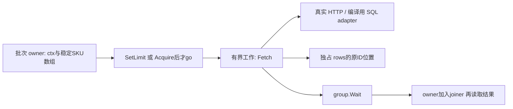
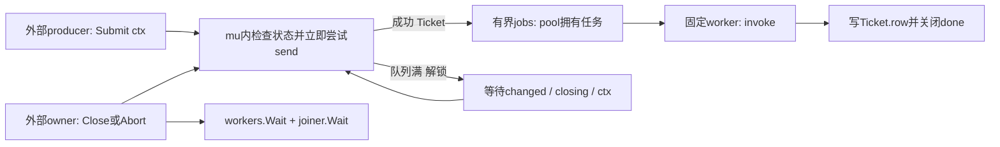

# M15：组合并发、限额、部分失败和真正收尾

本课交付一个独立 module，业务是批量读取 SKU 价格。四个固定 SKU 中 A=12500 分、B=1800 分、C 暂无价格、D=4200 分；允许部分业务失败时成功金额为 **18500 分**。同一份数据贯穿顺序读取、有界真实 HTTP、错误汇总和 worker pool，不让完成顺序改变商品归属。

现在必须理解三件事：**接纳成功才转移任务所有权；取消只通知；拥有者要等自己启动的工作真实返回。** `SetLimit`、队列容量和数据库连接池解决的容量问题不同；有锁仍可能发生业务死锁。可以延后读加权 semaphore 内部等待队列和 SQL driver 细节，但不能跳过谁取消、谁关闭、谁 Wait。

本课直接给完整反例、修复和解析，没有额外 exercise。先用 10～20 分钟读 E01/E02/E05 close，再展开 E03/E04 和其他故障路径。正常命令会运行全部五组实验。

## 运行与版本

从仓库根目录执行，嵌套 module 不在根 `go test ./...` 中：

```powershell
go -C lessons/m15_structured_concurrency run ./cmd/demo
go -C lessons/m15_structured_concurrency test -v -count=1 -timeout=60s ./...
go -C lessons/m15_structured_concurrency vet ./...
```

实际环境是 `go1.27.0 windows/amd64`，本课 `go 1.27.0`，没有 `toolchain` 指令。`golang.org/x/sync v0.24.0` 已在 `go.mod/go.sum` 锁定，真实 `go list -m all` 与缓存源码一致；该依赖自身要求 `go 1.26.0`。没有升级全局 Go，也没有修改根 module 或共享 `go.work`。

查证入口是锁定版 [errgroup 文档](https://pkg.go.dev/golang.org/x/sync@v0.24.0/errgroup)、[semaphore 文档](https://pkg.go.dev/golang.org/x/sync@v0.24.0/semaphore)、[Go 内存模型](https://go.dev/ref/mem)、[HTTP Shutdown](https://pkg.go.dev/net/http#Server.Shutdown) 和 [database/sql](https://pkg.go.dev/database/sql)。本次同时读了本机 `D:/Go/src/sync/waitgroup.go`、`net/http/server.go`、`database/sql/sql.go`，以及缓存 `golang.org/x/sync@v0.24.0/errgroup/errgroup.go`、`semaphore/semaphore.go`。网页默认标准库版本可能更晚，本课不把网页实现当成本机 Go1.27.0 的源码。

语言规则保证 channel/锁同步与 Go1.27 每轮声明的循环变量。库公共契约规定 `Wait/Acquire/Shutdown` 的含义。`errgroup.Go` 用 token channel、weighted semaphore 用等待者队列，则是锁定版的实现解释；不据此承诺永远不变的公平性或性能。

Windows race 使用主 agent 管理的 portable amd64 GCC，在一个专门 PowerShell 进程里设置环境：

```powershell
$m15Toolchain = Get-Content -LiteralPath 'D:/IdeaProject/go-demo/.local/course-orchestrator/toolchain.json' -Raw | ConvertFrom-Json
$env:CC = $m15Toolchain.cc
$env:CXX = $m15Toolchain.cxx
$env:CGO_ENABLED = '1'
$env:PATH = $m15Toolchain.bin_dir + ';' + $env:PATH
go -C lessons/m15_structured_concurrency test -race -v -count=1 -timeout=60s ./...
go -C lessons/m15_structured_concurrency run -race ./cmd/demo
```

关闭这个进程即结束设置，其他机器改为自身的 amd64 C 编译器。此课只读取工具链索引，不下载编译器、不执行 `go env -w`。实际命令与最终结果见 [STATUS](STATUS.md)，完整日志在 `evidence/`。

## 从入口到副作用的阅读顺序

| 文件和符号 | caller → callee → 返回给谁 |
| --- | --- |
| [cmd/demo/main.go](cmd/demo/main.go) `run` | main → 五组同步实验 → 最终 error；每组的 defer 完成后才返回 main |
| [legacyprobe.go](legacyprobe.go) `LegacyProbe` | run → 原 Pool+harness 编译 → `exec.CommandContext.Run` 真正回收 child → 返回真实日志 |
| [legacy_harness.txt](legacy_harness.txt) `fullQueue/recursive` | child main → 原 `NewPool/Submit/CloseAndWait` → 观察锁/队列 → 解除门/救援 → worker 与 owner Wait |
| [scenarios.go](scenarios.go) `HTTPScenario` | run → Sequential/FanOut → HTTPClient.Fetch → 实际 listener/handler → JSON/金额/ID → group.Wait → fixture.Close |
| [batch.go](batch.go) `FanOut/WeightedBatch` | 批次 owner → 接纳 → 已登记工作 → `invoke(Fetch)` → 稳定数组位置 → 真正 g.Wait → owner joiner.Wait |
| [http.go](http.go) `HTTPClient.Fetch/HTTPFixture.handle` | Fetch → net/http.Do → handle 的 gate → JSON response →严格 Decode/ID/status 检查 → Body.Close |
| [pool.go](pool.go) `Submit/worker/Close/Abort/Wait` | producer → 短锁接纳 → 有界 jobs → worker.invoke → Ticket终态 → 关闭/排空 → workers.Wait → joiner.Wait |
| [pool_scenarios.go](pool_scenarios.go) | 实验 owner冻结工作/提交 → 触发取消或关闭 →检查业务终态 → 独立预算 stopPool 收尾 |
| [lifecycle.go](lifecycle.go) `Cleanup/Tracker/invoke` | owner → 通知/放门 →独立两秒预算 →真实加入；worker →计数→业务→归还；panic→当前栈recover→error |
| [sql_read.go](sql_read.go) `SQLPriceFetcher` | 仅编译/阅读：Fetch → DB.QueryContext → Rows.Next/Scan/Err/Close；本课未连接数据库 |
| [lesson_test.go](lesson_test.go) | 外包测试直接核对 SKU/金额/错误链/资源结局；不拿内部 PASS 文案代替业务断言 |



本课只读并核对了已验收 M11–M14 的 STATUS 和核心源码。M11 的 `StartRequest/Cancel/Join` 说明请求拥有停止与加入责任；M12 的 `Pipeline.Start/Results/Wait` 说明有界通道、取消发送和唯一关闭者；M13 的 `ExecSQL` 与 `detachedOwner/afterFuncOwner` 说明同一整链预算和独立收尾预算；M14 的 `Inventory.Buy/Result` 与锁内 I/O 对照说明同一锁的关联状态与锁范围。这些前置多数在 `internal`，不能从本课跨 module 导入。本课按这些直接契约组合，不复制前置整套项目、不重跑前置全部实验。

## E01：先真实复现已有 Pool 的错误条件

第一组直接使用仓库 `examples/advanced-syntax/goroutine-pool/pool.go`。它是 `package main`，不能当普通库 import；`LegacyProbe` 每次读取原文件，逐字节复制到本课 `.local/legacy-*`，加入本课教学 harness 再编译。实际原文件 SHA256 为 `059c9a280d9f012566e44c4831f93490bef348f80e156871bac26adf058ec0d8`。运行结束连临时二进制与源码一起删除。没有修改原 `examples`。

原 `Submit` 的核心是 `RLock → submitted.CAS → jobs <- task → RUnlock`；`CloseAndWait` 是 `Lock → close(jobs) → Unlock → workers.Wait`。读锁保证不同时 close/send，却把关闭的进展交给了可能永久阻塞的提交者。以下条件必须一起成立，不能泛称“Pool 必死锁”：worker 没有消费能力、队列无位置、某个 Submit 已拿 RLock、关闭方需要写锁、没有其他机制让任务/发送继续。

| 时间 | 参与者/等待点 | 状态与下一步 |
| --- | --- | --- |
| 1 | 原 worker 执行 A，`<-gate` | 唯一 worker 被 owner 冻结，确实不能消费 B |
| 2 | caller 原 Submit(B) 返回 | cap=1 队列已存 B |
| 3 | 第三提交者原 Submit(D) | 观察原 Task 的 atomic `submitted=true`，它位于 RLock 内、发送前；worker冻结+队列满，所以发送不能完成 |
| 4 | closer 原 CloseAndWait | TryRLock=false 结合仍持RLock的提交者，证明 writer 已等待；Submit/Close 完成信号都没关闭 |
| 5 | fixture owner 关闭 gate | A返回→worker取B腾位置→D发送完成→RUnlock→closer拿Lock关闭队列→全部worker退出 |
| 6 | owner/closer/清理发布者 Wait | 实际 join，再打印 rescued；不是仅收到 Task结果 |

真实日志：`queue=1 submitted=true writer-pending=true Submit=false Close=false`。没有 `sleep` 推测调度。`runtime.Gosched` 只让出执行机会，成功条件仍来自原 atomic/锁状态；观察有 deadline。

另一个反例用原 `Pool(1,0)`：outer占唯一worker，outer里同步 `Submit(inner)` 等无缓冲发送，接收 inner 的正常 worker 恰好是被 outer 占用的自己。closer仍卡写锁。harness owner 额外接收一次 inner 并执行，只为救援、回收这个受控坏例子；**这是实验救援，不是原 Pool 提供了取消能力**。永久阻塞任务不会因为 Close、加锁或 context存在而自动退出。

修复不只是给 Submit 加个 ctx 参数。锁内不允许等待有界队列，关闭必须能改变接纳状态并唤醒等待者，已接纳的任务必须保有终态责任；递归提交还要改组合方式，不能同步等待自己占用的执行槽。E05给完整修复。

主目录只读 `files/语法进阶/协程池` 的旧材料还用了动态 `RunningWorkers` 和 `time.Sleep`：计数检查不能代替接纳协议，Sleep不能证明工作完成，GMP高效也不能证明建池必然提高性能。本课没有性能 benchmark，只证明容量与生命周期。

## E02：核心真实 HTTP，顺序到有界 fan-out

Sequential逐项同步读取，共用整批ctx。FanOut把数组位置在启动前按稳定ID登记；每个工作只写自己 `ownedRows[i]`，不 append共享slice、不按响应先后填商品。ctx/interface/channel值传入是句柄副本，仍指向同一个共享取消范围/通道；ID/int64 是值数据。调用者复制输入slice，避免继续借用caller的底层数组；调用者仍不能在复制的同时并发改输入。

并行时 owner保持A的门不开放，依次让B/C/D完成，所以固定的完成账本为 **B,C,D,A**。输入与输出保持 **A,B,C,D**：

```text
parallel-stable-ID id=SKU-A price=12500 err=<nil>
parallel-stable-ID id=SKU-B price=1800 err=<nil>
parallel-stable-ID id=SKU-C price=0 err=SKU-C: SKU 暂无价格
parallel-stable-ID id=SKU-D price=4200 err=<nil>
HTTP completion=[SKU-B SKU-C SKU-D SKU-A] active/max/finished=0/2/4
```

| 时间 | 参与者 → 当前函数/等待点 | 真实变化/证明 |
| --- | --- | --- |
| 1 | HTTPScenario → NewHTTPFixture | 动态loopback listener、Serve goroutine、四个唯一gate建立 |
| 2 | batch owner → FanOut.Go(A/B) | limit2满；第三次Go可能等内部token，不再无限创建任务 |
| 3 | A/B client → HTTPClient.Fetch → handler | 请求真实通过HTTP；handler Entered通知后等自身gate/请求ctx |
| 4 | HTTP owner → Release(B) →等Finished(B)/Entered(C) | B响应写出并被client解码返回，才释放group位置让C进入 |
| 5 | owner同样放C、D，再放A | C的404/UNAVAILABLE成为一项业务失败，g函数返回nil继续兄弟 |
| 6 | joiner → g.Wait，batch owner → joiner.Wait | 所有已启动Fetch都返回，owner才读稳定rows |
| 7 | fixture owner →放门、Shutdown/必要时Close、serve.Wait、connections.Wait、handlers.Wait | listener关闭、不再登记新连接、连接终态后不再新增handler，handler计数0；Body已经Close，Transport清闲连接关闭 |

HTTP200只能说明协议状态。Fetch先实际读最多4097字节，超过4096明确返回ErrResponseTooLarge，再对未截断的字节验证JSON完整、无多余字段/对象、响应ID匹配、非负金额、业务code匹配。仅把LimitReader(4096)交给JSON decoder会产生人为EOF，把超长空白/垃圾后缀藏掉；真实HTTP独立测试覆盖恰4096合法、4097空白、合法JSON+超限垃圾和第二个对象。C只有 `404 + UNAVAILABLE + 正确ID` 才被归为可部分失败；服务故障、解码错误、ctx取消都使整批失败。server `Completed` 是本进程“响应写出”的账本，不能单独证明client收到；最终rows来自真实client解码，独立测试核对三项价格与18500。

`TestRealHTTPCancel` 等两项handler真实进入门后再取消client。它先等FanOut加入，然后实际关闭fixture并核对handler `started=finished=2、active=0`，没有把client返回Canceled当成server已退出。此服务只有合成读与内存观察日志，没有数据库、写库存或持久交易；取消不能撤销别的实验中可能已提交的写效果。

## E03：errgroup的四个调用与两种阻塞

| API | 本课调用时机/意义/边界 |
| --- | --- |
| `WithContext(parent)` | 创建一个新批次Group与派生ctx；首个非nil工作错误或Wait返回会取消它。成功Wait也取消派生ctx，后续查询使用自己的正确范围 |
| `SetLimit(n)` | 在第一项Go前设置；运行中不能改变。负值无上限，0不让Go接纳；本课业务入口校验1..8，API测试用TryGo验证0立即拒绝 |
| `Go(f)` | caller等限额位置，然后才起新goroutine；限额等待在v0.24.0源码是 `sem <- token{}`，没有ctx分支，所以cancel不是可取消接纳 |
| `Wait()` | 等所有登记的f返回，返回第一个实际产生并被保存的非nil error；不是按输入最小ID、不是全部error汇总，也不recover panic |

GroupScenario将limit设1，第一项观察ctx取消后故意等cleanupGate；第二个Go位于单个dispatcher内。取消已被第一项观察，但它没返回、permit没释放，第二个Go不可能完成。owner放门后第一项返回，第二个Go仍可能被接纳；函数体再次检查ctx，避免误做业务。观察输出 `Go-admission-still-blocked=true`。

FirstErrorScenario先让A/B都进入，A由fail门返回ErrBackend，B才因group取消醒来，然后等自己的cleanup门。此时已有首错、B已观察取消，但Wait仍不能完成，输出 `Wait-before-cleanup=true`。放清理门→B返回→真实Wait返回A的错误，计数 `started=finished=2、active=0`。首错分支不会遗忘兄弟任务。

允许部分失败时，工作把自己的业务error存入Row，然后对ErrUnavailable返回nil；否则errgroup会误把“一件商品缺价”升级成整个catalog故障。首错策略适合无法继续的整体操作；部分策略保留成功价格并汇总失败。不能用errgroup把错误分类责任省掉。

WaitGroup仅统计完成，不传error、不取消。channel负责交接/广播，本身不自动统计所有工作。errgroup把一组工作的join、首错和派生ctx结合，但不会替你关闭应用队列、取消不合作的I/O或承担结果消费副作用。Java的Future/线程池经验能帮助认识join；goroutine没有隐式Future，context也不强杀执行体。

## E04：先Acquire，再创建工作

WeightedBatch针对不同资源成本，而非固定worker：A重2、B重1、D重2，总capacity3。单个批次owner先Acquire(workCtx,weight)，成功后才 `g.Go`，工作defer归还精确weight。前两项已占3个单位，第三项留在派发者内等待，并没有先为128项创建128个goroutine。

SemaphoreScenario在A/B两项进入、都停在门后断言 `active=2、units=3、started=2`。取消parent使已有工作从ctx分支返回，也使第三项Acquire失败。owner仍等g.Wait与joiner。实际 `maxUnits=3、started=finished=2、units=active=0`；D保留ErrNotStarted，A/B为取消终态。

这里控制资源占用，没有“每秒3请求”的含义。一个请求即使只执行1ms也会马上归还permit，RPS可以很高。真正速率限制还要时间窗口/token bucket。锁定版Acquire失败保持信号量占用不变；工作成功取得多少单位就Release多少，过量释放会panic。我们预先拒绝weight>capacity：官方实现会等待ctx结束，而不会让不可能满足的请求悄悄成功。权重等待队列可能使小请求等在大请求之后，吞吐与公平性需要另做业务评估。

## E05：修复的bounded queue与任务所有权

本课Pool是固定worker与正容量有界队列，workers=1..8、queue=1..16。它明确拒绝queue0：这个版本采用锁内非阻塞接纳，空的正容量队列始终有位置；无缓冲队列需要另一套接收者就绪协议，不能简单把容量改0就假定等价。原反例仍真实使用其支持的queue0。



| 状态/资源 | owner和协议 |
| --- | --- |
| caller传入ID/Fetch | id是string值，Fetch是函数值；闭包若引用可变对象仍可能共享，调用者负责并发安全 |
| Submit失败，返回nil Ticket | 所有权没转移；pool不欠结果、不会执行本项，caller决定重试/丢弃 |
| jobs发送成功，返回Ticket | 接纳的线性化点；任务转移给pool，即使caller此后取消提交ctx，也必须发布终态 |
| jobs | 仅pool.Close关闭；worker只接收。发送与关闭都在同一短mu内，避免send on closed channel |
| changed | worker在取走任务后，mu内关闭旧channel并建立新版本；waiter在锁内取版本，关闭已经发生也不会丢通知 |
| closing | Close一次关闭，唤醒所有提交者；Close不持锁等发送、不等待工作 |
| Ticket.done/row | 仅领取这项job的worker写row/关闭done。Result等单项发布，不等整个worker或池退出 |
| pool.ctx | 本池owner创建；Abort/首错取消。父ctx取消不会自动close jobs，owner仍必须Close/Abort和Wait |
| workers/joiner | pool先Add完整人数再go；joiner实际workers.Wait后发布joined；外部Wait还加入joiner |

Submit在锁内检查closed、caller ctx、pool ctx，再 `select{send:成功; default:满}`。default立即释放锁，捕获的changed版本与closing/ctx一起等待。worker腾空间使所有waiter醒来，但位置可能已被别人占用，所以醒来重新检查；不是每位waiter都已经获得任务名额。ctx取消与接纳若并发发生，按Submit实际返回值判断，不承诺取消通知以后绝不接纳。示例只创建一位阻塞producer；生产环境也应给外部producer数量和输入大小设上限，否则有界jobs不等于整个系统无积压。

六个完整路径由PoolReport与独立测试核验：

| 路径 | 触发、正常/错误分支和最终副作用 |
| --- | --- |
| close | 1worker/1queue，A在门内、B排队、D提交等待；Close立即拒绝D为ErrClosed且nil Ticket，A门未放时还没join；放门后A/B价格12500/1800，started=finished=2 |
| cancel-submit | 同样饱和，仅取消D的接纳ctx；D返回Canceled无Ticket、队列仍只含B；A/B按池预算成功。D未执行，不能拿D的取消去断言A/B也被取消 |
| partial | A panic→当前worker的invoke recover成PanicError；C缺价→业务error；D继续成功4200。三项均有终态，errors.Join同时保存panic与缺价，worker不因单项失败丢下一项 |
| first-error | 两worker运行A/B、D已排队；A先ErrBackend触发cancel，B观察后仍等清理门，joined不关闭；D不再调用Fetch但发布同一首错原因。放门后started=finished=2，三个Ticket都有终态 |
| consumer-exit | caller放弃接收结果，Abort取消A、关闭接纳；B排队被标Canceled。worker写自己的完成槽并close信号，没有无人接收的结果send；所有worker加入后再读两个Ticket，started=finished=1 |
| recursive-fix | outer占worker、B填队列；outer.TrySubmit(D)立即ErrQueueFull，outer先返回A结果。外部owner再Submit(D)，D接纳后4200成功，三个工作最终加入 |

Close是graceful drain；Abort是取消后关闭/终态drain。FailFast时worker仍range排空jobs，对已接纳未开始的项写取消原因，不能直接从ctx分支退出而遗失Ticket。先前成功结果仍保留。Pool没有“取消撤销所有历史效果”的协议。

递归提交即使用了短锁也不能自动安全：唯一worker等满队列中子任务，队列的消费者仍被父任务占用。本课修复用TrySubmit拒绝且由外部owner组合后续任务。也不要在worker里调用本池Wait；它会等待包含自己的worker退出。工作之间有依赖时应显式建DAG或在外部组合，不用无限加worker掩盖问题。

## 预算、清理与批量HTTP/SQL迁移

每组共享上层45秒课程budget，正常观察使用同一ctx；真正收尾使用独立Background派生的两秒预算。顺序是 **cancel/Abort →解除所有实验gate →关闭接纳 →真实Wait →读取最终状态**。错误路径用具名resultErr和defer合并errors.Join，主失败与清理失败都能由errors.Is检查；不能在joiner还写错误时同时更新同一个error变量。清理超时明确失败，不声称已join。`TestCleanupPreservesTimeout`只用未关闭信号测试错误链，没有故意遗留goroutine。

原Pool构建最多30秒、harness观察4秒、child进程监督20秒；原harness提前失败也用独立两秒预算救援/Wait。父进程Command.Run回收child，编译和child都直接执行而非shell/go-run孙进程。race标签会让原Pool child也 `go build -race`，不只检测本课父进程。race child另设进程级 `GORACE atexit_sleep_ms=0`，所有工作已join后不再要求检测器额外睡眠；没有关闭检测或改变race错误退出码。编译/进程启动总预算与harness业务等待上限分别记录，不能因为编译慢就把坏路径改成无限等。

实际HTTP的Body、Transport和动态listener由当前owner关闭；Shutdown有界并在失败时Close。不能在Close之后立即handlers.Wait：连接可能已被accept但尚未调用handler，Wait先看到0并不排除随后Add。本课ConnState在StateNew登记、StateClosed完成；Go1.27.0源码 `Server.Serve` 的StateNew同步发生在Serve可返回前，`conn.serve` 的StateClosed在handler返回后的连接退出defer中。先真正serve.Wait停止新增连接，再connections.Wait等所有已接纳连接终态，才handlers.Wait，最后加入发布者。每阶段用独立两秒预算并保留主错误。

`TestHTTPShutdownBeforeHandler`只建立真实TCP而不发HTTP字节，观察StateNew=1、handler started=0；本机Go1.27会把超过约五秒的StateNew才视为可关闭idle，所以两秒graceful预算实际到期。fallback Close随后真正回收该连接，最终accepted=closed=1、active=0，客户端读取真实EOF。这里deadline用于明确取消路径，未用Sleep推断调度。没有WebSocket/hijack连接，本课不承诺这些外借资源被这套Closed等待自动加入。所有上下文timer都有cancel；没有用进程退出替代正常收尾。动态race通过只说明本次路径未检出竞争，不证明全部输入/调度或业务原子性。

迁移到SQL时先画清三层容量：例如业务fan-out最多8，jobs最多16，DB.SetMaxOpenConns(2)意味着8个活跃业务工作可能只有2个占连接、6个在DB池等待。队列等待数、业务活跃数、连接等待数不是一项指标。别在取连接后才等另一个permit，别持业务锁等待网络或DB池，别把worker上限当成数据库并发上限。

批次deadline例如800ms，接纳/队列等了200ms，下游最多使用当时剩余的约600ms；HTTP.NewRequestWithContext、SQL.QueryContext继续传同一ctx。每层新建Background+800ms会重置caller预算。SQL的statement/lock timeout、driver取消、Rows关闭释放连接的实际行为还需实库验证；写操作的超时可能存在效果未知，首错取消不撤销已Commit。

[SQLPriceFetcher](sql_read.go)提供这条完整阅读链：共享服务DB→QueryContext参数占位符→本次Rows→Next/Scan→Err→Close。它未注册任何真实driver、未创建sku_prices表、未连接MySQL，只有编译/阅读核验；本课实证范围是loopback HTTP和本进程合成状态。实库课程在M20/M21验收，不能用本课HTTP或内存Fetch代替。

## 独立验证与交付接口

13个顶层测试和14个子测试覆盖原Pool实际文件、真实HTTP成功与已进入handler后的取消、真实响应大小/单对象边界、预handler连接关闭、Go限额与Wait、加权接纳、128个SKU在1/3/8限额下的705900分业务合计、Pool六路径、主失败与清理失败、成功Wait仍取消ctx和输入限额。内存Fetch明确只辅助单测。坏路径使用屏障/atomic/锁状态，timeout用于上限或取消语义，不用Sleep推断顺序。

本课公开 `Fetch/Row`、`FanOut/WeightedBatch` 和 `NewPool/Submit/Close/Abort/Wait`，后续M16可以通过自身go.mod的本地replace依赖本课根包；无需改共享go.work。长期服务一般由服务owner持Pool，Shutdown先关闭接纳、选择drain或cancel、再以独立budget Wait；请求只借用Submit，不拥有服务Pool.Close。实验通知waiting参数通常传nil。

第一次独立测试的固定金额常量错误写为705000，逐项预期与实际都算出705900；已修正为 `825600-119700=705900`，未改业务输出。首次race原Pool child的编译/运行超过该测试原10秒父预算，已把该测试构建/运行总预算分离为40秒。随后诊断明确 `child=6.352s child-ctx=context deadline exceeded`；原6秒监督不足以覆盖本机race进程启动/退出，已将进程监督调整为20秒，harness观察4秒与独立清理2秒不变。补验实际 `child=6.432s child-ctx=<nil>`，两种反例和救援join全部完成。最终完成状态以STATUS为准，失败记录保留，不把第一次失败写成通过。
