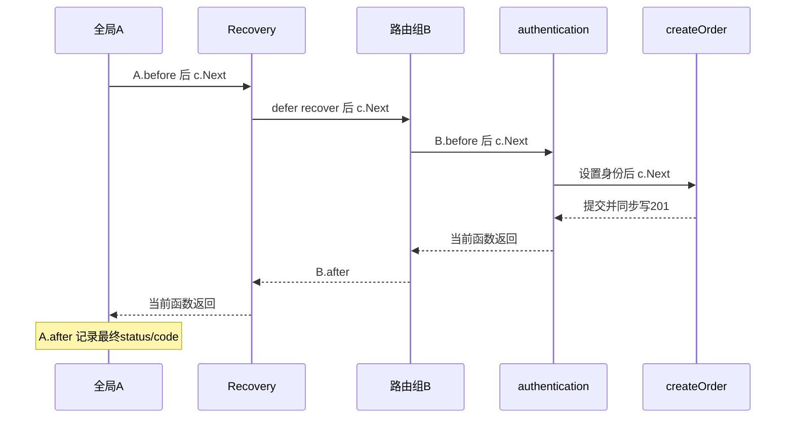

# M18：沿真实 Gin 调用链读订单、中间件、绑定与请求生命周期

这课把 M17 的合成订单协议接到 **Gin v1.12.0**，仍通过真实 loopback TCP/HTTP 发送请求。你会亲眼看到：`Next` 的前后顺序、`Abort` 以后当前函数继续提交、绑定失败后响应拼接、body 第二次读取 EOF、请求结束后的后台任务、Recovery 无法覆盖另一个 goroutine，以及取消没有传到真实依赖时发生的业务后果。每个反例旁边都有已实现的修复、响应内容、真实写入计数和独立断言。

最小规则是：Gin 在一个请求 goroutine 中借出 `*gin.Context`，同步执行一条 handler 链，再把对象归还池。`Next` 调度链；`Abort` 改链的停止位置；`return` 退出当前 Go 函数。这三件事分别发生。真正的请求取消范围取自 `c.Request.Context()`；后台任务必须另有 owner、预算、停止方法和完成信号。

## 怎样运行、先读哪些文件

仓库根目录的默认命令：

```powershell
go -C lessons/m18_gin_middleware run ./cmd/demo
go -C lessons/m18_gin_middleware test ./... -count=1 -v -timeout 120s
go -C lessons/m18_gin_middleware vet ./...
```

进入 `lessons/m18_gin_middleware` 后，相应命令是 `go run ./cmd/demo`、`go test ./... -count=1 -v -timeout 120s` 和 `go vet ./...`。根 module 的 `go test ./...` 不递归进入本课的嵌套 module。第一次运行需要下载锁定的 Gin 依赖，之后使用 Go 缓存。所有服务使用 `127.0.0.1:0`，端口由操作系统分配；无需常驻服务、数据库或共享基础设施。

10～20 分钟核心实验是 E01～E04：用一次订单建立完整调用链，再看 Abort、绑定和 body 的三个真实错误/修复。E05～E10 是直接交付的生命周期、Recovery、安全和取消扩展；默认入口一次执行全部十项，无需自己补题或填写 exercise。现在必须读懂 `*gin.Context` 的借用期、`Next`/`Abort`/`return`、错误返回与写响应、每个 `ctx` 的 owner、`Result` 与 `Finished`。路由树压缩算法、全部 validator 标签、HTTP/3/Protobuf 绑定和生产鉴权系统可以遇到相关源码时再查。

阅读顺序与职责：

| 文件 | 当前入口、返回与真实职责 |
| --- | --- |
| `cmd/demo/main.go` | 创建整轮 90 秒观察/工作预算，调用 `lab.Run`，资源已收尾后才选择退出码 |
| `internal/lab/experiments.go` | `Run → runOne → 各实验`，真实请求、屏障、协议/副作用断言和终端解释 |
| `internal/lab/fixture.go` | `NewRig → newEndpoint` 创建应用和依赖两份 HTTP server；`DependencyGate`、审计、后台任务及最终关闭 |
| `internal/lab/router.go` | 注册路由链，`onion`、`authentication`、各 handler、`slowOrder → reserve`、`lifecycle` |
| `internal/lab/protocol.go` | M17 契约、`bindOrder`、严格 JSON 检查、`Ledger.Commit/Lookup/Count` 与错误映射 |
| `internal/lab/client.go` | `Client.Request` 真实客户端/有界 body/Close；`StartRequest` 是异步请求 owner 句柄 |
| `internal/lab/owner.go` | `Signal`、`startJob → guardedWork`、一次性 `Result`、可重复 `Finished` 等待、`StopAndJoin` |
| `internal/lab/fault.go`、`cmd/fault/main.go` | 构建并监督两个有界故障子进程，检查实际 panic 来源和非零退出 |
| `internal/lab/lab_test.go` | 直接解析响应、读取账本、观察屏障与清理计数的独立测试 |

方法接收者 `r *Rig`、`l *Ledger` 是同一对象的指针别名；复制它们的指针不会复制对象、锁或 map。`Order`、`Envelope`、`Snapshot` 的普通赋值复制 struct 值；本课 Snapshot 只有 string 字段，不含共享可变指针。`Client.Request` 返回的 `[]byte` 是已读出的本地响应数据，和还在网络上的 body 所有权不同。源码旁的注释会在实际使用处解释 `:=`、接口动态值、闭包、channel、defer 和 error 的传播。

## M17 硬前置究竟复用了什么

起点是第 0 层已验收提交 `90f7381b495c08f4995dd13400fbc34fca69e8c0`。本次读过 M17 的 `STATUS.md`、README、真实 `fixture.go` / `client.go` / `owned.go` 和直接业务测试。M17 STATUS 包含返工后的 14 个真实网络实验与取消收尾证据；本课没有重跑它的全部 TLS、慢 header、连接池和长流实验。

前课实现都位于 `m17_net_http/internal/lab`，本课 module 不在该 internal 父目录内，不能合法导入。这里采用**直接协议契约与最小本课适配**：只重新定义小型 `Order/Envelope` 和本课账本，Gin 替换 HTTP 路由、绑定与响应部分；不复制前课整套 server、TLS、Transport 观测和故障工程，也没有本地 replace、循环导入或共享 go.work。

| M17 已验收契约/断言 | Gin 中的对应实现与本次组合证据 |
| --- | --- |
| JSON `{"sku":"sku-m17","qty":1}`，教学 Authorization，非空 Idempotency-Key | `/api/orders → authentication → createOrder → bindOrder → commitReply`；`/api` 是本课路由组前缀 |
| 201，`code=OK`，`committed=true`，`order_id` 一致；不能只看状态码 | E01 同 key 返回两个相同 ID=1，独立账本只有 1 行 |
| `TestConcurrentIdempotency` 的 8 个并发 POST 只写 1 行 | 本课 `TestM17ContractConcurrentIdempotency` 直接重新发送 8 个真实请求并读账本 |
| `TestInputRejectionAndProxyBoundary` 的无鉴权/坏 JSON/未知字段/尾随 JSON/非法数量/伪造 XFF | 本课独立逐条拒绝测试；正常 API 保留 256 字节、未知字段与第二 Decode 必须 EOF |
| 取消客户端不撤销已经发生的服务端副作用 | E08 `detached` 客户端 Canceled 后 rows 0→1；正确传递后无新增 |
| 结果可读/工作 ctx 取消不等于任务收尾 | `Job.result` 与 `Job.finished` 分离；E05 及真实取消清理测试用独立 gate 证明 owner 等待 |

本课在进程内账本上新增了两个应用保护：同身份同 key 不同订单内容返回 409/CONFLICT；订单归属来自认证身份，Bob 读 Alice 订单返回 403。`binding:"required"` 将缺失/零值字段归入 400/INPUT，业务非零但非法数量归入 422/ORDER_INVALID；这是显式的绑定层错误分类，M17 的拒绝不产生副作用的不变量仍保持。账本只证明当前进程内状态，未接入数据库、持久唯一约束、跨实例幂等或重启恢复。

## 锁定版本与真实源码入口

实际工具链是 `go version go1.27.0 windows/amd64`；本课 `module go-demo/lessons/m18_gin_middleware`、`go 1.27`，没有 toolchain 指令。Gin `v1.12.0` 的实际下载 go.mod 是 `go 1.25.0`；网页最低版本描述可能随页面/主分支变化，课程的 API 与源码以**锁定 tag 和实际 module**为准。完整依赖由 go.mod/go.sum 固定，环境证据在 [environment.txt](evidence/environment.txt)。

本机实际 Gin 源码根目录是 `C:/Users/Lenovo/go/pkg/mod/github.com/gin-gonic/gin@v1.12.0`。以下行号属于这次下载版本；换版本后按符号重新定位，不能机械套行号：

| 文件与确切符号 | 本次定位 | 读出的职责 |
| --- | --- | --- |
| `gin.go:Engine.ServeHTTP` | 662 行 | 从 `engine.pool.Get` 取 Context，重置 writer/Request/state，调用路由，最后 `pool.Put` |
| `gin.go:Engine.handleHTTPRequest` | 690 行；命中分支约 729 行 | 查方法对应路由树，取得 handlers/params/fullPath，再同步 `c.Next` 并刷新 header |
| `routergroup.go:RouterGroup.Use/Group/handle/combineHandlers` | 65 / 72 / 86 / 241 行 | 注册阶段合并父 group、子 group 与路由 handlers，形成 slice；必须注册完再启动 server |
| `context.go:Context.reset/Copy` | 103 / 122 行 | reset 清请求状态；Copy 复制 map/params 结构，保留 Request 指针、移除底层可写 writer |
| `context.go:Context.Next/Abort/AbortWithStatusJSON` | 188 / 207 / 230 行 | Next 用共享 index 推进同一链；Abort 把 index 改到停止值，不退出当前函数 |
| `context.go:Context.Bind/MustBindWith/ShouldBindJSON/ShouldBindWith/ShouldBindBodyWith` | 757 / 810 / 867 / 919 / 928 行 | MustBind 失败会提交状态；ShouldBind 返回 error；BodyWith 缓存实际读取的 bytes |
| `binding/json.go:decodeJSON` | 44 行 | 默认 Decode 一次再 validator；未知字段与尾随 JSON 需要按应用契约处理 |
| `context.go:Context.ClientIP`，`gin.go:Engine.SetTrustedProxies` | 975 / 451 行 | 先判直接 peer 是否可信，再解析转发链；默认可信范围不能当部署已安全 |
| `context.go:hasRequestContext/Done/Err` | 1434 / 1449 / 1457 行 | 必须 engine 启用 ContextWithFallback 才把请求 ctx 方法作为 fallback；本课默认关闭 |
| `recovery.go:CustomRecoveryWithWriter/secureRequestDump` | 53 / 98 行 | recover 位于返回的 middleware 当前栈；默认 dump 仅显式遮 Authorization，不能代表敏感日志全集 |
| `response_writer.go:responseWriter.Unwrap/WriteHeaderNow/Write` | 57 / 77 / 84 行 | wrapper 包着真正 HTTP writer；写出后最终状态无法改；Copy 的底层 writer=nil |

Go 标准库也实际核对：`D:/Go/src/net/http/server.go` 的 `serverHandler.ServeHTTP`（3404 行）调用配置的 Handler；HTTP/1 请求调用在 2137 行，后续 2139 行取消请求 ctx。`D:/Go/src/net/http/request.go:Request.Context`（357 行）和 `NewRequestWithContext`（899 行）提供入站/出站取消入口。记录见 [source-symbols.txt](evidence/source-symbols.txt)。`Next`/池策略属于该版本 Gin 实现；Request.Context 返回/取消范围属于标准库契约；goroutine 的独立调用栈、return/defer/recover 和 channel 同步属于 Go 语义。

官方查证入口：当前 [Gin 绑定文档](https://gin-gonic.com/en/docs/binding/binding-and-validation/)、[body 重复绑定](https://gin-gonic.com/en/docs/binding/bind-body-into-different-structs/)、[goroutine 中的 Context](https://gin-gonic.com/en/docs/middleware/goroutines-inside-a-middleware/)、[可信代理](https://gin-gonic.com/en/docs/server-config/trusted-proxies/)、[请求取消](https://gin-gonic.com/en/docs/server-config/context/)，以及 [Gin v1.12.0 源码](https://github.com/gin-gonic/gin/tree/v1.12.0)、[Go 1.27 发布说明](https://go.dev/doc/go1.27)、[net/http](https://pkg.go.dev/net/http)、[context.CancelFunc](https://pkg.go.dev/context#CancelFunc)。旧的 `en/docs/examples/...` 页面在本次访问返回 404，本课跟随官方目录链接读取了现行路径。

## 正常订单：从入口到 append 的完整调用链

```text
main -> lab.Run -> runOne -> NewRig
  -> newEndpoint(依赖) -> go Server.Serve(依赖listener)
  -> router -> Gin.New -> Use(A,Recovery) -> Group(/api,B,authentication)
            -> POST(/orders,createOrder)注册完整handlers
  -> newEndpoint(engine) -> go Server.Serve(应用listener)

protocolExperiment -> Client.Request -> NewRequestWithContext -> Client.Do
  -> 真实TCP/HTTP -> 应用Server -> 计数HandlerFunc.ServeHTTP
  -> 动态http.Handler值(*gin.Engine).ServeHTTP
  -> pool.Get -> reset -> handleHTTPRequest -> 路由树命中 -> c.Next
  -> A -> Recovery -> B -> authentication -> createOrder
  -> bindOrder -> ShouldBindJSON + strictOrderJSON + 业务SKU/qty/key校验
  -> commitReply -> Ledger.Commit -> mu.Lock -> 查key/校验同内容 -> append(rows)
  -> c.JSON(201,Envelope) -> responseWriter.Write -> 真正ResponseWriter
  -> handler层层返回 -> B.after -> Recovery返回 -> A.after审计 -> pool.Put
  -> Client拿headers/读body/Close -> Reply -> 完整JSON/ID/账本断言
```

`HandlerFunc` 是 `func(*gin.Context)` 的函数类型；Gin Engine 通过 `ServeHTTP` 满足 `http.Handler` 接口。`newEndpoint` 的 interface 值动态对象是 `*gin.Engine`，所以真实请求调用到 Engine 方法，不是 Spring 式反射调用/异常隐式映射。HTTP server 给各连接/请求安排 goroutine；`Next` 自己没有启动 goroutine。

实际 Next 顺序：



所有 Next 操作同一 `c.index`，不是每层复制独立游标。H 执行完会向上返回，故 E01 断言 `[A.before B.before H B.after A.after]`。认证拒绝时 Abort 停止剩余链，B/A 的 after 仍可执行；此前已进入的调用层没有被“抹掉”。代码使用明确 `c.Next()` 包围前后处理；仅省略 Next 并不等于拒绝请求，因为外层/Engine 的推进循环仍能调用后续 handler。需要停止链就明确 Abort。

相同 key 的第二次正常请求在锁内返回原 ID，不 append；不同内容复用同 key 在锁内返回 ErrConflict，经 `commitReply` 映射为 409/CONFLICT。实际 E01 是两个 201/OK/committed=true/ID=1，账本 rows=1，再冲突 409/false，rows 仍 1。Gin 管路由、绑定、输出与中间件调度；应用仍负责身份归属、业务校验、幂等、事务和副作用一致性。

## E02：Abort 已执行，为什么仍多写一单

`abortBad` 没有身份时调用 `reject → AbortWithStatusJSON(401,AUTH)`，然后因为缺少 Go `return`，继续 `Ledger.Commit` 并第二次 `c.JSON(201,OK)`。Abort 的 index 阻止后面的 `H.unexpected`，却不跳过当前函数下一句。

| 时间 | 当前参与者/语句 | 状态与业务结果 |
| --- | --- | --- |
| 1 | A.before → abortBad | 未认证，rows=0 |
| 2 | reject/AbortWithStatusJSON | 链停止值已写入；401/AUTH body已经发出 |
| 3 | 当前 abortBad 继续 Commit | rows=1；后面的独立handler仍不会执行 |
| 4 | 再JSON(201,OK) | 状态仍401；第二个JSON被追加到同一body |
| 5 | 客户端实际读完 | `{"code":"AUTH","committed":false}{"code":"OK","committed":true,"order_id":1}`，不是一个合法协议JSON |
| 6 | 修复authentication：reject后立即return | 一个401/AUTH JSON；同一账本rows仍1，没有第二次新增 |

实际 trace 是 `[A.before bad.current-handler-write A.after]`，没有 H；因此问题确实是**当前函数**继续执行，不是 Abort 失效。Java 过滤器经验可帮助理解调度链；Go 的 Abort 没有抛异常或非局部跳转语义，当前函数退出仍由 return 完成。

## E03～E04：绑定、业务校验和 body 消费

`Bind` 按方法/Content-Type 选择 binder，内部走 MustBindWith。普通绑定失败会自动 Abort 并写400；本次 v1.12.0 对可识别 `*http.MaxBytesError` 还会写413，不能机械复述所有版本一律400。自动写错以后你再想改422/JSON，状态已经不能反悔。危险 `bindBad` 又忽略 error 继续提交，真实响应是400、`text/plain; charset=utf-8`、拼接 INPUT 与 OK 两个JSON，账本新增1行。

修复 `bindOrder` 用 ShouldBindJSON，error 回到 caller，框架没有替你提交错误响应；应用选择统一400/INPUT JSON，再立刻return。成功绑定后仍需判断商品、数量、幂等key。`required` 的含义是非零/非空；qty=-1 能通过它，错误 `validationBad` 真的写了一行非法订单，正常API却返回422/ORDER_INVALID且无新增。库存是否足够、商品是否售卖、订单是否属于当前身份，更不可能单靠 JSON tag 得到。

正常 API 先 MaxBytesReader 限制实际输入到256字节，read body到本地bytes，ShouldBind将其变成struct，再用请求局部 strict decoder 拒绝未知字段/第二个JSON。两次解析来自同一有限本地bytes，网络只读取一次。没有在每请求期间改 `binding.EnableDecoderDisallowUnknownFields` 全局变量。首次 `Decode` 成功不代表后面没有第二个JSON，这就是独立EOF检查的目的。

E04 的 middleware preview 第一次 ShouldBindJSON 消费body，`bodyAgain(false)` 再ShouldBindJSON得到EOF，响应400/BODY_ALREADY_READ，rows=0。缓存修复先设置同样大小上限，两层均使用 ShouldBindBodyWithJSON；源码缓存在 `gin.BodyBytesKey`，第二次从bytes绑定，不再读socket。缓存仍须严查JSON/业务/非空key；独立测试对缓存修复继续拒绝未知字段、尾随对象、257字节和空key，账本不增加。仅需要读取一次时直接bindOrder更清楚，缓存只在确有多个消费者的场景使用。

| 本次输入 | 实际响应/副作用 |
| --- | --- |
| 非法 JSON，Bind危险版 | 400/两个JSON，rows增加1；修复400/一个INPUT，0新增 |
| qty=-1，required危险版 | 201/OK，rows增加1；修复422/ORDER_INVALID，0新增 |
| body重复读取 | 400/BODY_ALREADY_READ，rows0；缓存修复201/OK/ID1，rows1 |
| 无认证/未知字段/尾随JSON/257字节/非法业务/空key/错误Content-Type | 独立测试分别401/400/400/413/422/400/415，均不增加订单 |

## E05：Gin Context、Copy 和后台任务是三条生命周期

`Engine.ServeHTTP` 正常结束后把 Context 放回 sync.Pool；后续请求可能拿到同一地址，reset会清掉之前Keys/params/handler状态。E05 的16次顺序真实请求交替Alice/Bob，只比较当前借用地址、读取当前身份，记录本次复用次数；**不读取已归还原Context**，不把16次中复用几次当语言或库承诺。当前身份必须每次由当前认证重建。最终日志观察6次地址复用，后续运行可能不同或0。

Copy能提供请求外只读所需的一份结构快照，但实际源码清楚地显示：

| 对象关系 | 本次事实 | 对业务意味着什么 |
| --- | --- | --- |
| `cp.Request == c.Request` | true | 没有深拷贝Request；cp.Request.Context还是原请求取消范围 |
| `cp.Writer.Unwrap()==nil` | true | Copy没有在请求结束以后写response的权限；E10实际写会panic |
| Keys map结构独立、指针value共享 | marker从before改after，copy读到同一指针的after | Copy不是任意用户对象的深拷贝，也不让共享value自动线程安全 |
| 默认 `c.Done()==nil` | true | 满足context.Context接口不意味着默认传播Request.Context取消 |
| Snapshot只有User/服务器生成Request ID/路由模板string | worker拿值副本 | 不留原c、cp、Request或Writer，身份与路径不会被池重置 |

Copy检查和marker修改全部在当前handler同步完成，没有故意放一个race污染整课。后台Job只捕获Snapshot、并发安全的Life统计/屏障和单独的 `context.Context`。Request context本身是可并发使用的标准接口；池化的Gin框架对象不是这种终身共享载体。

| 时间 | 参与者/真正等待点 | request派生任务 | 独立owner任务 |
| --- | --- | --- | --- |
| 1 | `lifecycle`同步提取字段/Copy事实，startJob，返回202 | parent=原requestCtx | parent=Rig root，2秒预算 |
| 2 | net/http的ServeHTTP返回后取消requestCtx | worker的ctx随之Canceled | worker观察requestCanceled，独立ctx仍有效 |
| 3 | owner读Job.Result | Canceled，effects=0 | ownerOpen Release后完成合成效果1，result=nil |
| 4 | worker等待Cleanup gate | result可读但finished仍未关闭 | result可读但finished仍未关闭 |
| 5 | owner调用StopAndJoin | cancel/Open/新预算join | E05先不开放Cleanup，joinWaiting已发，owner_returned=false |
| 6 | 控制者打开Cleanup | worker收尾并关闭Finished | worker收尾→Finished→owner实际返回 |

这里的 effects 是专属后台任务内存计数，不是订单账本，不能据此声称持久任务提交。业务若要响应后可靠执行，通常还需持久任务/outbox/重试和状态查询；Copy与一个本地goroutine都没有提供这些。Java线程池的任务句柄可以帮助理解owner，但 goroutine 没有框架自动交给你的 Future；本课显式保存取消和完成信号。

## E06、E10：Recovery 的栈边界与已提交事实

`CustomRecoveryWithWriter` 在当前请求goroutine中 defer recover，然后同步Next。`/api/panic` 在提交前panic，实际返回500/PANIC、rows0；程序继续服务。`/api/panic-after` 先Commit再panic，实际仍返回500/PANIC/committed=false，但rows1。响应的“未提交”声明不能撤销独立状态事实；Recovery不能充当业务事务回滚或外部调用补偿。

新goroutine有自己的调用栈。E10构建 `cmd/fault`，子进程真实HTTP进入装有Gin Recovery的handler，再 `go func(){panic(...)}`。panic在另一个goroutine，当前Gin中间件的defer不在它的栈上；本轮子进程实际exit=2，panic来源标记成立。第二个子进程把当前handler同步创建的Copy交给新goroutine写JSON，因底层writer为空panic并exit=2。父进程为每个子进程提供8秒预算并等待退出，超时不算复现成功。

修复是需要隔离的worker在**自身goroutine入口**调用 `guardedWork`，同栈defer recover把panic变成 ErrWorkerPanic交回Job.Result，owner还必须StopAndJoin。recover不会恢复panic下一行执行，不能撤销worker已完成的副作用。本课正常任务框架具有这个边界，E06实际worker返回可分类error、Finished成立、active0。故障子进程故意跳过此框架，和正常服务隔离。

Recovery前的A会在恢复处理返回后继续A.after；panic穿过B时，B普通after语句没有执行，不要把洋葱的正常after误当finally。需要异常时也执行的收尾必须defer。CustomRecovery只在writer尚未Written时选择500；已经写出响应后只能停止链，不能承诺变更已发状态。本课故障panic都发生在发送响应之前，未做生产流式中途panic验收。

## E07、E09：登录、归属、客户端IP和日志分别判断

`authentication`验证两个教学token，生成alice/bob身份string；它不把X-User当身份。`getOrder`对已经存在的订单再验证Owner。Bob是已登录身份，却没有Alice订单的读权限；真实请求伪造X-User=alice、XFF、Cookie和query后仍403/FORBIDDEN，rows1。Alice读同订单200/OK/committed=true；不存在ID返回404。

本课所有普通engine显式 `SetTrustedProxies(nil)`；直接peer是loopback时也忽略XFF，审计Peer=127.0.0.1。E09另外创建独立engine，显式信任127.0.0.1来模拟经过代理的请求，XFF链 `203.0.113.9, 127.0.0.1` 得到203.0.113.9。IP仅描述来源，不替代token身份。线上必须限定真实代理网段、确保直连用户进不来、代理清洗/覆盖头；把本机loopback列为可信是合成实验配置，不是部署建议。

`Audit`只有服务器生成的ID、method、路由模板FullPath、固定可信身份、ClientIP、status和结果code。X-Run仅作为实验屏障/trace索引，不写Audit的Request字段。真正观测到的日志是：

```json
{"Request":"2","Method":"GET","Route":"/api/orders/:id","User":"bob","Peer":"127.0.0.1","Status":403,"Code":"FORBIDDEN"}
```

独立测试核对教学token、敏感Cookie、query、自报X-Run和伪造IP都没出现在序列化Audit里。默认Gin Logger可能输出原URL，默认Recovery的secureRequestDump在锁定源码里只特别遮Authorization；不能把这个行为当全量脱敏。本课使用gin.New、自有allowlist日志、`CustomRecoveryWithWriter(nil,...)`，不输出原request、任意panic值或完整error正文。demo打印的HTTP错误URL只含本课合成gate/mode，属于教学证据，不是生产日志模板。

## E08：请求ctx传到真实依赖的完整路径

依赖是另一份真正HTTP server，不是返回预制response的RoundTripper。调用链：

```text
Client.StartRequest -> Job goroutine -> Client.Request(入站请求ctx)
  -> TCP -> Gin slowOrder
  -> c.Request.Context -> WithTimeout(parent,budget) -> reserve(ctx,gate)
  -> http.NewRequestWithContext(ctx,依赖URL) -> depClient.Do -> TCP
  -> dependencyHandler -> select(Release / req.Context.Done / Rig.root / timer)
  -> 依赖status/body/allowed验证 -> slowOrder提交前检查 -> Ledger.Commit
```

入站ctx对象不会跨网络发送给依赖。客户端取消出站HTTP时，Transport终止网络交换；依赖net/http由本条网络请求观察取消，再关闭自己的Request.Context.Done。因应用把ctx放进出站request，整条链才能衔接。这与Java把ThreadLocal请求上下文交给异步线程不同：Go必须显式传参，ctx只协作通知，不强制中断任意CPU/事务。

四个模式使用不同gate/key，先等应用AppEntered与依赖Entered，保证请求真的进入依赖后才取消/让预算到期：

| mode | 依赖用哪个parent | 本轮取消/响应/订单事实 |
| --- | --- | --- |
| detached危险版 | Rig root，故意跳过提交前入站ctx检查 | 客户端Canceled，依赖未观察取消；释放依赖后rows0→1 |
| gin-context反例 | 默认*gin.Context，Done=nil | 客户端Canceled，依赖未观察取消，仍等Release；提交前检查阻止写入，rows1→1，但资源取消仍失败 |
| forward修复 | `c.Request.Context()`，2秒依赖上限 | 客户端Canceled，依赖实际观察取消；rows1→1 |
| timeout修复 | Request.Context再派生150ms预算 | 依赖观察到取消；客户端Do没有网络error，实际504/DEPENDENCY_TIMEOUT/false；rows1→1 |

150ms是明确依赖预算，不用于sleep猜调度。依赖观察取消后故意再等Cleanup；Done未关闭、handler尚未退出，独立测试检查这个窗口后才释放它。499/CANCELED是本课应用内部映射，不是标准HTTP取消状态；客户端已断开时不保证能收到499，demo实际看到网络Canceled与空Reply，而不是伪造一个成功送达的取消JSON。生产还需要区分其他依赖网络/协议错误，本课没有把完整重试、熔断或所有状态分类塞进本模块。

修复forward的具体时间线：

| 步骤 | 参与者/真实等待 | 状态变化和下一步 |
| --- | --- | --- |
| 1 | owner登记DependencyGate，再创建OwnedCall；应用slowOrder进入 | 已读取/校验订单，发布inbound ctx与AppEntered，尚未Commit |
| 2 | 应用reserve在真实depClient.Do等响应；依赖handler发Entered后等select | owner知道真实依赖已进入，无调度sleep |
| 3 | owner取消OwnedCall.Job，客户端requestCtx Done | 入站连接取消→应用Request.Context Done→出站HTTP取消 |
| 4 | 依赖select收到req.Context.Done，发Canceled，然后等Cleanup | 只证明观察到取消，Done仍未关闭；原订单未写 |
| 5 | 应用reserve返回包装的网络取消error | slowOrder映射取消并return，不Commit；AppDone表示该handler路径结束 |
| 6 | owner开Cleanup并等依赖Done；消费一次客户端Result | 依赖退出；客户端error是Canceled，尚需Job finished |
| 7 | owner StopAndJoin用新的清理预算 | call finished，账本0新增；最终再关闭服务器与连接 |

多ready的select可以任选一个分支，取消和“允许提交”可能竞态。提交前ctx.Err检查只覆盖已经可见的取消；检查与外部数据库Commit不原子。这里屏障确保取消已被观察之后才释放，所以能严格证明该窗口无额外写入；不能泛化成任何系统里客户端Canceled都等于订单永远没创建。已经成功提交但响应丢失仍是结果未知，应按业务幂等键查最终状态。

## 每个任务、等待点和资源最后由谁收尾

| 参与者/资源 | owner与实际等待点 | 停止、清理与join事实 |
| --- | --- | --- |
| main/Run | 当前主goroutine，等待每个实验 | 整轮90秒budget；每个runOne的defer先收尾再返回 |
| 应用/依赖Serve goroutine | Rig拥有Endpoint；阻塞accept/协议IO | root cancel、Shutdown关闭自有listener、wait Endpoint.finished，再核对live0/active0 |
| 应用handler | net/http调用Gin；普通同步返回，slowOrder等真实Client.Do | request ctx/依赖预算/Rig root；Shutdown等全部handler退出 |
| 依赖handler | 依赖Server；等待Release/请求取消，随后Cleanup | gate.Open/root/3秒安全timer；依赖Done再加Endpoint最终收尾 |
| OwnedCall.Job | 创建StartRequest的实验或测试；HTTP Do/Body读取/可选附加cleanup | 创建后立刻defer/t.Cleanup；cancel、全部gate Open、独立3秒join Finished；Result只读一次 |
| lifecycle Job | Rig与当前实验owner；requestCtx Done、Release、Cleanup | 明确2秒工作budget；root cancel或单任务Cancel；Open两gate，独立join |
| E05/清理测试的joiner Job | 当前实验owner；真正阻塞StopAndJoin | 自己也保存Job句柄、立即登记清理；开放被join任务的cleanup，join两层完成广播 |
| Client/depClient Transport、response Body | 创建者复用pool，单次Request/reserve拥有Body | 有界ReadAll与defer Close；pool最后CloseIdle；Bodies只是wrapper所有权计数 |
| timer/context关联 | WithTimeout/NewTimer的创建函数 | defer cancel/Stop；Cancel只通知，不等待任务退出 |
| 故障子进程/binary目录 | Faults | build预算60秒、每child8秒，Command.Run真正wait；只删除自己的.local/fault-*目录 |

`Job.Result` 是一次性结果槽位；发送后worker可能仍等Cleanup。`Finished` 是关闭广播，可在结果已读后反复join。`StopAndJoin`严格做 `cancel → unblock → 独立Background派生3秒预算 → wait Finished`。它不继承已取消的工作ctx，不二次消费Result，不把观察ctx取消当完成；到期返回明确清理失败。具名返回err配合defer `errors.Join`保留主错误和cleanup错误。

`Rig.Close`先cancel root并开依赖gate，再Shutdown应用使所有后台任务注册者退出；随后重新取完整Life列表、Open/Join各Job、CloseIdle依赖pool，再Shutdown依赖并join Serve。先等注册者退出避免“取完Job快照后又新增任务”的早失败漏洞。每个异步创建点立即登记完整收尾，即使等待Entered就失败或t.Fatal，也先收回任务再关总环境。测试另外确定性制造“工作ctx已取消、Result=Canceled已消费、cleanup未开”的窗口：calls=1、bodies=0、Finished=false、owner_returned=false；开放cleanup以后才calls0、owner返回。主错误与清理错误同时保留也有独立断言。

本次普通实验最终全部记录：`bodies=0 calls=0 jobs=0 app_live=0 dependency_live=0 app_handlers=0 dependency_handlers=0 Serve=joined`。这表示课程拥有的资源已归零，不声称整个Go runtime没有任何内部goroutine。没有启动长期服务、改全局代理/工具链、写原始files/其他课程或生产数据。

## 自验命令、race复跑与范围

实际demo十项、14项顶层测试（包含输入与四模式子测试）、vet与race结果见 [STATUS.md](STATUS.md) 和 `evidence/`。正常与危险入口的响应/账本断言都独立完成；不是仅编译通过，也不是搜索PASS文本。两种故障子进程都实际exit2并由父进程join；测试-race检测当前父进程内课程/库的实际执行路径，Faults自行构建的故障binary是普通build，未声称其panic进程也被race覆盖。

本机默认gcc是M17已记录的32位工具链；本课复用课程统一amd64 WinLibs，未重复安装或改`go env -w`。在本课目录用已登记compiler复跑：

```powershell
$m18Compiler = Get-Content -LiteralPath 'D:/IdeaProject/go-demo/.local/course-orchestrator/toolchain.json' -Raw | ConvertFrom-Json
$m18OldCC, $m18OldCXX, $m18OldCGO, $m18OldPath = $env:CC, $env:CXX, $env:CGO_ENABLED, $env:PATH
try {
    $env:CC = $m18Compiler.cc
    $env:CXX = $m18Compiler.cxx
    $env:CGO_ENABLED = '1'
    $env:PATH = $m18Compiler.bin_dir + ';' + $env:PATH
    go test -race ./... -count=1 -v -timeout 120s
} finally {
    $env:CC, $env:CXX, $env:CGO_ENABLED, $env:PATH = $m18OldCC, $m18OldCXX, $m18OldCGO, $m18OldPath
}
```

其他平台使用自己实际支持目标架构的compiler即可，私有toolchain索引不属于课程交付依赖。当前实证范围为本机HTTP/1.1、锁定Gin、进程内合成订单与显式后台任务。未验生产负载、公网/HTTP2/HTTP3、持久数据库事务、跨实例幂等、外部身份提供方、反向代理实际部署和跨进程可靠任务。`files/开发框架`的“中间件打印”方向已扩展为这些可复现正确性边界；资料中的性能比较方向未拿来声称本课做过benchmark。

本模块自验完成后冻结交付，最终主验收和整层提交由主agent负责。
