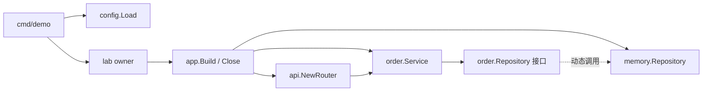

# M19：从入口、配置与构造，追踪一条真实订单请求

本课要解决的场景是：接手一份 Go 后端仓库，看到一个订单 API，能找到它使用哪个仓储、配置来自哪里、谁创建与关闭资源，并且能对自己的小改动给出运行证据。课程是独立 module：`go-demo/lessons/m19_composition_architecture`。默认入口把七段实验顺序运行完，每段都有输入、坏例、修复和事实断言。

这里真正跑了 Gin 1.12.0、TCP loopback、HTTP 请求与进程内订单写入。仓储 `rows` 的 append 是真实副作用，作用范围仅是本次 App 的内存；没有 SQL、MQ、重启持久性或跨实例事务证明。这样的边界适合先读懂 composition root，后续数据库课再替换仓储实现。

## 先用 10～20 分钟跑通核心实验

从仓库根目录执行，Go 的 `-C` 先把工作目录切进本课 module。根 `go test ./...` 不跨越嵌套 module，不能替代下列命令。

```powershell
go -C lessons/m19_composition_architecture run ./cmd/demo
go -C lessons/m19_composition_architecture test ./... -count=1 -v -timeout 120s
go -C lessons/m19_composition_architecture vet ./...
```

默认 `testdata/config.json` 的 token 是公开教学值，不是实际凭据。实验只监听动态 `127.0.0.1:0`，并且自行发请求、验证与关闭，不需要先启动服务器或依赖外部服务。若出现 Gin 的 debug 路由注册输出，它是第三方默认模式的非敏感输出；本课不在 router 内改 Gin 包级模式，以免把进程全局设置混入每个 App 的装配。

建议前 2 分钟读下面的最小规则；第 3～7 分钟跟 E01 的调用地图、运行入口；第 8～12 分钟看 typed nil、未 Start 与全局 client 的反例；余下时间跟 E04～E07 的资源路径。完整解析已经在这里和源码旁，不需要另外创建 exercise。

本次成功运行的关键输出（省去重复的 Gin 路由 debug 行）是：

```text
effective_config={"listen":"127.0.0.1:0","version":"m19-composition-v1","request_timeout_ms":250,"storage":"process-memory"}
E01 显式装配/真实 HTTP/幂等与错误返回
  version=m19-composition-v1 duplicate_requests=9 order_id=1 rows=1 conflict=409 invalid=422 auth=401
  PASS
E02 typed nil/尚未 Start/构造断言修复
  typed_nil_interface!=nil=true bad_call=panic root_reject=true early=ErrNotReady fixed_rows=1
  PASS
E03 包全局 client 串线/每 App 作用域修复
  global_bad=true request_to=A rows_A=0 rows_B=1
  global_bad=false request_to=A rows_A=1 rows_B=0
  PASS
E04 中途构造失败/资源关闭/错误原因同时保留
  real_listener=closed repository=closed errors.Is(construction)=true errors.Is(cleanup)=true
  PASS
E05 真实请求取消/写入前屏障/独立清理预算
  gate=entered client_result=context.Canceled root_shutdown=joined cancelled_rows=0 repository=closed
  PASS
E06 Serve Result 已可读/Done 尚未完成
  serve_result=nil final_done=false close_owner_returned=false repository=ready
  close_caller_result=nil close_caller_done=false tail_cleanup=waiting
  close_caller_done=true owner_joined=true repository=closed
  PASS
E07 init 偷绑端口/配置读取过早
  initbad.bound_before_main=true observed_version="before-main" main_version="main-configured"
initbad.owner.closed=true
  PASS
```

全部原始输出与验证范围见 [STATUS.md](STATUS.md)、[demo.txt](evidence/demo.txt)、[test.txt](evidence/test.txt)、[race.txt](evidence/race.txt)。耗时、TCP 端口、并发请求先后顺序是本次观察；业务 ID/行数/错误类型与资源最终关闭是代码机制保证并由断言验证的事实。

## 现在必须掌握的最小 Go 规则

`NewService`、`NewRouter` 和 `New` 都是普通函数名，没有容器自动发现它们。它们不会因为一个结构体“像 Bean”就自动执行，也没有默认的 singleton/request scope。Go 可以使用 DI 库，但这不属于语言默认行为。这里的 singleton 只是 root 创建一份 `*Service` 并把这个指针给所有路由；请求 state 则是每次中间件构造一个 `State` 值。

`Service{repo: repo}` 的字段赋值复制接口值。接口动态类型是 `*memory.Repository`，动态值是仓储指针；复制后仍指向同一仓储，并没有深复制。`Config` 本课只有字符串、整数，传值给 router 后形成该 App 的配置快照；`Request`、`Record`、`State` 也只有值字段。`Snapshot` 另外复制 slice 和每个 Record，测试修改快照不会修改仓储。若后来新增 map/slice/指针字段，必须重新讨论别名关系，不能沿用“struct 是值就总是深拷贝”的直觉。

Go 的接口由方法集隐式实现，不需要 `implements`。`order.Repository` 由使用者定义，只有 `Commit(context.Context, Request) (Record, error)` 一种业务能力。具体仓储的 `Start/Ready/Close/Snapshot` 留在 root 与实验里；handler 不能通过业务接口关闭全局仓储。构造器返回具体 `*Service`、`*App`，让状态和所有权清楚，而不是每一层都再造一个空接口。

`:=` 在当前作用域声明新变量；`if err := ...; err != nil` 的 err 只在这个 if 内可见。`Build` 的 `a, err` 是具名返回变量，`return a, 某个错误` 会先赋值给它们，再运行 defer，最后返回。因此回滚 defer 可以把 `a` 改为 nil、把 Close 原因 Join 到最终 err。`transferred` 单独记录是否已交接：构造过程中 panic 时 err 可能仍是 nil，但未交接资源仍需关闭。`go` 语句创建新 goroutine；普通方法调用并不创建另一条线程或任务。

`defer` 归属当前函数。`Client.Call` 的 defer 在 Call 返回前关闭该响应体；root 构造回滚的 defer 在 Build 失败/异常展开时执行；middleware 的 defer 在 `c.Next` 返回后取消当前请求 timer。`main` 最后才 `os.Exit`，避免退出跳过 run 内已经登记的清理。`cancel()` 发通知，不等待工作结束。`Shutdown`、独立handler账本的Wait、等待 `Done` 和仓储 `Close` 是后续具体动作。[Go 的初始化与执行规则](https://go.dev/ref/spec#Package_initialization)和[http.Server.Shutdown 契约](https://pkg.go.dev/net/http#Server.Shutdown)分别定义了初始化时机、服务关闭与等待边界。

可以延后：大规模框架 provider graph、Wire/Fx 高阶 API、HTTP2/3、ORM、数据库事务、反向代理部署与生产凭据验证。本课现在需要理解每次真实调用、返回原因、资源归属和请求状态；不用先把 DI 框架名词记齐。

## 硬前置怎样复用

已读 M04 的 [接口 service](../m04_interfaces_nil/internal/usecase/service.go)、[具体指针组合边界](../m04_interfaces_nil/internal/app/composition.go)与 [STATUS](../m04_interfaces_nil/STATUS.md)：M19 保留“使用者定义小接口、具体构造边界拒绝 typed nil”的约定，没有给所有接口增加反射 nil 检测。

已读 M18 的 [协议/仓储](../m18_gin_middleware/internal/lab/protocol.go)、[真实路由](../m18_gin_middleware/internal/lab/router.go)与 [STATUS](../m18_gin_middleware/STATUS.md)：沿用 `sku-m17`、qty 为 1..3、可信 owner、同 owner/key 同内容返回同 ID、不同内容 409、错误无新增、完整 `code/committed/order_id` 判断，以及请求 ctx 和 Gin 池化对象的范围。

前课代码都在它们自己的 `internal` 中，本课不能合法跨 module 导入那些 internal 包。复用方式是上述明确的协议与设计契约，做本课最小适配并组合验收；没有复制前课整套实验，没有 replace/go.work、循环导入或根 module 修改，也没有重跑前课无关的 TLS/MQ 等实验。

## 从 main 到外部副作用的可执行地图

先读左侧符号，再跳到对应源文件。`internal/lab` 是实验 owner，它只负责驱动有界验证；业务并不会反向导入 lab。

| 次序/符号 | 真实文件 | 调用与返回、对象来源 |
| --- | --- | --- |
| `main → run` | [cmd/demo/main.go](cmd/demo/main.go) | 入口从 `M19_CONFIG` 选择文件，调用 `config.Load`；run 返回 err 后 main 才可能退出 |
| `config.Load → Config.Validate` | [internal/config/config.go](internal/config/config.go) | 默认值→文件→已出现的 env；验证 token/version/budget/loopback，返回 Config 值，文件已关闭 |
| `lab.Run → Protocol` | [internal/lab/experiments.go](internal/lab/experiments.go) | 输出 allowlist 有效配置；构造 App 与独立 HTTP Client，并登记 Cleanup |
| `app.New → Build` | [internal/app/app.go](internal/app/app.go) | Config 先验证，再创建 root ctx、仓储、路由与真实 listener；成功才交接 App |
| `memory.New → Start → app.WireService → order.NewService` | [仓储](internal/memory/repository.go)、[组合](internal/app/app.go)、[业务](internal/order/service.go) | `new→ready`，具体指针 nil/ready 断言，接口只借用已就绪对象 |
| `api.NewRouter` | [internal/api/router.go](internal/api/router.go) | 捕获 Config 值和 Service 指针；注册 Recovery、`/version`、`/api/orders` 与身份/预算 middleware |
| `net.Listen → App.Start → http.Server.Serve` | [internal/app/app.go](internal/app/app.go) | 构造时已绑定动态端口，Start 才创建 App 拥有的 Serve goroutine；HTTP 成功才证明请求可处理 |
| `Client.Call → http.Client.Do` | [internal/lab/client.go](internal/lab/client.go) | 创建带 ctx 的实际 POST，请求 header/token 仅发网络；Do/读 body 是客户端等待点，Call 返回前 Close body |
| `http.Server → handlerOwner.ServeHTTP` | [internal/app/handlers.go](internal/app/handlers.go) | root记录真正进入的handler；停止注册后新请求拒绝，已进入的请求返回时才递减active、关闭idle |
| `Engine.ServeHTTP → handleHTTPRequest → Context.Next` | [Gin gin.go](https://github.com/gin-gonic/gin/blob/v1.12.0/gin.go)、[context.go](https://github.com/gin-gonic/gin/blob/v1.12.0/context.go) | `net/http` 调用 Engine；池中借出 Context，路由找到 handler 链，当前请求 goroutine 执行中间件与 handler，末尾归还 Context |
| 身份/预算 middleware `→ create` | [internal/api/router.go](internal/api/router.go) | 固定教学 token 映射 alice；服务器生成请求 ID，建立局部 State 和请求预算；Next 同步进入 handler |
| `create → Service.Create → Repository.Commit` | [传输](internal/api/router.go)、[业务](internal/order/service.go)、[仓储](internal/memory/repository.go) | 严格有限 JSON→带 owner/key 的 Request 值→业务校验→接口分派到具体仓储 |
| `Commit → rows=append + keys[...]` | [internal/memory/repository.go](internal/memory/repository.go) | Mutex 内检查已观察取消、内容冲突和幂等；仅新订单 append，返回 Record 值；这是本进程真实写入点 |
| `Commit error → Create %w → create switch → reject/JSON` | [业务](internal/order/service.go)、[传输](internal/api/router.go) | errors.Is 保留类型/ctx 原因，传输仅返回稳定 code，不泄露底层连接串或错误正文 |
| `Cleanup → App.Close` | [客户端 owner](internal/lab/client.go)、[root](internal/app/app.go)、[handler账本](internal/app/handlers.go) | body 已关闭，关客户端闲连接池，独立3秒预算 Stop注册→cancel root→Shutdown→Wait真实handler→Done join→仓储 Close |
| `ResultBeforeDone → StartCloseCaller → CloseCaller.Join` | [实验](internal/lab/experiments.go)、[一次Close调用owner](internal/lab/closecaller.go) | Close caller交付预览结果后仍要cancel与尾部清理；实验先开门，再用新4秒预算等caller.Done，最后读取含清理的最终原因 |

实际核对的 Gin v1.12.0 源码符号是：`RouterGroup.POST` 在 routergroup.go:111 调 `handle`(:86)，合并 `combineHandlers`(:241) 后进 `engine.addRoute`；`Engine.ServeHTTP` 在 gin.go:662 使用 pool.Get(:667) 和 pool.Put(:674)；`handleHTTPRequest`(:690) 找链后在 :722 进入 `c.Next`；`Context.Next` 在 context.go:188 循环调用 handlers。这里没有臆造一个 Spring dispatcher，也没有在每一跳新建 goroutine。[source-symbols.txt](evidence/source-symbols.txt)是当前版本的本机源码定位记录。



import 方向更简单：`app → api/order/memory/config`，`api → order/config`，`memory → order`，`order → 标准库`。接口调用方向不是新的 import 反向依赖。无需 domain/usecase/service/manager/DAO 五层空壳；本课的 `order` 就包含输入、结果、错误和一个实际业务函数。

## 配置的归属与安全输出

| 字段/输入 | 来源优先级与限制 | 谁使用 |
| --- | --- | --- |
| `M19_CONFIG` | 入口选文件，缺省 `testdata/config.json`，文件最多4096字节且恰好一个 JSON，拒绝未知字段 | 只有 cmd/demo 与 config.Load |
| `listen/M19_LISTEN` | 缺省 `127.0.0.1:0`，env 覆盖文件，必须 loopback | app.Build 的 Listen factory |
| `version/M19_VERSION` | 默认 `m19-local-v1`，文件示例为 `m19-composition-v1`，env 覆盖，非空 | 安全启动输出、`GET /version` |
| `token/M19_TOKEN` | 必需；env 若存在但为空会覆盖文件并验证失败 | api.NewRouter 的闭包，既不进入 context.Value，也不进日志/版本响应 |
| `request_timeout_ms/M19_REQUEST_TIMEOUT_MS` | 默认250，文件/env 覆盖，整数1..5000 | api middleware 的局部请求 timer |

`Config.Safe` 只返回 listen/version/request_timeout_ms/storage；默认 `/version` 无需 token，可以在发业务请求前观察版本和有效非敏感配置。接口里的 listen 是配置值 `127.0.0.1:0`，实际动态地址由 App.URL 暴露给实验客户端，两者含义不同。版本接口的可达不证明订单提交。

实际个人配置放 `.secrets/`，由本课 .gitignore 排除；不要把真实 DSN/token 写进 testdata、STATUS 或日志。本课不需要 DSN。`config_test` 验证环境覆盖、默认补齐、缺失必需项、未知字段、尾随 JSON、超长文件、非法预算/公网地址以及错误不回显 secret 内容。app 再验证一次，防止绕过 Load 直接构造非法 Config 创建资源。

## E01：真实 HTTP 成功、幂等、错误与状态作用域

业务输入为 `POST /api/orders`、`Authorization: Bearer <有效教学token>`、`Idempotency-Key: same` 与 `{"sku":"sku-m17","qty":1}`。core 先发1次，再并发发8次同 key 同内容。各请求有自己的 State.ID；仓储只有一个业务订单 ID。`RequestID` 是每次请求的编号，不能当幂等键或订单 ID。

| 时间步骤 | 参与者/函数与等待点 | 状态变化/下一步 |
| --- | --- | --- |
| 1 | owner `Protocol → app.New/Start` | 完整构造的仓储 ready；一条 Serve goroutine 接收真实 TCP；owner 登记 Cleanup |
| 2 | 客户端 `Call → Do` | 网络 header/body 发到 listener；Do 等 HTTP 响应，不代表某个 mock 函数调用 |
| 3 | `net/http` 请求 goroutine `→ api middleware` | token 校验通过，State 为 alice+新 request ID；请求 ctx 派生250ms预算 |
| 4 | 同一请求 goroutine `create → Create → Commit` | 解码有限 JSON；qty/key 业务验证；Commit 等 mu/gate（正常 gate=nil），锁内查重 |
| 5 | Commit 首次 append 并记 keys | rows从0变1；重复请求读取同 Record；锁保护“查重+比较+append”的整段，而非只保护 map 写入 |
| 6 | Record/error 返回到 create | 成功201、OK、committed=true、order_id=1；middleware 返回释放 timer，Gin归还Context |
| 7 | Call 读 body，关闭 response.Body；8 worker `wg.Done` | owner `wg.Wait` 真正等八个客户端函数返回后检查所有 JSON 与仓储快照 |

同 key 改 qty=2 得409/CONFLICT，qty=-1 得422/ORDER_INVALID，未知JSON字段得400/INPUT，未认证得401/AUTH。四条错误路径都不增加行。独立测试还保留M18的缺key400/KEY_REQUIRED与body超限413/INPUT协议。不是只看201：实验同时检查业务JSON、相同 ID、可信 owner/SKU/Qty，以及最终 rows=1。测试额外检查八个不同 request IDs 和快照不共享内部数据。

对于 Java 工程师，`Service` 可以像一个显式构造的应用服务，但 Go 不会因你写了 handler→service→repository 就自动形成代理事务、AOP 或依赖管理。`err` 是显式返回值；`fmt.Errorf("create order: %w",err)` 保留原因，`errors.Is` 在 HTTP 层分支。提交发生在 response 之前，未来响应丢失或 handler panic 不会自动撤销已写入事实；这点与 M18 Recovery 边界一致。本课没有业务 panic 后回滚实验，持久事务要在数据库课验。

## E02：typed nil 和过早调用资源是两种错误

危险代码真实位于 [Construction](internal/lab/experiments.go)：`var pointer *memory.Repository` 是 nil 指针，赋给 `var contract order.Repository=pointer` 后接口包含动态类型与 nil 动态指针，`contract!=nil`。直接 `order.NewService(contract)` 的接口判空通过；有效业务输入一路调用 `Commit`，nil 接收者访问 r.mu 时 panic。`ObservePanic` 在同 goroutine 的 defer 捕获，代码不会从 panic 语句后继续；这里只让反例有界，不给正常业务注入 nil。

修复不是吞 panic 后返回“订单不存在”，而是 `app.WireService(pointer)` 在具体指针尚未转接口时拒绝 nil。接口构造器的约定写清“可用实现，禁止 typed nil”；root 是创建具体对象的人，能够也应该验证它。

另一个反例 `r:=memory.New(nil)` 并不是 nil，Service 可以保存其指针，但资源状态是 new。直接调用 Create 返回被 %w 包装的 ErrNotReady，rows仍0。root WireService 的 Ready 断言也拒绝它。`r.Start()` 明确转到 ready 后再次构造，真实业务调用写1行。这里 Start 只是内存仓储的教学状态，不冒充 DB Ping/迁移/远端 readiness。

Spring 的构造注入/初始化回调可以帮助理解职责，但 Go 普通 `NewService` 不知道其他对象有没有 Start。非 nil、方法集满足、连接池对象创建、服务健康、业务可用是不同事实。来源→具体对象→状态检查→业务接口这条顺序才是本课修复。

## E03：加锁的全局 client 仍会跨 App 串线

真实坏例在 [legacy.go](internal/lab/legacy.go)：Service 保存 `globalRepository{}`，它的 Commit 每次读取包全局 `legacyClient`。装配 A 写全局=A仓储；装配 B 又覆盖全局=B仓储；请求发到 A 的真实 HTTP URL，A的token/路由配置没有变，副作用却落在 B仓储。实际输出 `rows_A=0 rows_B=1`。

global 访问使用 Mutex，`-race` 可以通过，但这只能证明受检路径没有未同步内存访问，无法证明依赖对象选对了。把全局指针读写改为 atomic 或 sync.Once 也不会自动赋予每 App 作用域；single instance 与生命周期/多实例隔离必须分别设计。

修复阶段两个 App 都调用默认 app.Build；root WireService 把自己的 `*memory.Repository` 保存在本 App 的 Service 接口字段中，NewRouter 的闭包捕获这个 Service 指针。再对 A 发同一业务请求，直接观察 `rows_A=1 rows_B=0`。两轮各自逆序关闭 B/A，ResetLegacy清除坏例共享引用；没有把这个危险全局带入正常 api/order 包。

配置仍来自入口→root→router。请求状态来自可信认证中间件；依赖对象来自 root；不能把 request ctx 当作容器偷偷取 Config/Repository。Java 的默认 singleton Bean 只在一个容器作用域内成立；Go 包全局变量在整个进程共享，把它当成“每个 App 容器里的 singleton”会导致这个跨实例错误。

## E04：构造到一半失败，仍要收回已经取得的对象

`PartialFailure` 的 Listen factory 真正调用 `net.Listen` 成功绑定一个动态 TCP端口，然后返回“listener+ErrInjected”。这不模拟一个 SQL driver 成功，不声称数据库故障；它专门复现构造函数取得资源后失败的所有权窗口。

| 步骤 | Build 中状态 | 回滚与证据 |
| --- | --- | --- |
| 1 | Config 验证通过；root ctx已创建 | 注册未交接回滚defer |
| 2 | repo取得、Start后ready，Service/Router完成 | 还没把 App 成功交给 caller；仓储仍由 Build 拥有 |
| 3 | 真 listener已绑定，factory返回ErrInjected | a.listener先接住对象，再检查err，避免忽略半成品 |
| 4 | return设置具名err，执行defer | cancel root、Close listener、Close repo、Join额外清理原因、a=nil |
| 5 | caller检查 | errors.Is同时识别ErrInjected/ErrCleanup；repo状态closed；真实Accept返回net.ErrClosed |

Listen的Accept断言还有500ms deadline：若发生回归未关闭，也只等待有界时长然后失败，不挂住实验。独立测试另外覆盖“配置无效零factory调用”、“repo factory返回资源+error”、“从未Start的App关闭”，以及 router构造panic时defer先关闭仓储、原panic向外展开。`transferred` 分离成功交接和err值，防止panic期间err仍nil跳过回滚。清理原因不替换原原因；两者用 errors.Join 保留，日志不回显秘密。

Build内新建资源的顺序和关闭顺序不是自动反射的结果。如果后来加数据库driver、MQ生产者，要在取得成功/半成品后立刻安排回滚，成功交接时再由 App.Close 按实际使用者结束顺序关闭；不要只是补一个任意 defer 后宣称生命周期完成。

## E05：真实请求取消、观察失败与副作用边界

[Cancellation](internal/lab/experiments.go)构造带 Gate 的实际仓储。没有 `sleep`：`Gate.Entered` 关闭表示 Commit 已在真实请求处理路径上到达写入前等待点，owner收到后才取消客户端请求。gate.release 此时保持关闭前状态。

| 步骤 | 参与者与实际等待 | 状态/证明 |
| --- | --- | --- |
| 1 | owner创建App/Client、带ctx的Call goroutine | 从创建时就defer cancel→Release→新预算等finished；观察失败也执行 |
| 2 | 请求goroutine在`Commit select` | 关闭Entered广播“已到达”；等待release或请求ctx.Done，尚未append |
| 3 | owner `Wait(Entered)`返回，调用client cancel | 只是通知；Client.Do观察后返回包装的context.Canceled，body owner路径已结束 |
| 4 | owner收到client result | 不能据此声明handler完成；客户端与服务器是不同参与者 |
| 5 | owner用新3秒budget `App.Close` | cancel root关闭入站请求范围；Shutdown等handler退出；gate未释放，Commit必须走已观察ctx取消路径 |
| 6 | handler错误返回，无append；Serve结束、Done关闭 | Close最后标记repo closed；owner检查rows=0，随后join客户端finished |

context源自真实 `http.Request.Context()` 和 App的BaseContext，配置始终来自闭包。ctx取消与提交不是一个原子操作：在任意线上请求，client canceled 不代表订单未创建。本课只证明屏障明确停在提交之前、handler观察取消后没有写入的窗口；若提交后响应丢失，内存/数据库事实不会由cancel撤销。

独立 `TestRequestBudgetReachedAtActualRepository` 让 gate一直不释放，80ms请求timer自然到期，HTTP层返回504/BUDGET/committed=false且rows=0。80ms是deadline预算，Entered与实际响应是状态证据，没有用80ms sleep推测handler已进入。客户端timeout为2秒、观察预算2秒、清理预算3秒是不同owner的等待上限。`TestCancelledObserverStillOwned` 验证观察者已取消时Wait返回Canceled，unfinished channel仍未关闭；观察失败不能代替工作完成。

## E06：Result 可读不等于最终 Done，超时也不是已回收

本课 Result是缓冲1的error channel，Serve返回后保存serveErr、发送一次结果、关闭Result，然后进入实验的FinalizeServe尾部屏障，最后关闭Done。Result代表主要函数的返回结果；Done代表这条owner goroutine的最终清理已完成。方向类型`<-chan error`/`<-chan struct{}`只允许caller接收，关闭权留给App的Serve goroutine。

`ResultBeforeDone` 启动Close caller，实际Shutdown让Server.Serve返回。owner收到 `serve_result=nil` 时，App的tail屏障还未释放，所以App.Done未关闭、Close调用未返回、仓储仍ready。三个非阻塞select/State检查验证这一时刻，不能把结果nil转换成“全部资源关闭”。释放App的tail后App.Done关闭，Close完成仓储关闭，但这仍不是Close caller自身的最终退出。

主验收发现旧版本的第二个边界有遗漏：Close caller把`a.Close(ctx)`的结果写入缓冲channel后，才执行自己的`defer cancel`。旧owner只接收这个结果，就把它写成已join；结果交付并不能证明caller的尾部defer完成。本次修复引入很小的[CloseCaller](internal/lab/closecaller.go)，只拥有这一次关闭调用，不是另一个并行框架。它在唯一的最终defer里依次cancel本次预算、执行尾部清理、合并Close/清理原因，最后才关闭自己的Done。Done关闭以后不再有另外一个用户defer需要执行cancel。

实验额外给caller自己的尾部清理一扇门：接收`close_caller_result=nil`并等到`callerCleanupEntered`时，cancel已经执行，尾部清理仍在等待，所以`close_caller_done=false`。正常返回和任何提前观察/业务失败都会进入同一退出defer：先解除App tail与caller tail两道门，再从Background创建新的4秒等待预算，调用Join实际等待caller.Done；Done关闭后才读finalErr并与实验原失败errors.Join。不会把预览channel改名为join，也不会复用已经取消的观察ctx等待收尾。

| 步骤 | 参与者/具体等待 | 此刻的完成事实 |
| --- | --- | --- |
| 1 | Serve等待App tail | Serve Result可读；App.Done仍未关闭；Close仍等待App.Done |
| 2 | owner释放App tail，App.Done关闭 | Close继续关闭仓储；这只结束App拥有的Serve，并不结束caller |
| 3 | Close caller向Result交付nil | owner可以查看方法结果；caller的最终defer还没完成 |
| 4 | caller最终defer cancel，再等待caller tail | callerCleanupEntered广播已到这个点，caller.Done仍未关闭 |
| 5 | owner的退出defer释放两扇门，用新预算Join | 等caller.Done，不把Result消费当作退出；finalErr尚不能提前读 |
| 6 | caller合并Close/cleanup原因并最后关闭Done | Join可以安全读取finalErr；实验输出owner_joined=true，再执行App幂等Cleanup |

`TestCloseCallerFinalDone`分别覆盖正常返回和owner已经有原失败的路径。预览结果已交付、尾部门仍关闭时，测试等Joining广播确认owner已进入Join等待分支，直接断言owner.Done未关闭且没有最终结果；解除门后先等caller.Done、再等owner自己的Done，最后读取结果。失败组独立检查原观察失败、Close失败和尾部清理失败三项errors.Is都保留。Joining只表示等待分支入口，不声称goroutine已经实际挂起；Done仍被屏障阻挡才是无法完成的事实。该测试也执行实际ResultBeforeDone，用真实App/HTTP关闭链验证helper已经接入，而不是只测试纯函数替身。

`TestResultNotDoneAndCloseRetry` 用30ms独立清理预算，在尾部屏障未释放时Close返回DeadlineExceeded。App不假装closed，也不提前关闭仓储。释放tail后换新的预算重试Close完成关闭；已经关闭的App不能重Start。Shutdown超时时root会尝试Server.Close断连接，但保留超时且不提前关仓储。`Server.Close` 不等待仍在运行的handler；再次Shutdown的连接列表可能已空，也不能证明它们退出。

因此root另有handlerOwner：入站调用在同锁下取得使用资格/递增active，defer在原handler真正返回时递减active；Close先Stop禁止新的业务调用，再等idle。独立`TestForcedCloseStillJoinsRealHandler`让真实HTTP handler卡在受控release屏障，连续两次20ms关闭预算都超时，即使第一次已经断TCP，active仍1、仓储仍ready。owner放开release并等待函数退出后，新预算Close成功，active=0、仓储closed。这是实际handler与连接关闭的边界实证，未模拟完全不响应ctx的第三方driver。正常与故障路径最终均解除自有屏障。

需要区分：通知取消→观察取消→请求函数返回→Shutdown完成→Serve结果返回→Serve尾部清理→App.Done关闭→关闭仓储→Close caller结果交付→caller cancel/尾部清理→caller.Done关闭→owner真正join后返回。对于Java使用者，Future完成一个任务的结果与整个应用容器销毁没有自动等价关系；一条goroutine内部的方法返回，也不自动表示这条goroutine自己的defer已完成。

## E07：init 偷绑端口与读取配置过早

单独故障入口 [cmd/initbad](cmd/initbad/main.go)才导入 [badinit](internal/badinit/init.go)。该包init先读取 `M19_VERSION=before-main` 并真正绑定loopback端口；随后main设置version为main-configured。观察结果证明配置快照已过早取得，import已经产生隐藏副作用。正常cmd/demo不导入badinit，正常资源只从Build取得。

init没有参数/返回error，不能像普通构造器把打开错误返回给caller；坏例只好放进OpenError全局变量，caller必须知道它的存在。init返回时的defer只会立刻执行，不能用来表示main结束时关闭长期资源。坏例main的run显式接管Listener并defer关闭，真实输出owner.closed=true；没有启动后台Serve，所以不存在遗留goroutine。root的修复路径则是先解析/验证Config，再New/Start，入口统一Close；它已在E01、E04运行，而非只留伪代码建议。

demo为这个坏例构建一个独立二进制到本module的`.local/initbad-*`，20秒context预算，`CombinedOutput`内部执行Start+Wait，退出后检查证据再删除自有目录。删除前把绝对目录与本module `.local`比对；不操作其他课程。这个二进制是普通build，父进程race证明不扩展为该子进程race证明。

`files/原理剖析/程序初始化`提到文件名顺序。本课按现行spec纠正：同包跨文件声明/初始化顺序取决于文件呈交编译器的顺序，构建系统被鼓励用词法文件名顺序保证复现；不能把任意构建系统都绝对化为文件名顺序。import包先于导入者初始化，每个包只初始化一次，初始化本身串行；init可以显式启动其他并发goroutine。main返回不会自动等待它们。我们不依赖多个文件的init顺序管理长期连接。[官方初始化规范](https://go.dev/ref/spec#Program_initialization)

## 每个资源与 goroutine 的 close owner

| 对象/创建点 | 使用者/实际等待 | 停止与最终等待的owner |
| --- | --- | --- |
| Config文件，config.Load | decoder/ReadAll，本次Load同步读 | Load的defer Close，Join解码/关闭原因；成功返回不持有文件 |
| Repository，memory.New | Service.Commit，在mu或可选gate等；无后台goroutine | Build失败时回滚；成功由App.Close在Shutdown+Done之后关闭 |
| root ctx，Build | Server.BaseContext与请求子ctx | 构造失败cancel；成功App.Close先cancel，后续还需join |
| listener，Build/net.Listen | Server.Serve接收TCP | 中途失败Build.Close；未Start由App.Close直关；运行后Server.Shutdown/Close负责关闭本App listener |
| Serve goroutine，App.Start | http.Server.Serve；实验尾部tail | App保存Result/Done，Close等Done后关闭仓储；tail由E06 owner释放 |
| 入站handler、body、请求timer | handlerOwner→middleware→create→Commit；不创建业务后台任务 | Stop禁止新的业务handler，Shutdown后另等handlerOwner.Wait；create defer关闭包装body，middleware defer cancel timer |
| Client.Transport与出站response.Body | Client.Call在Do/ReadAll等待 | Call退出前Close Body；所有请求结束后Client.Close关闭闲连接池 |
| E01八个客户端worker | 每个一次真实Call | Protocol WaitGroup.Wait；结果/错误channel由全部worker完成后的owner关闭 |
| E05 Call goroutine | Call的ctx取消路径 | Cancellation从创建时登记defer，cancel+Release+独立3秒等finished |
| E06 Close caller | Close的Shutdown/App.Done等待，方法结果交付后还等caller tail | ResultBeforeDone从创建时登记开两道门→新预算Join；最终等caller.Done，再读最终错误；预览Result无关闭职责 |
| initbad子进程/listener/二进制 | cmd/initbad main；无Serve | main run defer关listener；父进程Run/Wait结束后移除自有临时文件 |

Mutex是共享仓储事实的同步，channel关闭/WaitGroup是完成的同步。没有NumGoroutine计数猜退出，没有sleep猜调度，没有共享固定端口。对外副作用只有本课动态TCP监听/网络请求、当前内存订单、临时独立故障二进制；没有真实数据库/MQ写入。

## 综合项目可以采用的最小契约

可以带走的是使用者定义的Repository.Commit、Request/Record、明确的错误族、构造/Ready/Close责任和请求State来源。`Request.Owner`必须来自可信认证；Key来自校验过的请求字段；Config来自root；同owner/key内容必须相同；业务结果成功不等于响应可达；取消错误保留ctx原因，任意取消不承诺回滚已发生事实。

后课若接入SQL，可以在自己的module定义同等能力的适配器，复核真实事务/幂等/持久事实。签名相同不代表语义相同：数据库实现须自行验证幂等原子性、错误归类和取消窗口，不能拿本课内存测试充当实库验收。当前模块目录冻结后不交给多个后课并行修改；后课复制的是小契约的说明或其自有实现，不导入本课internal，不把此课扩为共享全局容器。

## DI 生成代码与陌生仓库阅读方法

本课没有生成文件、wire_gen.go、Wire或Fx依赖，Build就是可直接读的普通Go接线代码。`files/开发框架`推荐框架/单例并不意味着每个模块都要安装几套DI工具。若陌生仓库用了DI，先按下面的入口判断，再回到同一条请求链。

| 写法 | 首先找什么 | 它仍不能替你证明什么 |
| --- | --- | --- |
| 手写构造（本课） | main→app.Build→具体New/Start/Close | 业务接口语义、正确关闭时机与副作用仍靠代码/断言 |
| Wire生成装配 | provider/wire.go与build tags，生成wire_gen.go的普通初始化函数，项目已有go:generate/生成脚本及锁定工具版本 | 生成能排依赖图，不等于请求scope、取消、事务或运行资源已清理 |
| Fx运行期装配 | fx.Provide/Invoke与Lifecycle hook，已有module版本与应用启动入口 | 必须继续查hook中谁启动/关闭资源、谁等待退出，不把图构建成功当业务成功 |

Wire官方README说明它生成显式Go初始化代码，仓库当前已不再维护；遇到现有代码按项目锁定版本/生成脚本重生成，不把本课命令当其生成入口。本课没有需重生成的交付文件，因此没有杜撰一个`go generate`命令。[Wire官方来源](https://github.com/google/wire/blob/main/README.md) Fx官方提供运行期DI与Lifecycle机制，具体项目仍需定位所用版本与hook内容。[Fx官方来源](https://uber-go.github.io/fx/)

接手复杂仓库时先找go.mod的module/go/toolchain与实际go版本，再找cmd目录入口、Config来源、依赖构造、资源启动、API路由和handler，沿业务调用找到提交点与err返回，最后反向查Close owner。不要从目录名猜“service一定代理事务”，也不要只搜索接口名就认为找到具体实现。本课的[lesson-symbols.txt](evidence/lesson-symbols.txt)提供全部真实函数/类型定位。

## 版本、资料与独立验证的范围

实际Go是`go1.27.0 windows/amd64`，本课`go 1.27`、无toolchain指令；Gin锁定v1.12.0，其go.mod最低Go版本为1.25.0，间接依赖锁在本课go.mod/go.sum。`go`指令与toolchain选择要按[Go modules文档](https://go.dev/ref/mod)解释，不能把根go.mod的要求当本课实际执行证据。本课实际读取本机go env、Gin源码与go doc，不凭旧API记忆拼函数。

读了现行[Effective Go](https://go.dev/doc/effective_go)、[Go1.27说明](https://go.dev/doc/go1.27)、[Gin v1.12.0来源](https://github.com/gin-gonic/gin)、[context.CancelFunc](https://pkg.go.dev/context#CancelFunc)、[Server.Shutdown](https://pkg.go.dev/net/http#Server.Shutdown)与前述官方spec。Effective Go是语言/风格背景，不会提供应用容器或所有最新库功能；本课版本化源码与运行证据限定实际库契约。

单元/集成断言分别检查Config来源/安全输出、构造具体边界与早失败、真实TCP监听已关闭、构造panic回滚、App及Close caller两级Result/Done、caller尾部屏障与三项错误保留、超时后收尾、8并发HTTP幂等/请求状态隔离、内容冲突/错误无副作用、预算到实际仓储、全局串线/修复与取消。race使用主执行者已提供的WinLibs编译器，仅验证进程临时CC/CXX/CGO/PATH，finally恢复；具体复跑脚本与版本在STATUS。主验收前的旧日志/README/STATUS及旧E06源码快照保留在[evidence/review-r1-before](evidence/review-r1-before)，它们属于历史快照，当前行为以上述修复和本轮新日志为准。

未验证：生产token校验、公网/反向代理、HTTP2/3、持久数据库/MQ、进程崩溃重启/跨实例幂等、真实驱动不可取消故障、性能容量、业务事务。当前实验不需要安装服务、隧道或DI工具。完整交付和验证状态由STATUS记录；主验收与整层提交由主执行者负责。
