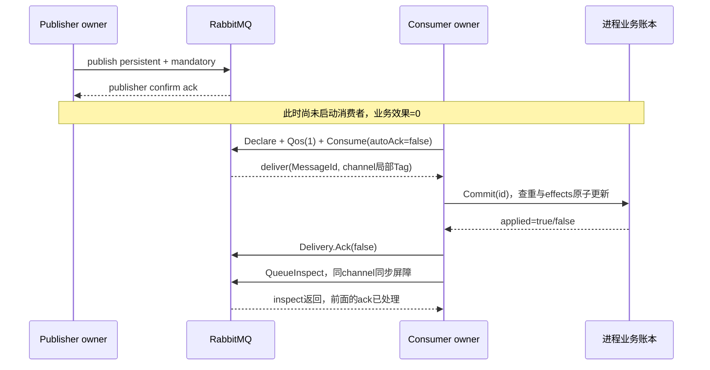

# M28：RabbitMQ 的消息责任在哪一步转移

这课的业务只有一件事：收到订单任务后，给订单发一张合成优惠券。`Ledger.effects[id]` 是发券事实，RabbitMQ 负责保存、路由和投递任务。程序分别读取两边的状态，回答“发送成功”“消费成功”“业务成功”到底各指哪一件事。

面向熟练 Java 工程师、Go 初学者。第一次按下面的核心入口阅读，约 10～20 分钟可以跑完并讲清；默认入口再展开 context、毒消息、并发 ack 和 channel 错误。文档直接给出坏例、修复和解析，不需要另做 exercise。

```powershell
# 从仓库根执行；嵌套 module 必须通过 -C 选择。
go -C lessons/m28_rabbitmq_delivery run ./cmd/demo -only=core

# 默认 all 包含本课全部八组真实 broker 断言。
go -C lessons/m28_rabbitmq_delivery run ./cmd/demo
go -C lessons/m28_rabbitmq_delivery test -v ./...
go -C lessons/m28_rabbitmq_delivery vet ./...
```

运行需要 M00 已验收的基础设施契约，以及安装者发布的 RabbitMQ `READY`。默认只读 `D:/IdeaProject/go-demo/.local/course-orchestrator/infra-services.json`，可通过进程环境变量 `GOLEARN_SERVICE_INDEX` 指定另一份同结构索引。缺失/非 READY/鉴权失败会返回错误，程序不会用本地 channel 假装 MQ 验收。

```json
{
  "services": {
    "rabbitmq": {
      "state": "READY",
      "host": "127.0.0.1",
      "port": 5672,
      "server_version": "由安装者实测填写",
      "credential_file": "已忽略私有JSON的绝对路径"
    }
  }
}
```

这里端口仅是结构示意，不是现行端点；实际端口以索引为准。私有 JSON 字段是 `username/password/vhost`，没有将真实秘密放进课程。使用安装者创建的独立 vhost `/golearn_m28`，账号仅有该 vhost 的 configure/write/read 权限。不要打印整个 Config、URI 或秘密 JSON。首次安装、安装锁、服务器容量、隧道 owner 和持久恢复属于安装者；本课不升级、重启或停止 broker。

## 现在需要掌握的最小规则

| 名称 | 本课实际值/作用 | 不能推出的事实 |
| --- | --- | --- |
| Connection | 一条真实 TCP/AMQP 连接，`Session` 拥有 | 连接活着不表示业务已完成 |
| AMQP Channel | Connection 上的逻辑会话，保存 confirm/consumer/delivery tag 状态 | 它不是 Go `chan`；数字 tag 不能跨 Channel 移植 |
| direct exchange | `.work.x` 根据 routing key 精确匹配 binding | exchange 不是保存业务状态的数据库 |
| queue + binding | `.work.q` 绑定 `.work.x` 的 `work`；`.dead.q` 绑定 `dead` | 名字相同不能用不同声明参数重定义 |
| durable | 三个 exchange/queue 的声明属性 | 单节点不提供副本；本次连接故障不等于 broker 重启验收 |
| persistent | 每个 publish 的 `DeliveryMode=2` | 单独设置属性不等于已拿到 confirm，更不等于消费完成 |
| mandatory | 路由失败时要求 `basic.return` | `confirm=ack` 仍可能同时有 return |
| publisher confirm | broker 对发布的责任边界 | 不知道哪个消费者完成了业务 |
| manual ack | `Consume(autoAck=false)`；业务后 `Delivery.Ack(false)` | Ack 返回 nil 通常只是异步确认帧写出 |
| prefetch | `Qos(1,0,false)` 限制消费者未确认额度；并发反例用2 | 它不让业务数据库提交和 ack 组成一个事务 |
| message_id | 本课的业务幂等键属性 | broker 不据此自动去重 |
| redelivered | broker 标记这次 delivery 是重投 | false 也可能是发布者重新发送的业务重复；不能只在true时查重 |

Go 本课使用 `:=` 创建局部变量；`if err := ...; err != nil` 中的 err 只活在该 if。`*Session`、`*Consumer`、`*Ledger` 是共享对象指针；`amqp.Delivery` 是值副本，但其 `Acknowledger` 接口仍引用原 AMQP channel。复制 Delivery 不会复制 broker 责任，也不会把 tag 变成全局 ID。`defer` 在所在函数返回时执行；入口先让 `run` 返回再 `os.Exit`，让资源清理能发生。

把 Go goroutine 类比为线程池中的任务有助于定位 owner，但创建 goroutine 没有自动 join。`context` 类比取消令牌，只会发通知，具体等待需要显式观察。业务账本锁可类比 Java 临界区；它只提供本进程内原子性，不能冒充持久数据库事务。

## 阅读顺序和完整调用链

1. `cmd/demo/main.go`：`main → run`，解析 `-only`、加载配置、建立 Ctrl+C/90s 总预算。
2. `internal/lab/config.go`：`LoadConfig → 只读 READY 索引 → 私有凭据 → Config.uri`，连接字符串只在内存传给 DialConfig。
3. `internal/lab/experiments.go`：`Run → execute → scenario.fn`。每组 9s，有独占 run 名称和新的 Ledger。`execute` 拥有发布者和删除资源的 defer。
4. `internal/lab/broker.go`：`Connect → net.Dialer.DialContext → amqp.DialConfig`；`NewPublisher → Connection.Channel → NotifyReturn/NotifyClose → Confirm(false)`；`Topology.Declare → ExchangeDeclare → QueueDeclare → QueueBind`。
5. 每条消息沿 `Publisher.Publish → PublishWithDeferredConfirmWithContext → DeferredConfirmation.WaitContext` 返回。消费沿 `scenario.consumer → Connect → NewConsumer → Declare/Qos/Consume → Consumer.Next → Ledger.Commit → Delivery.Ack(false) → Barrier`。
6. `internal/lab/faults.go`：在真实路径上制造 Write 屏障、消费者断连接、并发提前 ack、foreign channel tag 异常；失败同样返回统一 owner 清理。
7. `internal/lab/ledger.go`：`Commit` 把查重标记与 effects 增量放在同一把锁里，`Count` 给独立业务断言读取。
8. `internal/lab/lab_test.go`：默认跑并发账本和取消后真实 join 的断言；开启 `GOLEARN_M28_INTEGRATION=1` 才再次跑八组真实 AMQP 实验。

读函数签名时，`func (s *scenario) consumer(...)` 中的 `(s *scenario)` 是指针接收者：`s.consumer` 调用时把同一个 scenario 对象交给方法，不是重新复制它。`func() { ... }` 是闭包；defer 中的闭包捕获外层变量，退出时读取并更新同一个具名 `result`，因此清理错误能和原错误一起回到 caller。`<-chan T` 只允许接收，库拥有的通知流不能由课程 close；`chan struct{}` 的空结构体不携带业务消息，只利用关闭事件广播“已停止/已完成”。`flag.String` 返回 `*string`，入口的 `*only` 读取 flag.Parse 后的值；测试的 `for range 24` 只表示执行24次，没有隐含线程池。

所有创建的消息、队列、exchange、consumer 都属于形如 `golearn.m28.r<纳秒>.<scenario>` 的本 run。README下面使用 `poison`、`confirm-A` 这些短标签；源码 `scenario.id` 把它们变成带完整run/队列前缀的真实 MessageId/ledger 键。每组最多三个队列，`x-max-length=32`；work/retry 的溢出策略是拒绝发布，publisher confirm 会据此给 nack。三个队列依次为 work、retry、dead。实验串行执行和清理，同时最多三个连接、六个逻辑 channel。没有 broad scan-delete、purge 他人队列或 broker 进程故障。

## 核心时间线：publish → confirm → deliver → commit → ack



这张图是本课有意建立的先后关系。真实系统里消费者可以在发布者观察到 confirm 之前拿到消息，confirm 与 delivery 的网络调度不能被图误写成全局保证。业务 commit 与 ack 是两个系统的两次操作，中间一定有失败窗口。

| 步骤 | 参与者/具体等待 | broker 状态 | 独立业务事实/下一步 |
| --- | --- | --- | --- |
| 1 | 主 goroutine 在 `Publisher.Publish → dc.WaitContext` 等待 | 发布已交给broker；confirm后责任成立 | ledger仍为0，不能在这里声称发券完成 |
| 2 | 主 goroutine `Barrier(pub.Ch, workQ)` 等 declare-ok | ready=2，没有consumer | 代码尚未调用Commit，是确定屏障 |
| 3 | `Consumer.Next` 等真实deliveries或close/cancel/ctx | prefetch=1只交付A，B仍ready=1 | A有delivery不等于发券，effects=0 |
| 4 | 主goroutine进入`Ledger.Commit(A)`，在mutex等待/持锁 | A仍未确认 | effects=1与applied=true一起发生 |
| 5 | `Delivery.Ack(false)` 返回，再同channel `Barrier` | broker按顺序处理ack，释放prefetch额度 | B才有机会继续投递；账本读取仍单独断言 |
| 6 | B同样commit→ack | 两条任务完成责任转移 | A/B各effects=1，关闭消费者后清理拓扑 |

运行 `-only=confirm` 对照 `CONFIRM ready=2 ... effects=0`、`DELIVER ... ready=1 ... effects=0`、两条 `COMMIT`。这些行分别来自 confirm、真实 QueueInspect、真实 Delivery 和 Ledger.Count；不是用一条“成功”日志代表四种事实。

## 核心反例：先 ack 的消息真的丢了处理机会

`-only=recovery` 第一段明确执行 `d.Ack(false)`，业务没有 Commit。随后同 channel inspect 做协议屏障，再关闭消费者 Connection、从发布者 channel 检查 ready。结果必须同时为 `ready=0` 与 `effects=0`，才打印 `EARLY_ACK`。

| 时点 | 消费者动作 | 责任/后果 |
| --- | --- | --- |
| A拿到delivery | 还没提交业务 | broker仍持有未确认责任 |
| 提前Ack | broker收回消息 | 应用把责任交还，业务却没完成 |
| Barrier→关连接 | ack已经先被broker处理 | 连接结束不再引起A重投 |
| owner查询 | ready=0且effects=0 | 任务没了，券也没发；消费者重试已无消息来源 |

这相当于在 Spring 事务还没 commit 前确认 MQ，但 Go 没有一个自动事务代理替本课修正顺序。修复不是在 Ack 之后补一条日志；是改变真实执行顺序为 commit→ack。

第二段在 `Ledger.Commit(commit-before-disconnect)` 成功后、ack之前，直接关闭这个消费者的真实 socket。原 Delivery 的 `Ack(false)` 必须返回错误。恢复建立全新 Connection/Channel，重新执行 topology 声明、Qos 和 Consume，等待同 MessageId 且 `Redelivered=true` 的真实消息。

恢复时 `Commit` 返回 `applied=false`，因为本进程账本已记录这笔业务；效果仍为1，然后 ack这一次新delivery。接着发布并处理 `after-reconnect`，证明恢复后仍可持续接新任务。`RECOVERY old_tag=1 new_tag=1` 如果出现，是两个 channel 的各自序号重新从1开始，不是旧tag恢复了身份。

本课账本在同一进程里存活，因此验证的是“消费者连接中断后业务效果唯一”。没有验证进程宕机后账本保留。生产实现需要把幂等记录与真实发券/订单变化放入持久事务、唯一键或可对账的外部幂等接口；纯内存 map不能提供跨进程 exactly-once。

## 重发也会重复：message_id 不是 broker 去重开关

`-only=duplicate` 将同一 `duplicate-id` 真正发布两次，分别等待 confirm，先断言 ready=2，再消费两次。首次 Commit applied=true，第二次 applied=false，兩次delivery都ack；最终 `broker_deliveries=2 business_effects=1`。

发布者丢失 confirm 响应后只知道结果未知，重新发送可能形成这类重复。`Redelivered=false` 的第二条仍可能是同业务事件，因为它是一次新publish。业务查重应检查业务键与持久事实，不能只看 redelivered 或 delivery tag，也不能认为给 MessageId 赋值就让 RabbitMQ承担幂等责任。

## 扩展一：mandatory return 与 confirm 是独立信号

`-only=return` 使用已有 `.work.x`，routing key=`missing-binding`，mandatory=true。发布者仍得到ACK confirm；`NotifyReturn` 单独得到 `ReplyCode=312`、同 MessageId 和原routing key；ready=0、effects=0。

这不是 consumer 报处理失败。broker处理了这次发布并发现无匹配队列，return告诉发布者需要处理路由错误。两个通知各有缓冲，最大一条发布在途，owner分别等待；生产并行发布需要按 message_id/sequence 关联，并持续接收通知。关闭通知/channel要结束等待，不能把永远收不到return当成功。

不要把“Publish返回nil”“confirm ack”“已路由”“发券成功”合成一个布尔值。本课每种事实都有不同的读取来源。

## 扩展二：PublishWithContext 的真实取消范围

本课锁定 `amqp091-go v1.15.0`，实际下载源码中 `PublishWithContext` 与 `PublishWithDeferredConfirmWithContext` 在入口检查 `ctx.Done()`，开始后进入不感知 context 的 Publish/I/O。较老版本材料说完全忽略context，在当前锁版上不成立。可选自动恢复也已存在；本课显式 `Recovery:nil` 使用手工恢复。版本更换必须重新读源码和运行实验。

`-only=cancel` 首先传入已取消的context：返回 `context.Canceled`，publish序号不增长，ready=0。随后 `transport.Write` 截住真实TCP上的一次Write：

| 顺序 | owner/等待位置 | 确定事实 |
| --- | --- | --- |
| 1 | owner arm `writeGate`；新publisher goroutine进入Publish | 底层Write发出entered，表明发送调用已开始 |
| 2 | owner收到entered，然后cancelSend | sendCtx.Done已关闭；Connection自己的scenario ctx仍正常 |
| 3 | publisher仍在`<-gate.release` | ctx通知不会解除当前I/O，`ownedTask.finished`尚未关闭 |
| 4 | owner打开release | 原AMQP字节继续写真实RabbitMQ |
| 5 | publisher返回nil；owner用独立scenario ctx接收`NotifyPublish` | in-flight取消没有改变返回；真实confirm由另一段等待单独证明 |
| 6 | owner从真实broker收到`inflight-canceled` | 消息仍产生effects=1；停止确认等待没有撤回副作用 |

这个屏障只是本课对自己的socket的一次I/O暂停，RabbitMQ仍是真服务。不是用Go channel模拟队列。实验不声称模拟了broker宕机/网络分区；它准确定位“context无法自动中断开始后的调用”。发布goroutine由`ownedTask`保存结果与最终完成广播，defer先释放屏障/必要时关闭自己的socket，再用独立3s预算等待finished，失败不会把自己的Write永久留下。其他实验的`dc.WaitContext`把确认等待owner放在当前goroutine；它的ctx取消只停止等待。如果确认与取消同时就绪，select不承诺固定选择。

`Session` 的scenario watcher会在总预算到期时关闭自己的socket，这是本课owner主动解除I/O；和Publish API自己支持context是两回事。确认等待返回Canceled/DeadlineExceeded后，消息结果仍可能未知，恢复应靠业务幂等、记录和对账。

## 扩展三：有限 retry、nack/requeue 与毒消息 DLQ

`-only=retry` 对两个ID采取不同策略。`transient` 首次失败只允许一次 `Nack(false,true)`，第二次实际 delivery要求 `Redelivered=true`，成功commit→ack。这个一次重试计数仅用于本run的演示；它不提供进程重启后的策略记忆。

`poison` 每次都业务失败，从不增加effects。第0/1次失败把 `attempt=1/2` 新消息送入 `.retry.x → .retry.q`，等待publisher confirm后才ack旧delivery。retry队列有真实broker TTL150ms、DLX指回work；消费者在Next等实际delivery，没有sleep猜测TTL到期。计数保存在消息header，重建消费者不会让该消息的attempt归零。

第2次attempt（总第3次业务失败）使用 `Nack(false,false)`，work队列DLX将消息路由到dead。程序用真实basic.get等到DLQ消息，核对 `message_id=poison`、`x-death`、毒消息总3次/transient总2次，并单独断言 `poison_effects=0 transient_effects=1`。读取dead后manual ack、协议屏障，然后删除本组。

| 对象 | 本课上限 | 业务/协议证明 |
| --- | --- | --- |
| transient | 2次delivery，最多一次立即requeue | 第二次redelivered，最终effects=1 |
| poison | attempt=0/1/2，总3次失败 | 最终dead真实消息有x-death，effects=0 |
| retry等待 | broker TTL150ms，scenario最多9s | 不断言精确耗时；只认真实delivery |
| 全部消费循环 | 最大5条delivery | 超出次数不继续忙循环 |

“转发retry成功→ack旧消息”也有重复窗口，不能声称是原子搬迁。这里TTL死信与最终Nack的DLX使用单节点classic队列，观察到迁移不等于验证了broker崩溃/目标队列不可用时的可靠死信。生产要求更强保证时应选择合适队列类型/死信策略并单独验收，不把本课简化路线当完整生产方案。DLQ需要后续告警、诊断与人工/程序修复，本课精确清理合成毒消息而不做无限自动回放。

## 扩展四：并发 Ack(multiple=true) 会确认没完成的前项

`-only=multiple` 使用prefetch=2，同channel收到A(tag1)/B(tag2)。两个真实业务worker：A发started然后在release/ctx等待，未提交；B真实Commit并把结果送给owner。owner等到A已进入屏障、B已返回，读取 `A_effects=0 B_effects=1`，再ack B。

坏例 `db.Ack(true)` 把该channel上截至tag2的所有未确认消息都ack了。owner通过同channelBarrier确保broker处理ack，再取消A、join两个worker、关闭Connection。此时ready=0而A_effects=0，证明A的处理机会真的被误确认丢失，不能用日志“B成功”掩盖它。

修复路线只改成 `db.Ack(false)`。同样取消A并关闭Connection之后，`awaitReady` 通过真实inspect观察ready达到1，再由全新消费者实际收到redelivered A并commit→ack，A/B最终effects各1。close返回到broker重新入队涉及不同参与者，所以这里轮询可观察状态；10ms timer仅节制观察频率，不以等待一段时间冒充消息已回队列。即使某条发送路径有client锁、没有帧交错，也不能让multiple知道哪个业务任务已完成。当前客户端文档明确不保证跨goroutine共享Channel；本课两个业务worker只访问Ledger，AMQP Ack统一由owner串行执行，仍能复现业务并发的误确认。若生产要批量ack，需要owner追踪已完成的连续前缀；单条ack是本课清楚的修复。

| goroutine | owner | 实际等待 | 停止/join |
| --- | --- | --- | --- |
| A业务worker | concurrentAck | release 或 workers.Done | owner cancelWorkers，等aDone.finished；没有释放业务屏障所以不提交 |
| B业务worker | concurrentAck | Ledger的mutex；完成后关闭bDone.finished | owner先join B读取其结果再ack |
| connection watcher | Session | scenario ctx.Done 或 Session.stop | Session.Close关闭stop/socket并读done |
| context实验publisher | cancelExperiment | Write.release；确认等待由外层owner另做 | defer打开release、cancelSend、必要时关闭socket，独立预算等finished |

`ownedTask.start`先注册最终close(finished)，执行work并等待它内部defer完成，再保存result，最后关闭finished。owner在观察关闭后才读取result，且可以重复join；不是消费一次业务结果就当成收尾完成。`TestTaskJoinAfterCleanup`把worker的defer停在独立清理屏障，真实断言cancel已观察时finished仍未关闭，放行后join才保留原取消错误。本课没有依赖goroutine创建顺序。Cancel通知、worker观察、函数退出、资源清理、owner join分别发生，不能把一次cancel调用当作所有后台工作已停。

## 扩展五：delivery tag 属于收到它的 channel

`-only=tag` 原consumer持有未确认delivery，再在同Connection的新channel直接 `foreign.Ack(oldTag,false)`。这个channel没收过该tag。Ack写帧可以返回nil，随后NotifyClose必须收到真实406 unknown delivery tag；原channel仍开放，原消息照常Commit→Delivery.Ack(false)，effects=1，Connection未关闭。

不要由此推断“跨channel一定报错就不会误伤”：如果另一个channel碰巧有相同数字tag，它可能确认另一个业务消息。正确方式是保留原Delivery/Acknowledger，在拥有它的channel上确认；旧channel关闭后旧Delivery不能复用。恢复重建consumer和topology，不把旧tag搬到新channel。

## 清理、测试与证据的边界

每组 `execute` 用具名error与 `errors.Join` 汇总主错误、消费者close、发布连接close、删除和join错误。消费者defer先返回并Close/join后，外层用新的5s cleanup context建独立连接，精确删除本组3个queue/3个exchange。每个删除对象用临时channel并立刻关闭：部分Declare失败时，一个不存在对象的404不会毁掉后续对象的清理路径；只接受准确的协议404作为“已经不存在”，其他错误如实返回。`noWait=false` 等broker的delete响应。连接CloseDeadline有独立3s握手预算，显式Recovery=nil，没有自动重连在后面偷偷拉起资源。

所有阻塞都可由scenario ctx（9s）/run工作ctx（90s）或自己的socket关闭解除，收尾另有独立预算。NotifyClose/NotifyReturn/NotifyCancel有缓冲；Next对channel提前关闭、broker取消和ctx都有错误路径。本课自己拥有的worker/publisher通过只关闭的finished报告最终完成，提前失败也执行cancel/解除屏障/必要socket关闭/独立预算join；首次join超时不标为已完成，defer继续收尾。剩余服务与SSH隧道由安装者持有，课程退出不会停止它们。

```powershell
# 显式重跑全部真实broker实验的测试，和普通纯业务单测分开。
$env:GOLEARN_M28_INTEGRATION = '1'
try { go -C lessons/m28_rabbitmq_delivery test -v -count=1 -timeout 120s ./... }
finally { Remove-Item Env:GOLEARN_M28_INTEGRATION }
```

Windows race需要可工作的amd64 C编译器。本机安装者把只读定位放在 `.local/course-orchestrator/toolchain.json`。执行时仅在当前进程设CC/CXX/CGO_ENABLED/PATH，finally恢复；不写go env或系统PATH。实际命令/结果和broker版本见[STATUS](STATUS.md)。默认TestIntegration明确SKIP，普通test/race证明Ledger并发原子性和owner收尾；只有显式integration/demo运行才证明真实AMQP行为。

```powershell
# 只做账本并发和owner收尾race。
& ./lessons/m28_rabbitmq_delivery/scripts/verify-race.ps1
# 在READY broker上，把全部真实消息实验也纳入race。
& ./lessons/m28_rabbitmq_delivery/scripts/verify-race.ps1 -Integration
```

2026-10-12 已在实际 Go1.27.0、amqp091-go v1.15.0、RabbitMQ4.3.6 上跑完默认八组，并在开启 integration 的 race 下再次全部通过。实际 loopback 端点为127.0.0.1:15673，运行时仍读安装者索引。可以直接对照[完整 demo 原始输出](evidence/demo.txt)中的 `CONFIRM/RETURN/CANCEL/EARLY_ACK/RECOVERY/DUPLICATE/DLQ/MULTIPLE_BAD/MULTIPLE_FIXED/TAG_FOREIGN`，以及[race 原始输出](evidence/race.txt)中的三个真实 PASS。两轮各精确删除24个课程队列和24个课程 exchange，最终进程退出；安装者持有的服务继续保留。

现在先理解责任转移、channel归属、取消/清理、重复窗口与幂等。AMQP帧二进制格式、集群副本、quorum流控、高吞吐confirm窗口和生产监控可在遇到相关代码时再查，本课没有把它们写成已验范围。

## 本次核对的官方入口

实际采用[官方维护客户端 v1.15.0](https://github.com/rabbitmq/amqp091-go/releases/tag/v1.15.0)。阅读时对照已下载module的 `channel.go` 中 `PublishWithContext`、`PublishWithDeferredConfirmWithContext`、`Ack`、`Qos`、`Consume`，`confirms.go` 中 `WaitContext`，`connection.go` 中 `Config.Recovery`、`DialConfig`、`CloseDeadline`。本课以实际下载源码和实验为版本事实；在线页面缓存可能滞后。本次另从官方raw URL实际下载了同tag channel.go，与module cache SHA256完全一致，`go mod verify`通过。

责任边界可查[confirm/consumer ack官方指南](https://www.rabbitmq.com/docs/confirms)，基本工作队列入口是[Go work queues官方教程](https://www.rabbitmq.com/tutorials/tutorial-two-go)，死信配置入口是[dead letter exchanges官方文档](https://www.rabbitmq.com/docs/dlx)。本课在教程基础上补了独立业务断言、有限故障和owner清理；教程里的演示sleep不会被本课当作提交或调度屏障。
