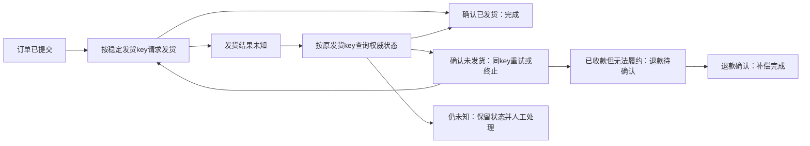

# M30：MySQL + Kafka，outbox、inbox 与结果未知

这课的业务很具体：下单扣源库存，Kafka 通知另一个服务扣它自己的库存投影。两个服务各有一份库存，源订单写成功与下游效果成功是两件事。实验会真正把订单进程、relay 进程和消费者进程强制结束，再启动新进程查原数据库与 Kafka，观察哪些事实已经留下。

先掌握一条规则：**订单、源库存、outbox 在同一个 MySQL Tx；inbox、下游业务效果在消费者自己的同一个 Tx；消费者业务提交成功后才确认安全 offset。** 两个 MySQL 事务与 Kafka 之间仍有窗口。可靠恢复靠稳定 ID、权威查询和幂等，不靠给一个本地函数起名叫“分布式事务”。

本课是独立 module `go-demo/lessons/m30_outbox_idempotency`，Go 1.27.0。真实依赖锁在本课 go.mod/go.sum：mysql driver 1.10.1、franz-go 1.22.1、kadm 1.19.0。使用安装者的 MySQL 8.4.11 / Kafka 4.3.1，入口分别 `127.0.0.1:13306` / `127.0.0.1:19192`，库 `golearn_m20`，Kafka 单节点 KRaft / PLAINTEXT / none。没有新建隧道、停止服务或操作 DeepHelp 数据。

## 10～20 分钟核心实验

程序通常在数十秒到两分钟完成；阅读和对照约十五分钟。只有一个“订单 → 消息 → 下游效果”实验，E01～E08 是它的失败/恢复分步，没有额外 exercise。

| 时间 | 看什么 | 现在必须理解 |
| --- | --- | --- |
| 0～3 分钟 | 跑默认入口，读 E01/E02 | 两坏顺序；发送 error 与 broker 是否接受分开查 |
| 3～7 分钟 | `Store.Place/withTx/QueryOrder` 与 E03 | 显式 Tx、稳定原 key、提交前后强杀 |
| 7～11 分钟 | `RelayOne/Apply/ConsumeOne` 与 E04～E06 | ACK→sent 的窗口；inbox+效果原子性；业务→offset 的窗口 |
| 11～15 分钟 | E07/E08 与最终查账 | 先 offset 会漏效果；聚合版本乱序停止进度；受控恢复 |
| 15～20 分钟 | `runChild/Client.Close/Cleanup` | ready/result/ACK/commit/offset/finalDone不同；精确清理读回 |

在仓库根目录运行：

```powershell
go -C lessons/m30_outbox_idempotency run ./cmd/demo
go -C lessons/m30_outbox_idempotency test -v -count=1 -timeout 30s ./...
go -C lessons/m30_outbox_idempotency vet ./...
go -C lessons/m30_outbox_idempotency mod verify
```

默认入口直接执行真实 MySQL+Kafka，不需要测试开关。默认 `test` 有五个 Go/协议辅助断言，`TestRealMySQLKafka` 明确 SKIP；SKIP 不算实库验收。全量真实测试需显式开启：

```powershell
$m30IntegrationExisted = Test-Path Env:GOLEARN_M30_INTEGRATION
$m30SavedIntegration = [Environment]::GetEnvironmentVariable('GOLEARN_M30_INTEGRATION', 'Process')
try {
    $env:GOLEARN_M30_INTEGRATION = '1'
    go -C lessons/m30_outbox_idempotency test -v -count=1 -timeout 6m ./...
} finally {
    if ($m30IntegrationExisted) {
        [Environment]::SetEnvironmentVariable('GOLEARN_M30_INTEGRATION', $m30SavedIntegration, 'Process')
    } else {
        Remove-Item -LiteralPath Env:GOLEARN_M30_INTEGRATION -ErrorAction SilentlyContinue
    }
}
```

保存“变量是否存在”和“原值”两项，才能区分缺失、已有空字符串、已有非空值。缺失变量用 `Remove-Item` 真正删除；已有空值也按原值恢复，不把 `$null` 传给字符串参数后误留下空变量。此处只改变当前 PowerShell 进程。

Windows amd64 的真实 race：

```powershell
& ./lessons/m30_outbox_idempotency/scripts/verify-race.ps1 -Integration
```

脚本只读安装者既有 `D:/IdeaProject/go-demo/.local/course-orchestrator/toolchain.json`，临时设置自身进程的 CC/CXX/CGO_ENABLED/PATH 和 integration 开关，finally 恢复并输出 `M30_RACE_ENV_RESTORED=True`。不安装编译器、不改系统 PATH、不执行 `go env -w`。只运行脚本不带 `-Integration` 时实库测试仍是 SKIP。

配置入口默认只读 `D:/IdeaProject/go-demo/.local/course-orchestrator/infra-services.json`；`GOLEARN_SERVICE_INDEX` 可覆盖**文件路径**。凭据从它的 `credential_file` 只在内存读取，不复制/输出 DSN 或密码。缺少 READY/loopback/独立学习库会失败，不改成 mock。

## 从入口到副作用的阅读顺序

| 文件与符号 | 谁调用 → 职责 → 返回给谁 |
| --- | --- |
| [cmd/demo/main.go](cmd/demo/main.go) `execute/main` | 命令入口 → 建3分钟业务预算或进入已登记子进程 → Run全部收尾后决定退出码 |
| [internal/lab/config.go](internal/lab/config.go) `LoadConfig/openDB` | Run/Child → 只读端点和秘密，真实核对SQL版本/库 → 交出owner必须Close的DB池 |
| [internal/lab/experiments.go](internal/lab/experiments.go) `Run/setup/E01～E08/totals` | 入口 → 先登记资源，准备合成数据，安排故障与恢复，独立断言 → 业务及清理错误 |
| [internal/lab/store.go](internal/lab/store.go) `Place/withTx/QueryOrder/recoverOrderDuplicate` | 请求/子进程 → 库存+订单+outbox同Tx，检查整棵错误树后才恢复安全1062，原key查询 → 稳定Event/UNKNOWN/业务及清理错误 |
| 同文件 `Apply/Snapshot/Verify` | consumer/验收 → inbox+效果同Tx，版本校验，锁定读后查账 → 实库持久事实 |
| [internal/lab/kafka.go](internal/lab/kafka.go) `RelayOne/produce` | relay子进程 → 读提交outbox，真实ACK后sent更新 → 独立投递事实 |
| 同文件 `ConsumeOne/pollOne/VerifyOffset/Records` | consumer/验收 → 真poll，业务Tx成功后commit offset；admin/直分区读回 → broker事实 |
| [internal/lab/process.go](internal/lab/process.go) `runChild/Child/gate` | case owner → 新OS进程，等待真实边界ready，Kill、Wait、再重启 → 崩溃位置与完成事实 |
| [internal/lab/fault.go](internal/lab/fault.go) `ProduceFault.Dial/faultConn.Read` | E01/E02独占producer → 实际TCP关闭/真实Produce响应丢失 → 客户端error与仪器观察 |
| [internal/lab/lab_test.go](internal/lab/lab_test.go) | testing → 辅助断言/显式全量实库 → PASS、SKIP或原始失败 |

正常路径完整调用链：

```text
main → execute → Run
  LoadConfig → openDB → Store.Create → openBroker
  setup → Seed(源库存10/下游库存10) → Topic/Group不存在核验与独占登记
  Store.Place(Request)
    QueryOrder(original key)
    withTx → DB.BeginTx → 立即defer Rollback
      Tx SELECT stock FOR UPDATE → 再查原key的current read
      Tx UPDATE源库存/版本 → INSERT订单 → INSERT稳定event_id的outbox
    Tx.Commit → MySQL确认 → deferred Rollback=ErrTxDone
  runChild(relay-recover) → Child → RelayOne
    Pending(已提交outbox) → produce → kgo.ProduceSync → broker ACK
    UPDATE outbox.sent=true → child Close/Wait退出0
  ConsumeOne → PollRecords(max1)
    Store.Apply → withTx
      INSERT inbox(event_id PRIMARY KEY) → 锁投影/校验version → UPDATE效果
      Tx.Commit
    CommitRecords(record) → broker next=record.Offset+1
  Verify → 锁定读/SQL计数；VerifyOffset → admin FetchOffsets
  totals → 最终总量 + 每topic真实内容数
  deferred Broker.Cleanup → group/topic删除协议读回
  deferred Store.Cleanup → 精确DROP/information_schema读回
  deferred DB.Close → open/inuse=0 → main报告完成
```

这里 `*sql.DB` 是连接池指针，`*sql.Tx` 是绑定一条连接的事务指针，Store 借用 DB 而不拥有关闭权。回调 `func(*sql.Tx) error` 在当前 goroutine 同步执行；闭包捕获当前 `event` 变量，给它补上锁定行的版本，没有异步竞写。`Request/Event` 是小结构体值副本；`*kgo.Record` 和它的 Key/Value 字节数组交给驱动后不再修改。

`:=` 在当前代码块声明变量，`if q := ...` 的 q 只在 if 内有效；代码明确 `return q`，不会吞掉内层错误再由外层 nil 去提交。方法接收者 `(s *Store)` 让函数借同一 Store/DB；接收者不是线程绑定的事务。Java/JDBC 可帮助识别 Tx 对应的单连接边界，但 Go 的 `database/sql` 没有 Spring 的调用栈/线程事务传播，每条事务 SQL 都必须写成 `tx.ExecContext/QueryRowContext`。

## SQL 和消息的最小契约

每轮随机 `m30_<16位hex>` 的五张表都为 InnoDB，创建前核验不存在。`stock` 保存源库存/版本；`orders.request_id` 主键绑定原请求；`outbox.event_id` 主键保存要通知的事实与 sent；`inbox.event_id` 主键防下游重复；`projection` 保存下游库存/版本/effects。每个 SKU 初始两处库存均10，订单数量为1。只有 ordering 同 SKU 下两笔订单。

event_id 是 `SHA256(original request key)` 的64位hex，跨子进程/重投稳定。订单表同时保存 SKU/qty/version；原 key 改 quantity 直接 `ErrKeyConflict`。inbox 同 ID 重来只在 payload 全部一致时跳过效果，同 ID 改 payload 也拒绝。生产系统还需定义 key 的租户范围、保留期、重试窗口和负载指纹；这里的 key 带本 run 命名空间。

`withTx` 在 Begin 成功后立即登记 Rollback，callback完整返回 nil 才显式 Commit。普通 error、取消、panic展开会先退出清理；panic不自动给 err赋值，但这里根本不依据defer中的err提交。Commit失败保留 `ErrUnknown` 和底层原因；`ErrTxDone` 仅表示本地Tx结束，不能证明服务器没提交。强杀子进程跳过所有defer，所以回滚依赖实际socket断开后的MySQL事务结束。`Snapshot`对源库存、投影和inbox做锁定读后统计，避免一次MVCC快照看不到未提交行就误报“已回滚”。

Outbox修的是“业务已提交就一定留下待发送记录”。Relay ACK后才标sent，二者不是原子操作。消费者inbox修的是“同一事件可以反复到达，但SQL效果只有一次”。Kafka offset修的是“下一次从哪里开始消费”，它不替代inbox，也不属于MySQL事务。

## E01～E02：两坏顺序和网络UNKNOWN

| 路径 | 实际时间线与等待点 | 权威结果/业务影响 |
| --- | --- | --- |
| DB-first | Place不开outbox→MySQL Commit→独占producer真实TCP建立后主动关闭，未发Produce→driver返回error | stock9/orders1/outbox0；broker end0/记录0；下游库存10/effects0，订单存在但通知丢了 |
| Kafka-first | Tx扣源库存/插订单→producer真正等待ACK→afterWrites返回ErrEffect→Tx Rollback | 源stock10/orders0；broker确实有孤儿事件；下游消费后stock9/inbox1/effects1/next1，发生无源订单的效果 |
| ACK-lost | DB已提交→真实Produce请求转发→本课连接读到其correlation响应并吞掉→client失败 | 同样返回失败，broker却读到原ID/原payload一条；原key查订单并返回它，无第二次扣减 |

故障 Dialer 只包装本课新 producer 的连接，未监听占用公共端口，未停 broker。E02 故障 producer显式关闭幂等写入并限制重试，目的是定位一条真实ACK丢失；正常relay保留默认幂等producer。截断之后拒绝该故障client重连，所有client/produce任务仍被owner关闭和join。

日志 `SEND_FAILED classification=UNKNOWN` 与 `ACK_LOST classification=UNKNOWN` 对调用者都只表示无法从返回证明业务结果。`before_produce/response_dropped` 是课堂仪器，线上 caller 没有它。实证来自 `BROKER_READ` 的原 ID/值匹配以及 `QueryOrder(original key)` 的权威SQL，不把连接错误当成“broker未接受”。本次 E02 的真实原因是 `unable to dial: M30独占producer ACK丢失后拒绝重连`，但消息已存在。

## E03：订单提交前后强杀

| 步骤 | order-before | order-after |
| --- | --- | --- |
| 1，子进程 | Tx已写源库存/订单/outbox，未Commit | Tx.Commit已经返回nil |
| 2，观测门 | 写ready，当前等ctx.Done；Tx仍占连接 | 写ready，当前等ctx.Done；DB已提交 |
| 3，父进程 | 发现ready→Process.Kill→独立Wait完成，退出1 | 同样强杀与Wait，父请求未收到成功结果 |
| 4，新SQL事务 | 锁定读等断连回滚后stock10/orders0/outbox0 | stock9/orders1/outbox1/sent0 |
| 5，原key恢复 | 本实验原进程已结束，权威记录不存在，可用同key下单 | QueryOrder匹配→恢复COMMITTED并返回原Event |
| 6，重复原key | 两次Place仍订单1/扣减1/outbox1 | 两次Place仍订单1/扣减1/outbox1 |
| 7，独立relay/consumer | sent1/inbox1/effects1/next1 | sent1/inbox1/effects1/next1 |

`PROCESS_CRASH ... ready=true killed=true wait_done=true exit=exit status 1` 来自 Windows `Process.Kill` 与真实 `exec.Cmd.Wait`。普通函数返回ErrEffect只属于E01/E06，不充当process crash。子进程只有一个门，预算50秒；父以门出现这个状态定位，不靠sleep猜调度。

未知请求接口就是 `Store.QueryOrder(ctx, originalKey)`。found=true且业务参数匹配可以返回原订单；found=false只说明此刻没读到。生产中原请求还在执行、读副本延迟或key可重复使用时，必须保留UNKNOWN继续查权威库。本实验额外有原进程Wait与锁定读证明，不把课堂的“已终止后不存在”泛化到任意线上请求。

下单失败的 `recoverOrderDuplicate` 先用 `errors.Is` 检查整棵错误树。1062 同时伴随 `ErrCleanup` 或 `ErrUnknown` 时原样返回所有原因，连“查到原单就成功”的归一化都不能做：查到旧单不证明失败事务的扣减已安全回滚。只在不含这两种严重状态、确为1062、原key权威查询成功且参数一致时恢复原订单。查询失败/参数冲突仍用 `errors.Join` 保留原1062和新原因。

E03 在两种重启恢复后都真实重插已存在订单，MySQL 返回1062，完整回滚后用同一恢复函数查询原订单，日志为 `ORDER_DUPLICATE_RECOVERY ... sql=1062 rollback_safe=true original_match=true`；最后逐SKU断言仍订单1/扣减1/outbox1。辅助 `TestOrderDuplicateRecoveryBoundary` 则构造1062与 cleanup/UNKNOWN 的包装/Join cause，核对拒绝恢复、未调用查询和原cause保留。这些构造cause是错误分类证据，不能当作真实网络或Rollback故障实证。

## E04～E06：至少一次投递，效果唯一

E04 的完整顺序是：父Place提交outbox → relay子进程 `ProduceSync` 收到broker ACK → 尚未UPDATE sent时ready → 父强杀并Wait → SQL sent0 → 新relay进程读同一pending event_id → 第二次ACK、sent1 → broker读出**两条ID/payload相同事件** → consumer第一次INSERT inbox+效果Commit、offset next1 → 第二次真实投递命中inbox主键、验证原payload、跳过效果、offset next2。最终source9/orders1/outbox1/sent1/inbox1/projection9/effects1。

这里 Kafka 幂等producer不能去掉跨新进程relay的两次发送。每次新建 producer 的身份和序列不是业务 event_id。我们接受消息重复，以SQL唯一键守业务效果，没有宣称消息恰好一次。

| E05/E06窗口 | 强杀/失败前的等待点 | parent查询与重启后的事实 |
| --- | --- | --- |
| consume-inbox强杀 | INSERT inbox成功，仍在同Tx、尚未效果 | 强杀Wait后inbox0/effects0/next-1；同group新OS进程重投原offset0，成功后inbox1/effects1/next1 |
| consume-commit强杀 | inbox+效果Tx.Commit成功，尚未CommitRecords | 强杀后inbox1/effects1/next-1；新OS进程读原offset0，inbox重复只读校验，effects仍1，next1 |
| effect-fail普通失败 | inbox INSERT成功后返回ErrEffect | 整Tx Rollback→inbox0/effects0/next-1；完整Close后同group新client重投成功，inbox1/effects1/next1 |

`BUSINESS_COMMIT applied=false offset=1` 只在持久inbox确认原事件已经成功时出现；不是“消息被忽略”。业务效果失败时不能提前留下inbox，否则重投会被当成已处理。Inbox同时包含原payload，使event_id复用错误也能暴露；实库还验收同ID改qty被拒绝而效果不变。

## E07：先offset后业务会永久跳过效果

错误子进程先读offset0，再 `CommitRecords` 确认next1，然后在没有业务事务的位置ready，被父强杀。SQL投影仍10/inbox0/effects0，broker next1。同group新client真正加入到Stable成员1后，从已提交位置读取，500ms有界poll没有消息。超时只是观察“当前fixture没有后续消息”的工具；真正的丢效果证据是next1与SQL效果0，以及原消息仍可从broker直分区读到。

恢复只针对课程独占资源：新登记repair group从start重放确切原事件，先MySQL业务Commit，后offset next1。原错误group不做全局reset。生产回放必须基于已核验的范围/幂等契约；不能在不清楚已提交效果的情况下重置所有消费者。

正常代码 `ConsumeOne` 的顺序就是E05的修复：`Apply` 返回成功后才CommitRecords。此课一个partition、串行max1，没有尚未完成的更低offset，所以该记录r的安全进度就是r+1。如果改为同分区并发，不得让高offset先完成就越过低offset；需复用M29的已投递连续完成前缀，而不是拿最大完成数。

## E08：同聚合乱序必须检测

源库真实下两笔同SKU订单，版本v1/v2、库存8、outbox2。故障发送顺序为Kafka offset0=v2、offset1=v1。同key只保证分区内**发送到broker的顺序**，不会自动替业务把v2排到v1之后。

消费v2时，`Apply`在同Tx先INSERT inbox，再锁定projection，发现expected1/received2，返回 `ErrVersion`。回滚后inbox0/effects0/projection10，broker next-1。业务契约是停止此partition进度并对账，不能跳过v2确认next1让错误悄悄过去。

受控恢复读取同topic的两条原记录，核对offset0/1、payload以及各原key的源库订单，最多暂存两条；先按v1做SQL效果，再按v2做效果，两条都提交成功后才确认最大已完成连续前缀next2。若中途崩溃，next仍未提交，已成功那条由inbox幂等保护。最终inbox2/effects2/projected8/version2，outbox两条均实际ACK后标sent。这是一个明确、有界的人工恢复步骤，没有通用乱序缓存/Saga框架或并行relay承诺。

默认只有一个relay，父进程等上一relay真正Wait完成才启动下一个。本课的`Pending SELECT`不能防止两个不同relay同时领取。多relay要另行实现claim/lease/CAS或受控SKIP LOCKED，验证过期owner、重复发送及版本顺序，本课未验。

## 完成信号、等待对象和收尾

| 事实/资源 | owner及真实等待点 | 正常/失败收尾 |
| --- | --- | --- |
| produce Result | `produce`拥有辅助goroutine，等kgo promise | Result缓冲1可先送出；之后独立join done；ctx到期先Close自己的client |
| broker ACK | producer `ProduceSync` | 证明broker响应这个发送；不证明outbox.sent、消费者SQL或offset |
| SQL业务Commit | `withTx/Apply` | 同Tx成功才可确认结果；error可能UNKNOWN；普通退出Rollback；强杀由parent查持久事实 |
| Kafka offset | `ConsumeOne → CommitRecords` | SQL成功后确认r+1，再用admin FetchOffsets读回；与poll本地位置不同 |
| ready门 | `Child → gate`，当前等ctx.Done | 只是定位真实边界；父Kill自己的process并Wait，普通取消仍会跑defer |
| 子进程finalDone | `runChild`唯一Wait goroutine | Start后立即有保护defer，父任一早退Kill+独立Background10s Wait join；只在done后读waitErr |
| kgo后台任务 | `Client`，lifetime/连接/组协调 | 允许rebalance→独立8s Leave→cancel lifetime→实际Close→独立10s done join |
| DB/Tx | Run父池max2，Child池max1，Tx占各池一连接 | Tx始终owner清理，所有子process Wait后清表，最后DB.Close读Stats0 |
| topic/group/表 | Run/Store/Broker精确名单 | 创建前登记、确认不存在才获得清理授权；每项新预算，失败也继续其它项；协议/SQL读回 |

取消ctx只关闭Done通知，不强杀goroutine，也不能撤销broker/MySQL已接受的请求。`select`中结果和取消同时可读时，不能承诺固定分支顺序。channel close被接收后建立可见性，所以closeErr/waitErr只在done后读。Go没有自动Future/Executor owner；我们显式保存done、cancel和Wait责任。

原业务失败与清理失败通过`errors.Join`共存，`ErrCleanup`让预期发送失败不能遮住关闭/join错误。强杀consumer没有Leave响应，group可能暂留到session超时；cleanup先Describe到无成员才Delete，随后Describe为Dead/不存在。Topic删除与创建均通过锁定kadm版本的`WithAuthorizedOps(ctx)`走真实metadata请求，避开先前不存在结果的缓存；不靠缓存声称删除完成。

每轮资源先登记在忽略`.local/m30_<run>/resources.json`，子进程spec/ready/日志也在那里。测试运行的cwd在internal/lab，因此其报告在`internal/lab/.local/`，同样忽略。逻辑删除不承诺Kafka segment磁盘立刻回收。正常结束最终11topic/12group精确清理读回、5表读回不存在、DB open/inuse=0。

异常group恢复入口只在**原owner已退出、实际日志确认属于本run**后使用：

```powershell
go -C lessons/m30_outbox_idempotency run ./cmd/demo `
  -recover-registry .local/m30_<run>/resources.json `
  -recover-group golearn.m30.<run>.offset-bad.group
```

它只检查登记中的一个精确group并删除/读回，不做前缀扫描；登记文件本身不能证明一个未知同名对象属于本课。真实失败轮和恢复结果详见STATUS。

收尾后可只读核验整份精确登记，包括未实际创建的计划对象：

```powershell
go -C lessons/m30_outbox_idempotency run ./cmd/demo -verify-cleanup .local/m30_<run>/resources.json
```

`RECORDED_ABSENT`来自新的SQL、直接metadata、DescribeGroups和FetchOffsets响应，要求表/topic不存在、group Dead/不存在且offset为空，不删除对象，也不把早期缓存或旧日志当成当前状态。

## 最后查账，不只看成功日志

逐SKU断言是主要证据。最后另用权威SQL/真实topic读回断言：orders11、订单qty11、源库存总99、outbox9/sent9、inbox11、下游库存总99/effects11；11topic合计12条消息，其中relay多一条同ID重投。DB-first丢一个效果与Kafka-first多一个孤儿效果恰好在总量上抵消，**总量相等本身不代表业务正确**，所以E01逐SKU的反例不能省略。

`BUSINESS_ALL_PASS/FINAL_AUDIT`先说明查账通过；真正入口成功在Run的全部defer清理结束后才报告。五个辅助测试分别验证稳定ID/标识符、ready与done分离、真实net.Pipe分段correlation解析、错误身份保留、下单1062恢复边界；net.Pipe和构造的错误cause不是Kafka/数据库故障验收，完整集成才有实broker接受、SQL效果、真实1062与OS强杀证据。

## 前置、来源与边界

已读取M21实际README/STATUS/事务与UNKNOWN代码、M29实际README/STATUS/客户端/offset/关闭契约。复用的是前置已验证的显式Tx、手动offset和owner收尾方式，未复制整套项目、导入其它module internal、修改前置或重跑全部前置。

files/开发框架提供Go数据库/框架学习方向，files/语法进阶/Context和基础defer只作启发。材料说“所有goroutine同步收到取消信号”不能理解为所有任务同步退出：Done关闭是通知，每个任务在自己的等待点观察，最后仍由owner join。defer可以整理普通返回/panic路径，但OS强杀/Exit不会执行，不能用它保证跨系统原子性。

官方核对：[Go SQL事务](https://go.dev/doc/database/execute-transactions)要求事务内操作使用Tx；[Kafka 4.3设计](https://kafka.apache.org/43/design/design/)区分消息交付与消费进度；[franz-go](https://github.com/twmb/franz-go)及本机精确锁定源码校验API。阅读库入口为`kgo.ProduceSync`（producer.go）、`CommitRecords/LeaveGroupContext`（consumer_group.go）、`CloseAllowingRebalance`（client.go），`kadm.Metadata/ListEndOffsets/WithAuthorizedOps`（metadata.go/topics.go）。实际源码符号定位可用`rg`，本课未升级前置依赖或Go工具链。

生产多节点故障、复制/断电耐久性、SASL/TLS、吞吐压力、长期inbox/outbox保留与压缩、多relay领取、公司旧版本不在本轮实证。Kafka本课只一个ISR，AllISRAcks不能扩成多副本容灾证明。重复下单/重投效果唯一只覆盖本课同MySQL Tx里的SQL效果；外部扣款/发货不能由这个Tx回滚。

对于确实不可回滚的外部发货，Saga只给具体状态方向：`订单提交 → 发货请求 → 结果未知则按发货key查询 → 已发货则完成，明确未发货可重试；不可撤销失败则进入退款/人工处理状态`。退款本身仍需要独立幂等key与对账，不把“补偿”写成时间倒流。这个分支是状态设计说明，没有运行外部支付/发货，也没有实现通用Saga框架。


