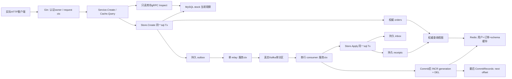
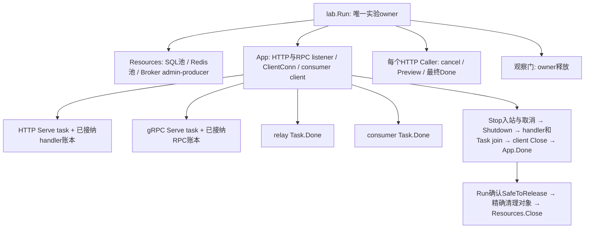

# M37：把真实订单、库存、缓存、gRPC 与 Kafka 接成一条业务

这课已经提供一套可以直接运行的订单后端。Gin 接受创建和查询请求，库存、订单、outbox 在同一个真实 MySQL/GORM 事务提交；后台 relay 发布 Kafka，消费者把 inbox 和消费确认放进另一个 MySQL 事务；Redis 缓存查询视图，一个真实 TCP/HTTP2 gRPC 只读当前库存。核心入口还包含错误、panic、客户端超时、晚回填和提前退出的有界实验，全部由独立响应/SQL/键值/offset断言核对，无需另做练习。

业务很小：一个 `sku-m37`，初始库存10，CNY单价299分，单次1～3件，两个合成身份alice/bob。没有支付、发货、UI和服务平台。这让你能沿一张订单读完所有真实调用，同时保留实际后端必须处理的失败边界。

## 先看数据流与资源 owner





数据 owner 与连接 owner 是两回事。MySQL源表和持久消费表是业务事实；Redis值与查询视图可以重建。安装者拥有三个共享服务和隧道，本课仅拥有自己创建的client、listener、任务及精确合成表/topic/group/键。`App.Stop`发通知，`App.Close`等真实退出，`Resources.Close`最后回收池。不能收到HTTP结果、Kafka ACK或取消通知后就关SQL。

## 15～20分钟核心阅读与复跑

前4分钟读上图和 `Command/Order/Event/View`；接着5分钟从Gin走到 `Store.Create` 的同Tx；再5分钟对照E03/E04的SQL、Redis和offset；最后5分钟读超时与 `App.Close`。程序执行通常为几十秒以内，120秒是保险上限，不是要求等待固定120秒。

本次唯一实施目录是 `C:/Users/Lenovo/.codex/worktrees/go-course-m37/go-demo/lessons/m37_order_backend_capstone`。汇总后也可以从 `D:/IdeaProject/go-demo` 根执行：

```powershell
go -C lessons/m37_order_backend_capstone run ./cmd/demo
go -C lessons/m37_order_backend_capstone test -v -count=1 -timeout 25s ./...
go -C lessons/m37_order_backend_capstone vet ./...
```

根module的 `go test ./...` 不进入嵌套module。普通测试只验证输入、错误树和值/资源同步，三个实库入口明确SKIP。完整真实测试与race：

```powershell
$m37HadIntegration = Test-Path -LiteralPath Env:GOLEARN_M37_INTEGRATION
$m37SavedIntegration = [Environment]::GetEnvironmentVariable('GOLEARN_M37_INTEGRATION','Process')
try {
    $env:GOLEARN_M37_INTEGRATION = '1'
    go -C lessons/m37_order_backend_capstone test -v -count=1 -timeout 180s ./...
} finally {
    if ($m37HadIntegration) {
        [Environment]::SetEnvironmentVariable('GOLEARN_M37_INTEGRATION',$m37SavedIntegration,'Process')
    } else {
        Remove-Item -LiteralPath Env:GOLEARN_M37_INTEGRATION -ErrorAction SilentlyContinue
    }
}
& ./lessons/m37_order_backend_capstone/scripts/verify-race.ps1 -Integration
go -C lessons/m37_order_backend_capstone run ./cmd/demo -verify-recovery
```

race脚本读取安装者登记的WinLibs amd64 `CC/CXX/bin_dir`，只在当前进程设置CC/CXX/CGO/PATH，finally同时恢复存在性与精确原值。原来不存在就Remove，原来已有空字符串也保留。不安装编译器、不 `go env -w`，不使用旧32位MinGW。

默认服务索引为 `D:/IdeaProject/go-demo/.local/course-orchestrator/infra-services.json`，`GOLEARN_SERVICE_INDEX`仅可指定另一个已有索引路径。凭据从索引的 `credential_file` 只在内存读取，不能打印Config/DSN或复制秘密。真实索引/连接不可用时入口失败，不改成mock通过。

每次run生成 `m37_<16hex>`；五张精确表、topic `golearn.m37.<run>`、group后缀`.consumer`、Redis `golearn:m37:<run>:...` 写入模块忽略 `.local/<namespace>/resources.json`。实验结束逐项删除并读回。可以再次只读核验已有账本，例如实际命令中的路径用自己的run替换：

```powershell
go -C lessons/m37_order_backend_capstone run ./cmd/demo -verify-cleanup .local/<namespace>/resources.json
```

`-verify-cleanup`只读取精确目标是否不存在、group offset是否空；不扫描前缀、不重置进度、不执行清理。

账本路径相对于真实运行工作目录：`go -C ... run`的账本位于模块根`.local`；Go测试为每个package设置工作目录，所以TestLive账本位于本模块`internal/lab/.local`，也由`.gitignore`忽略。STATUS列出实际路径，复验时可传绝对路径。入口不会写根仓库或共享调度目录。

## 沿符号读完整调用链

| 文件 / 关键符号 | caller、责任、返回位置 |
| --- | --- |
| [cmd/demo/main.go](cmd/demo/main.go) `main → run → lab.Run` | 建立signal/120s总预算，等Run全部defer后才决定Exit；维护模式调用VerifyGone |
| [orderbackend/resources.go](orderbackend/resources.go) `LoadConfig → OpenResources → Provision` | 内存读取秘密；显式构造一个MaxOpen4 SQL池、Redis池、admin-producer；预检不存在→attempt登记→CREATE |
| [orderbackend/domain.go](orderbackend/domain.go) `DecodeInput / Command.Validate / OrderID / EventFor` | JSON协议与业务校验分开；纯值命令，用户/幂等键确定ID，冻结整数金额/事件 |
| [orderbackend/app.go](orderbackend/app.go) `NewApp → router → Service.Create` | 具体指针接线；认证/预算/handler登记；同步gRPC提示→唯一Store用例 |
| [orderbackend/store.go](orderbackend/store.go) `Create → withTx → FindByKey / RecoverDuplicate` | 权威幂等→锁库存→二次查key→扣减/订单/outbox同Tx→显式Commit；失败回滚、保留cleanup/UNKNOWN |
| 同文件 `Read / Stock / Pending / MarkSent / Apply` | 用户归属查询、只读库存、relay持久事实、消费者inbox/receipt同Tx |
| [orderbackend/messaging.go](orderbackend/messaging.go) `RelayOne → Publish → MarkSent` | 服务ctx读取已提交outbox→实际ACK→sent；失败保留发布可能已发生的UNKNOWN |
| 同文件 `ProcessRecord → Apply → Invalidate → CommitRecords` | 单partition串行处理；SQL效果与进度分阶段，持久去重后重复仍失效 |
| [orderbackend/cache.go](orderbackend/cache.go) `Query / Invalidate / Inspect` | 真实GET、miss回源、Lua代际拒旧；commit后失效；独立检查键/TTL/代际 |
| [internal/lab/course.go](internal/lab/course.go) `Run / Audit / Repeats / TimedCall / EarlyExit` | 实验编排；完整HTTP响应、独立SQL、键值、broker原始记录/offset固定断言 |
| [internal/lab/lifecycle.go](internal/lab/lifecycle.go) `Gate / Caller / Finish` | 观察门、Preview与最终Done；正常/提前失败均创建即登记收尾guard |
| [internal/lab/recovery.go](internal/lab/recovery.go) `RunRecovery` | 同一业务的窄接口证明：关闭旧client后打开fresh，原key/API/cache/consumer继续，原owner精确收尾 |
| [orderbackend/maintenance.go](orderbackend/maintenance.go) `ReadManifest / VerifyGone` | 只读按账本复验精确对象，不推断delete返回已完成 |

真实框架路径是：`net/http.Server.Serve`接纳连接并调用wrapper `ServeHTTP` → `httpOwner.enter` → Gin `Engine.ServeHTTP`从pool取得Context → `handleHTTPRequest`匹配路由 → `Context.Next`执行Recovery/身份预算middleware/handler → `Service.Create` → 生成client `InventoryClient.Inspect` → `ClientConn.Invoke` → gRPC unary interceptor → `inventoryServer.Inspect` → `Store.Stock`真实SELECT → RPC返回 → `Store.Create`真实Tx → handler JSON → middleware cancel → wrapper leave。Gin handler全部在当前请求goroutine同步执行，不能把 `c.Next()` 看成启动新任务。Context借自Gin pool，绝不传给后台；传下去的是普通Command值和标准request ctx。

GORM `WithContext`派生会话，`Begin`把 `Statement.ConnPool`换成这一个 `*sql.Tx`。`tx.Table(...).Create/Update`走当前版本callbacks/driver，`.Error`必须接住；`.RowsAffected`只有结合条件扣减才证明该库存行成功修改。没有Spring线程绑定事务，换成外层 `s.DB` 就离开这个Tx。库的 `Transaction` 会忽略Rollback返回原因，所以本课 `withTx`显式保存底层Tx并Join清理失败。

读源码时要认出几个Go语法：`:=`在当前块声明变量，内层同名变量可能遮蔽外层；`(err error)`是返回槽，defer能把清理错误Join进去；`*Store`接收者借同一个对象，Command/Order传值则是纯值副本；`<-chan struct{}`只允许caller接收完成通知，close的owner仍是任务。`errors.Is`沿整棵包装树识别取消/UNKNOWN/清理标记，`errors.As`提取driver错误对象后才读1062。`func(...){...}`闭包捕获门或返回槽，不自动复制这些共享对象；在本课Tx callback同步执行，后台Task则靠Done同步读写。

Java类比有用的范围是“组合根像显式依赖注入、sql.Tx像一次事务对象、Task像有结果的异步工作”。失效点也具体：context不是Java线程中断，cancel不会杀goroutine；错误值需要caller逐层返回或Join，defer不会自动获得Spring回滚语义；Gin.Context是框架池对象，不能像请求DTO一样留给后台任务。一个真实资源必须由创建者登记并收尾，不能靠GC关闭SQL/Kafka连接。

现在必须理解：值复制和共享指针、具名error返回槽/defer、request ctx与service ctx、sql.Tx边界、持久幂等、缓存窗口、offset与最终Done。Gin树的构建细节、HTTP2流控、复杂GORM关联、group rebalance并发水位、Kafka多节点耐久性可在阅读相应旧课或M38时展开；本课没有偷偷引入这些机制。

## 字段、状态、预算和错误

| 符号 | 意义与权威位置 |
| --- | --- |
| `request_id` | 每次HTTP调用新的 `<namespace>-<instance16hex>-req-N`；Resources级计数跨App重建不归零，fresh Resources再生成独立随机instance避免归零复用旧号，用于追踪。本课创建调用的ID持久在orders并随event保留 |
| `request_key` | 客户端 `Idempotency-Key`，同owner稳定复用。MySQL UNIQUE(owner,request_key)绑定原sku/quantity，不用后续新requestID替换 |
| `order_id` | JSON数组规范编码owner+key后SHA256，64hex字符串。ID格式不是鉴权，SQL/key仍带可信owner |
| `event_id` | order_id+created:v1稳定派生；outbox/inbox主键。重投保留ID和同payload，Kafkaoffset不写入Event |
| `aggregate_version` | 源订单创建版本1，本课仅创建订单，无取消/支付状态。不同订单都可以v1，不把topic offset当业务版本 |
| `status` | 源订单权威状态ACCEPTED，表示库存/订单/outbox已经同Tx接受，不表示支付/发货 |
| `delivery_status` | 独立查询有限状态PENDING→RECORDED；receipts不存在/存在决定。消费确认不改源订单version/status |
| `amount_minor/currency` | 服务端单价299分×整数quantity，固定CNY；MySQL BIGINT，对外最小单位int64字符串，客户端不能给价格 |
| `first_offset/effect_count` | inbox记录首次成功处理offset；receipts效果数恒1。重复只推进broker，不能再扣源库存 |
| `sent` | outbox发布确认后的独立标记；可为false而消息已经存在，不能当Kafka事实的反向证明 |

M08本课复用“具体整数/字符串ID/服务器定价/明确输入语义”，没有照搬其内部数值ID或PATCH DTO；M19复用显式接线和已接纳handler账本；M23复用GORMTx/错误/Rows契约；M26复用作用域键与代际Lua；M30复用同Tx outbox/inbox、严重cause优先级和效果先于offset；M31通过本地replace仅复用已生成公开protobuf包。六课STATUS/接口及集成ACCEPTANCE已核对，前置internal不可跨module硬导入，未复制完整前置项目或重跑全部前置。

RPC的 `Inventory` service在M31还声明Reserve/Watch。M37只override Inspect，嵌入的Unimplemented实现使另外两个方法明确返回gRPC `Unimplemented`；默认实验实际调用Reserve并检查库存仍8。Inspect是MySQL当前SELECT的值副本，没有锁，也没有承诺到Create时库存仍相同。不能先RPC读10再用这个数字决定无锁扣减，更不能将它当跨服务事务。

| 范围 | owner / 当前具体等待 / 上限 |
| --- | --- |
| 整课 | `main.run` signal与ctx，Run的defer负责收尾 | 业务120s，清理另建独立预算 |
| HTTP请求 | middleware创建timer，ctx来自Request/Server BaseContext | 整条RPC+SQL链3s，Body1024/响应8KiB/headers4KiB |
| 故障客户端 | TimedCall创建deadline，先确认真实门Entered | 2500ms客户端期限小于服务端3s；不靠Sleep触发 |
| SQL池/Tx | Resources池MaxOpen4/Idle1；withTx拥有单连接 | dial2s/read5s/write2s，请求ctx随SQL传递 |
| Redis | Resources一个池MaxActive2，禁自动重试 | dial2s/read/write1s；数据TTL30s、代际TTL300s |
| 后台relay/consumer | App service ctx，独立于任一HTTP请求 | relay30ms状态轮询；consumer真实PollRecords，最多一条串行 |
| Kafka | producer/admin、consumer、短暂audit reader各一个 | delivery/retry4s，单partition/ISR1，最多5条正式数据，审计上限8条 |
| 关闭 | Stop接纳/cancel→Shutdown/GracefulStop→实际join | HTTP/优雅RPC各4s，任务/handler10s，App.Close外层35s；数据清理15s |

cancel调用只通知；等待实际Done以后才能读取task.err。`select`没有优先级，门和取消同时就绪可能选门，所以 `Gate.Wait`醒来后仍检查ctx.Err。Canceled通知仅在真实Wait读到取消后关闭，仍不代表Tx/handler已经返回。withTx在body成功之后、Commit之前再检查同一个ctx；这不使网络Commit与取消原子化，检查后的Commit错误仍UNKNOWN。SQL可因ctx取消被驱动终止，是否提交仍按业务阶段/权威事实判定。`Rollback`的 `sql.ErrTxDone`只表示对象结束，不证明服务端回滚；本课超时实验还用后续同SKU事务与固定SQL查账确认最终副作用。

| error树或输入 | HTTP/code/outcome | caller该怎样理解 |
| --- | --- | --- |
| 无身份/缺key/JSON错误 | 401 AUTH / 400 KEY_REQUIRED或INPUT；NOT_STARTED | 尚未进入写用例，不能靠body填写owner |
| quantity/sku非法 | 422 ORDER_INVALID；NOT_COMMITTED | JSON成功不代表业务合法 |
| owner+key换payload | 409 CONFLICT；NOT_COMMITTED | 不能拿旧key改数量；原单没有第二次扣减 |
| 权威缺货 | 409 STOCK；NOT_COMMITTED | Tx当前锁定行作决定，RPC数字不作保证 |
| 当前owner不存在订单 | 404 NOT_FOUND | 不泄露他人记录；缓存key与SQL条件都隔离 |
| ErrCleanup | 503 CLEANUP_FAILED；UNKNOWN | 先于其他错误匹配，清理原因不能被原单查询吞掉 |
| Commit/发布/进度确认错误或提交后hook失败 | 503 UNKNOWN；UNKNOWN | 写/消息可能已成功，保留原owner/key，独立查权威事实 |
| request ctx超时/取消 | 504 BUDGET或499 CANCELED；UNKNOWN | 协议保守，客户端不能由错误猜库存没扣 |
| 其他依赖错误 | 503 DEPENDENCY；NOT_COMMITTED | 沿错误树确认阶段，本课不自动重试写 |

客户端可能连JSON都收不到，此时没有Envelope结果亦是UNKNOWN。错误Envelope若带候选order_id，不能把候选Order数据当已提交；只有 `Outcome=COMMITTED`或独立权威查单才能确认。`GET /requests/:key`走MySQL绕过缓存；一次NOT_FOUND不能证明另一个还在执行的请求不会稍后提交，需等待其owner结束或走后续对账。Commit返回error后本课不重试业务写；完整网络断裂/崩溃矩阵留M38。

`RecoverDuplicate`首先对整棵Join树检查ErrCleanup/ErrUnknown，命中就原样返回且不查询。只有安全回滚后的1062才允许查原key；payload匹配才能恢复原单，查询错误或冲突也Join原1062。辅助测试验证严重cause与1062同时存在仍零查询；这只是分类测试，不能声称辅助构造的cause代表真实数据库通信故障。

## 对照真实实验逐段理解

E01：HTTP创建alice两件，完整Envelope的sku/owner/quantity/598分/CNY/status/version/creation_request_id必须匹配。独立SQL看到orders1/qty2/stock8/outbox1。consumer停在自己的BeforeConsume门，两个真实GET先miss再hit，都是PENDING；Redis真实键存在、TTL大于0且不超过30秒。只读RPC返回available8，Reserve被拒绝，源库存不变。请求完成后relay仍能发布，说明后台ctx不是request ctx。

E02：六个有限真实HTTP caller并发重试同key，均201/相同order_id/相同creation_request_id，而每次request_id不同。冲突数量3、quantity0、body冒充owner、重复JSON字段、缺认证均按完整状态/code断言，SQL仍只有一笔。Bob按alice ID查询与按alice key查询都404。以后Bob用同key创建自己的1件订单，得到另一ID和299分，不能共享alice的查询缓存。

E03既展示最终修复，也真的重现危险缓存：

| 时间顺序 / 参与者 | 函数与实际等待点 | 可观察事实与解析 |
| --- | --- | --- |
| reader | 先INCR+DEL清旧缓存，真实SELECT得到PENDING，`AfterRead → readGate.Wait` | generation1，旧HTTP请求停在填充前 |
| 第二个普通reader | 同一 `Cache.Query` 不带观察门 | 实际Redis重新存入PENDING，给commit窗口提供真实旧键 |
| consumer | `Apply`提交inbox+receipt，再 `AfterConsumeCommit → consumeCommitGate.Wait` | MySQL视图RECORDED、Redis实际hit PENDING、group next仍-1 |
| owner | 放消费Commit门 | consumer INCR generation2+DEL，随后才确认next1 |
| 旧reader | 放read门，`Eval(fillScript)`比较expected1/current2 | Lua返回0，旧请求仍可拿到PENDING快照，但数据键不存在 |
| 故障观察入口 | `UnsafeFillForLesson`对同一旧View执行真实普通SET | GET真的错读PENDING，而MySQL已RECORDED，说明“最后一次DEL”不能阻止晚SET |
| 修复 | 再INCR+DEL；正常 `Query`重读SQL并fenced fill | 下一GET RECORDED/miss，再下一GET RECORDED/hit |

`UnsafeFillForLesson`只被明确的E03坏例调用，正常Service从不走它。生产cache-aside若直接SET，会出现这里的真实错误；修复是原子的代际比较+SET，不能把GET generation与SET分成两条。这个fence只保护已经观察到的失效：SQL Commit→Redis失效之间仍存在窗口，E03也直接证明了。TTL只限制错值寿命，不消除错读；代际300s适合当前120s实验，长期代际丢失/过期ABA仍须设计。这里不宣称跨MySQL/Redis强一致。

E04：正常relay的原事件是offset0，显式再发布同一事件得offset1。消费者持久inbox命中，applied=false，receipt仍1，group next2。改变同event_id的quantity直接交真实Store.Apply会ErrConflict且SQL效果不变，不把坏消息放入主topic毒化消费。关闭App并等Done，重建同group的client后第三次真实发布offset2，仍applied=false/效果1/首次offset0/next3。重建发生在同OS进程，证明去重来自持久SQL而不是内存map；跨OS崩溃与重启由M38展开。

E05：AfterOrderWrites位于真实三个SQL写入完成、Commit之前。普通error与panic都回滚为库存7/orders2/outbox2；panic先在withTx回滚并继续展开，再由Gin恢复为非成功协议，不能内层recover返回nil。`cancel-before`先确认Entered，客户端deadline到达，等caller.Done及实际handler归零后SQL仍2单/qty3/stock7。`lost-response`门位于Commit nil之后；客户端同样DeadlineExceeded，但MySQL已经3单/qty4/stock6，relay/consumer还独立处理。`GET /requests/lost-response`确认原单COMMITTED，不发第二次写。两条客户端错误相同，业务副作用不同，这是UNKNOWN必须存在的原因。

原实验使用500ms期限时，有一轮在目标SQL门前就超时，观察者只等Entered而等到总预算失败。保留 `.local/demo-second.log` 的原错误 `等待actual SQL boundary cancel-before: context deadline exceeded` 和精确清理。现在同时观察目标Entered、caller最终Done和owner预算；没进入门就明确失败，不把任意位置超时当目标窗口成功。2500ms只是进入窗口的预算，真实断言仍要求实际门和独立权威读回，未降低业务断言。

E06：创建真实下单caller，看到三个未提交SQL写入后观察者刻意提前返回errEarly。创建caller时就注册的guard先取消caller，再调用App.Stop取消应用根ctx并停止入站，使用fresh 2s预算等真实Tx hook关闭Gate.Canceled，日志明确`EARLY_CANCEL_OBSERVED before_release=true`，然后释放门。随后独立等待已接纳HTTP/RPC和四个任务、关闭consumer/Conn、再等待caller自己的最终Done。HTTP context由BaseContext直接继承App根ctx，Gin timer和GORM Tx使用同一请求ctx；gRPC的AfterFunc桥接仅用于只读handler，Stop调用返回不能用来推断那个桥接已完成。只cancel客户端后立刻放门有真实竞态：服务端还未收到网络取消就可能Commit。首次实库race运行因此出现4单/qty5/stock5，固定SQL断言拒绝了它；修复的是取消与放门的因果关系，预期值没有改。原观察错误不能被清理成功改成nil，清理失败也必须Join。修复后的默认入口和实库race都独立看到3单/qty4/stock6，App `safe_release=true`。另建一个未Start的App直接Close，tasks0，不误等未启动Serve。Run总guard也遵循先Stop全部App、再放自有门、再join；最后才删精确业务对象并关SQL/Redis/admin。

`-verify-recovery`是单独的窄接口实证，直接复用同一Service/Store/Cache，完整源码在RunRecovery。原consumer停在BeforeConsume，真实订单和outbox已经提交/发布，PENDING缓存已存在。原owner读取精确账本冻结两键授权，再创建另两条自有Redis fixture键供未知对象拒绝断言；fixture不是第二条订单，也不经业务API读出。关闭原App并等Done，关闭原SQL/Redis/Kafka client且SQL0后，fresh OpenResources借用同namespace。错namespace/畸形授权被拒绝；BorrowCacheKeys只放行原账本两键，未授权已有fixture返回ErrOwnership且fresh登记仍0。原owner随后明确追加四键授权，Inspect证明拒绝没有删fixture。

fresh App使用原key创建得到完全相同的Order和新的requestID，API命中既有PENDING缓存，Bob的原key权威查询404。放fresh消费门后实际receipt/inbox提交、失效、next1，API变成RECORDED/miss；SQL仍1单/qty2/stock8/效果1。关闭fresh App并等Done后，borrower自己的CleanupOwned删除0项，SQL原单和效果仍在；最后原owner调用CleanupOwnedVia(fresh)清理5表4键/topic/group并VerifyGone，再关fresh client。这里证明重建接线能力和owner归属，没有制造强杀或声称崩溃矩阵已经完成。

## 一条实际订单的逐符号时间线

订单ID `ae916df9408db31ae6bb024f32c160a0aea138d54852a8f662905384d300ee65`，事件ID `1658a8e2ec0bce3e8c64fd845a9c47fabdd3a46b8e8d0d58ac2e7130851622de`。它们由alice/order-main固定派生，namespace和requestID随run变化。最终demo的一次真实日志在 `.local/demo-final.log`，下表按有机制保证的顺序对应源码；relay打印与HTTP响应可能互相穿插，不承诺偶然调度顺序。

| 步骤 | 谁 / 当前符号 | 状态或资源改变 / 下一步为何发生 |
| --- | --- | --- |
| 1 | HTTP caller → wrapper.enter → router.middleware | 建立owner=alice及新requestID，开始3s预算；输入完整且合法才继续 |
| 2 | handler → Service.Create → InventoryClient.Inspect → inventoryServer.Inspect | 真HTTP2调用读MySQL available10；返回值只是提示，之后仍需Tx |
| 3 | Store.Create → FindByKey → withTx.Begin | 原key未见；Tx独占当前SQL连接，GORM pool动态对象为*sql.Tx |
| 4 | Tx stock FOR UPDATE → orders FOR UPDATE | 拿到当前库存10；二次查key仍无，原子条件扣2成功Rows1 |
| 5 | tx.Create Order → tx.Create outbox | 源订单与payload未提交；`TX_WRITES`记录三项完成，外部不应看见半成品 |
| 6 | withTx.Commit nil → ORDER_COMMIT | stock8、订单ACCEPTED/v1、outbox同一原子事实成立；HTTP201表示该提交已确认 |
| 7 | relay Pending → Publish → KAFKA_ACK offset0 → MarkSent | broker已接受；之后独立sent更新。两步间崩溃会重投同事件，consumer必须幂等 |
| 8 | GET → Cache.Query | PENDING视图填generation0；第二次命中，Redis不成为权威owner |
| 9 | E03 old reader → readGate.Wait | generation1/旧SQL PENDING被固定，owner放consumer门 |
| 10 | consumer PollRecords → ProcessRecord → Apply.Commit | inbox first_offset0、receipt效果1提交；commit门上SQL RECORDED/cache PENDING/next-1 |
| 11 | Invalidate Lua → CommitRecords | generation2+DEL后才next1，顺序由同步调用保证 |
| 12 | old reader fill Lua | expected1≠2返回0，旧请求不能覆盖下一查询；坏例普通SET能覆盖，修复再次失效 |
| 13 | duplicate offset1/2 → Apply | DB持久payload匹配，applied=false，效果1；缓存再失效成功，进度才到2/3 |
| 14 | App.Close / Run cleanup | Stop通知与Done分别观察，handler0/task Done后才清理表/键/topic/group并关闭池 |

最终SQL为3订单/总量4/库存6/outbox3全部sent/inbox3/receipts3/效果3，逐订单金额与数量匹配，receipt必须对应源单和inbox。broker原始5条里前三条Key/Value完全相同、offset连续0/1/2；group next5。一个“消费者函数返回nil”或HTTP200不能提供这些证明。

## 安全新增字段：以收货备注为例

本课没有实际增加字段；这里直接给改动范围与可执行验收思路，避免只在struct里加一行便发布。假设新增业务 `delivery_note`，先决定缺失、null和空字符串分别意味着什么，以及同key换note是否冲突。若note属于订单业务payload，必须纳入以下位置：

| 影响面 | 必须一起做的改变 |
| --- | --- |
| JSON / Input | DecodeInput允许精确字段、重复/大小写/长度与UTF8规则，明确presence；不能悄悄让v1老客户端失效 |
| Command / SamePayload | 冻结新字段进入权威幂等比较；同key不同note必须409，不能返回第一单假装接受修改 |
| Order / MySQL | 采用先expand列再兼容读写的迁移，旧行默认/presence含义明确；本课DDL只针对新合成表，不能当生产迁移脚本 |
| Event / outbox / inbox | 新事件schema与兼容读取策略；旧payload重投时使用原存储字节，不能按当前代码重新补默认导致同event_id载荷变化 |
| View / Redis | 新查询形状升级schema键，旧值失效/TTL及代际生命周期；slice/map/指针字段必须考虑拷贝，不能沿用本课纯值的“自动隔离”结论 |
| consumer / receipt | 若note不改变消费效果也须明确校验；若影响效果，应纳入持久幂等/投影和版本迁移 |
| 响应与断言 | 完整HTTP字段、原key查询、原始broker payload、重复冲突、旧新缓存、迁移前后兼容及清理同时验证 |

不要把可有可无的日志标签加入业务幂等载荷，也不要把业务字段只加进日志。requestID是追踪，order/version/event是稳定事实；增加支付/发货不属于这一课的小改动。M24的迁移契约和M38的恢复矩阵是后续依据。

## 给M38复用的边界与当前未证明范围

唯一真实业务都在公开 `orderbackend` 包：`LoadConfig/OpenResources/NewStore/NewApp`构造；`Provision/Manifest/ReadManifest/Manifest.Validate/BorrowCacheKeys/CleanupOwned/CleanupOwnedVia/VerifyGone`对象owner；`Service.Create/Store.Create/FindByKey/Read/Apply`业务；`Broker.RelayOne/Publish/ProcessRecord/Offset/PollOne`消息；`App.Start/Stop/Done/Close/SafeToRelease`生命周期。OpenResources只打开client，不创建对象；新run的parent才Provision并持有精确账本，恢复使用者可以打开已有namespace而不收编/删除它。App借用同一个Resources，在两个App之间复用一个SQL池，不能为每个worker另开池。

打开client也不自动获得旧对象所有权。fresh Resources的Cache第一次准备写键，会证明不存在并登记attempt；若已有未知键便ErrOwnership拒绝，不把它纳入清理名单。`fresh.BorrowCacheKeys(originalGrant)`是受信caller的显式借用：先同namespace/精确固定表topicgroup/严格两类键/重复与数量校验，再允许原账本键的业务读写；它不添加fresh清理registry。Manifest.Validate只证明名字合法，授权须来自真实创建者，不能把HTTP输入或别人给的JSON当权限。

M38父owner可以保留原Resources/账本，先确认旧App.Done及旧进程退出，再让fresh实例ReadManifest→BorrowCacheKeys→NewApp/Start。整个namespace同时只准一个业务写者；借用接口不是分布式锁。fresh App.Close/Done之后，`originalOwner.CleanupOwnedVia(fresh)`只借同namespace的新客户端清原owner的登记，不隐式转移责任；fresh.CleanupOwned只删除它自己新登记的attempt。若恢复实例新增键，要保留它自己的精确账本并安排该owner收尾，不能广泛收编旧键。RunRecovery给出完整真实路径；跨OS强杀、持久授权传递与恢复矩阵仍留M38。

Hooks只有真实阶段后的同步观察点，门归实验owner；默认nil，不接收HTTP用户故障选择。回调失败/取消不能把已经Commit的事实撤销。`UnsafeFillForLesson`是明确的坏例入口，正常业务和后续恢复不能依赖它。M38复用此实现和同一协议，不复制另一套订单业务。

当前真实证明包括单进程真实协议、客户端超时、SQL普通错误与panic回滚、同group客户端重建、持久去重、缓存窗口/坏例/修复以及正常/提前失败关闭。没有实际制造DB Commit响应丢失、relay ACK后强杀、inbox/offset间强杀、多节点broker、SASL/TLS、Redis复制/驱逐/硬断电、长压测、多SKU死锁、跨服务Tx或生产身份系统。Kafka版本依据安装者当前READY索引，本课核验真实metadata地址及消息协议，未重做broker进程安装/重启。AllISRAcks在ISR1只表示这一broker确认，不是多节点耐久性证明。

依赖固定在go.mod/go.sum。唯一本地replace为M31生成协议；实际Go1.27 `go mod verify`会报该本地替换 `missing ziphash`，整个命令仍未成功。STATUS记录远端依赖的独立校验与实际被消费M31生成文件/符号/hash核验，不能把这些替代检查写成整个命令已通过。

## 官方契约与锁定源码

执行时核对[Go事务文档](https://go.dev/doc/database/execute-transactions)、[GORM事务](https://gorm.io/docs/transactions.html)、[Gin文档](https://gin-gonic.com/en/docs/)、[Kafka 4.3设计](https://kafka.apache.org/43/design/design/)。本课以锁定源码和实测为准，官网滚动页面不意味着将库升级成另一个版本。

锁定入口：Gin1.12.0 `gin.go:Engine.ServeHTTP/handleHTTPRequest`、`context.go:Next`与`recovery.go:CustomRecoveryWithWriter`；GORM1.31.2 `finisher_api.go:Begin/Commit/Rollback/Transaction`；franz-go1.22.1 `consumer.go:PollRecords`、`consumer_group.go:CommitRecords/LeaveGroupContext`、`client.go:CloseAllowingRebalance`；kadm1.19.0 `WithAuthorizedOps/Metadata/FetchOffsets`；gRPC-Go1.84.0生成client的`Invoke`和本地已集成M31的`Inventory_ServiceDesc`。精确版本、实际命令和未验范围见[STATUS.md](STATUS.md)。
