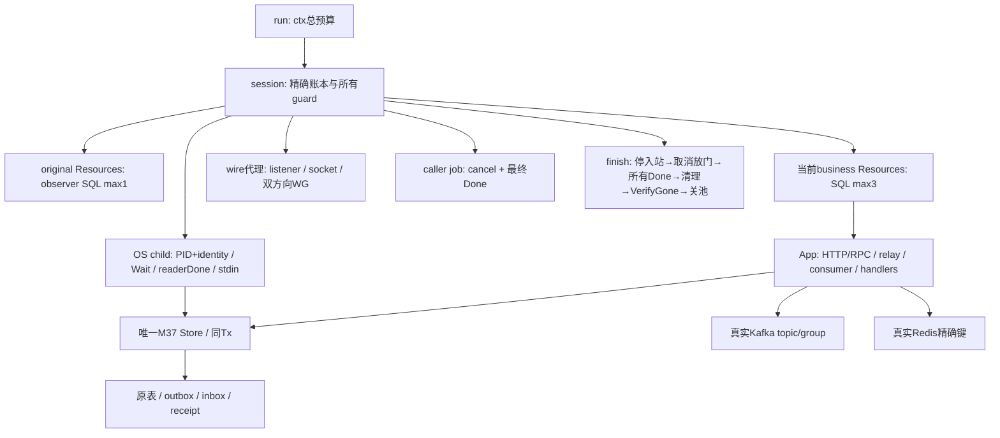

# M38：真实故障后，用旧事实恢复同一张订单

本课直接复用已验收 M37 的 `orderbackend`，把真正的请求超时、Tx panic/error、池饱和、HTTP/SQL/Redis 回复丢失，以及三个 Windows OS 进程强杀窗口连到真实 MySQL、Redis、Kafka。每个故障都保留原状态，先查账，再继续同一个 key/event/group；最终独立核对库存、outbox、inbox、receipt、原始消息、offset、API内容和资源退出。

M37 的业务只有一个SKU，初始库存10，单价299分CNY；这里每单数量1。订单创建终态是 `ACCEPTED/v1`，消息消费视图从 `PENDING` 到 `RECORDED`，不代表支付或发货。故障再多也不能改变这套事实契约。

## 10～20分钟核心阅读

前3分钟读 [FAULT_MATRIX.md](FAULT_MATRIX.md) 的不变量与允许暂态；接着5分钟读 `Core → Store.Create → withTx → AfterOrderWrites` 的取消/回滚；再5分钟看HTTP响应丢失与真实SQL、duplicate和offset；最后5分钟沿 `session.finish` 看所有owner最终退出。直接运行核心实验即可看到错误与修复，不需要另做练习。

现在必须理解的是：Go函数返回error不会替你回滚所有外部效果；`panic`只展开当前goroutine；`defer`在当前函数退出时按后进先出执行；`ctx`取消只是通知；多个持久事实有先后窗口；`event_id`与Kafka offset不同；阶段门/HTTP结果/ACK和最终Done不同。

可以延后查的是MySQL packet编码、RESP各类型字节、Kafka coordinator详细协议、Gin/GORM内部完整实现和profile采样算法。这里已经把它们相关入口、版本和证明边界写明，遇到公司实际源码时再沿对应版本深入。

本次独立目录为 `C:/Users/Lenovo/.codex/worktrees/go-course-m38/go-demo/lessons/m38_failure_recovery_lab`。汇总后从仓库根 `D:/IdeaProject/go-demo` 执行：

```powershell
go -C lessons/m38_failure_recovery_lab run ./cmd/demo
go -C lessons/m38_failure_recovery_lab run ./cmd/demo -scenario core
go -C lessons/m38_failure_recovery_lab run ./cmd/demo -scenario proxies
go -C lessons/m38_failure_recovery_lab run ./cmd/demo -scenario kills
go -C lessons/m38_failure_recovery_lab test -v -count=1 ./...
go -C lessons/m38_failure_recovery_lab vet ./...
& ./lessons/m38_failure_recovery_lab/scripts/verify-race.ps1 -Integration
```

默认入口 `all` 真实运行全部矩阵；`core`包含真实故障但全部由有界owner管理。测试默认只执行四项辅助断言，三个实库入口明确SKIP；完整普通实库测试可以在当前 PowerShell 进程保存/恢复 `GOLEARN_M38_INTEGRATION` 的原存在性和值，然后设置为 `1`，执行 `go -C lessons/m38_failure_recovery_lab test -v -count=1 -timeout 300s ./...`。`verify-race.ps1 -Integration`自动做这个操作，且设置 `GOLEARN_M38_CHILD_RACE=1`，真实强杀child也用race编译，不能把未启用的SKIP当实库验收。

脚本只读取主agent登记的 `toolchain.json`，在当前进程设置CC/CXX/CGO/PATH，finally恢复不存在、空字符串和非空原值。没有 `go env -w`、系统PATH变更或默认32位MinGW混用。普通 `go run`会按需编译本模块 `.local/m38-child.exe`；测试cwd为 `internal/lab` 时，专属child产物在该package自己的 `.local`，仍被本模块ignore覆盖。

真实基础设施沿用安装者索引 `D:/IdeaProject/go-demo/.local/course-orchestrator/infra-services.json`，可用 `GOLEARN_SERVICE_INDEX`指定已有索引。秘密只由M37 `LoadConfig` 从 `credential_file` 读入内存，不打印/复制DSN、口令或SSH命令。端点是MySQL `127.0.0.1:13306`/8.4.11，Redis `127.0.0.1:16389`/8.2.8/DB0，Kafka `127.0.0.1:19192`/4.3.1/单KRaft/ISR1/PLAINTEXT none。服务未READY或协议失败时入口真实失败，没有mock替代。

## 沿文件和符号走完整调用链

| 阅读位置 | 谁调用、做什么、结果回到哪里 |
| --- | --- |
| [cmd/demo/main.go](cmd/demo/main.go) `main → run → lab.Run` | CLI建立signal与240秒总预算；所有lab defer执行完再决定Exit |
| [internal/lab/suite.go](internal/lab/suite.go) `Run` | 顺序运行core/proxies/kills；SafeWriter保护共享日志，不排序调度 |
| [internal/lab/owner.go](internal/lab/owner.go) `withSession → openSession → authorize → fresh` | 原owner Provision并保留账本；预授权精确键；恢复者只OpenResources/BorrowCacheKeys，不收编旧对象 |
| [internal/lab/core.go](internal/lab/core.go) `Core / pool / cacheRace` | HTTP/RPC到真实Store、Tx门、取消/停止、真实Conn等待、缓存晚回填 |
| [internal/lab/http.go](internal/lab/http.go) `call / verifyAPI / newHTTPDrop` | 完整协议内容验证；代理先读真实201再断下游；owner分别加入Serve和已接纳handler |
| [internal/lab/audit.go](internal/lab/audit.go) `audit / waitState` | 独立SQL内容、原始Kafka Key/Value/offset、持久group next；predicate读事实，不sleep猜阶段 |
| [internal/lab/rebalance.go](internal/lab/rebalance.go) `rebalance` | same-group只读standby加入/离开，broker成员、client generation与assignment、worker/client最终Done |
| [internal/lab/proxies.go](internal/lab/proxies.go) `Proxies → commitLoss / redisLoss` | 独占连接的SQL/Redis回复门；保存真实UNKNOWN原因，fresh同状态恢复 |
| [internal/lab/wire.go](internal/lab/wire.go) `newWire → mysql / redis → packet / respFrame` | 动态listener、真实双向TCP协议；只输出无秘密阶段；close等全部方向与socket归零 |
| [internal/lab/kills.go](internal/lab/kills.go) `Kills → killTrial` | 父观察目标窗口→实际Kill/Wait→fresh原key/API/cache/consumer→最终不变量 |
| [internal/lab/process.go](internal/lab/process.go) `childBinary → startProcess → Worker → atStage → kill` | 无秘密spec/identity/PID；父自有pipe；stdout阶段认证；OS退出和日志reader独立Done |
| [internal/lab/lab_test.go](internal/lab/lab_test.go) | error身份、取消与最终Done、完整协议frame；明确开启的三个独立真实入口 |

真实业务调用从这里进入前置公开源码（本地replace，没有import前置internal或复制业务）：

`call POST → M37 App.router/Gin → Service.Create → 实际gRPC Inventory.Inspect → Store.Stock → Store.Create → withTx → 锁stock/二次查key/扣库存/插orders/插outbox → Commit → AfterOrderCommit → HTTP201`。

`App relay → Broker.RelayOne → Store.Pending → Broker.Publish/ProduceSync → 真实broker ACK → AfterRelayACK → Store.MarkSent`。

`consumer PollRecords → Broker.ProcessRecord → Store.Apply/inbox+receipt同Tx → AfterConsumeCommit → Cache.Invalidate/EVAL → CommitRecords → AllowRebalance`。

`GET /orders/id → Cache.Query → Redis GET → miss时Store.Read → AfterRead → Lua generation比较/填缓存 → View`。`GET /requests/key`直接权威MySQL，适合UNKNOWN对账。

`go.mod`明确replace M37，另外replace M31以解析M37消费的生成库存协议。root `go test ./...`不会进入嵌套module。原 `go mod verify`遇本地replace的missing ziphash失败必须保留，实际消费源码与远端图的独立校验见STATUS，不能改写成原整命令成功。

## owner、值复制和真正等待点



`s`、`Resources`、`App`、`job`、`wireProxy`是共享指针；复制指针不会复制池/任务。`Command`和`Config`是值副本；前者不含可写引用，后者在proxy子例只替换地址，秘密仍在内存。`Hooks`是函数值，其闭包捕获的是实验owner的门指针；它不会把门复制成独立channel。`channel`方向/关闭是同步机制，`<-Done`等待关闭后的同步关系使owner能安全读取工作goroutine最后写的error。

`launch`先建立cancel/Done，再启动goroutine；`defer close(done)`最早注册，所以panic恢复和cancel先执行，Done最后关闭。`consumed`只由owner在Done后且独立故障断言成功时写；预期故障不再当整场失败。观察者提前失败时未消费的error/panic/UNKNOWN仍由session保留，不能悄悄丢掉。

| 参与者 | 当前实际等待 | 谁取消/放行 | 最终证明 |
| --- | --- | --- | --- |
| HTTP caller | `http.Client.Do`与Body读取 | 自己的ctx/owner cancel | job.Done，Body已Close |
| server handler | gRPC、SQL、AfterOrderWrites门 | M37 request ctx或App根ctx | admission active归零 + App.Done |
| relay | ticker、Pending SQL、ProduceSync、ACK hook | App根ctx或真实OS Kill | App task join或Process.Wait |
| consumer | PollRecords、Apply Tx、EVAL、CommitRecords、hook | App根ctx/专属worker cancel/OS Kill | worker/App Done + client.Close；offset另查 |
| MySQL代理 | 两方向ReadFull(packet)，COMMIT OK门 | session关listener/socket/放门 | Accept Done + 双方向WG + sockets0 |
| Redis代理 | 命令RESP/对应reply读取、reply门 | session关socket/放门 | Accept Done + 连接WG + sockets0 |
| OS child | 目标hook内stdin ReadString | 父只Kill持有的cmd.Process | 非零ExitError + readerDone + stdin关闭 |
| standby | PollRecords/AllowRebalance | own cancel | poll job.Done后Leave/Close；broker成员再核对 |

Java中异常+事务注解可能让你期待“抛异常就回滚整个调用”，但Go error只是值；这里的 `withTx` 明确决定Rollback/Commit。goroutine不是由某个全局线程池自动管理的请求线程，入口返回也不会自动取消/等待它。context也不等价于强制线程中断：`cancel()`不会撤销已经提交的SQL或broker消息。真实Kill更不会运行Go defer；父保留原账本与恢复连接才有机会精确清理。

## 正常链、取消链和回滚的时间线

| 步骤 | 参与者 / 函数或等待点 | 持久状态与下一步 |
| --- | --- | --- |
| 1 | parent `openSession/authorize` | 预检不存在，登记五表/topic/group/精确缓存键；只随后副作用 |
| 2 | caller `call POST` → Gin → gRPC | request_id只追踪本次调用；Inspect只是库存提示，不是锁 |
| 3 | Store.Create / withTx | begin连接属于Tx；stock行锁→数量扣减+order+outbox，暂未提交 |
| 4a | hook提前error/panic | withTx defer Rollback；panic继续至Gin；HTTP错误后独立SQL仍stock10/orders0 |
| 4b | timeout hook等待ctx | caller期限到→server hook观察取消→Rollback→handler返回；只有此后空查询才能描述最终无提交 |
| 4c | stop在途 | App.Stop停止新接纳并取消root→hook观察→handler与callerDone→App.Close join→SQL0 |
| 4d | 正常Commit | stock9、order1、outbox1属于同一个已提交事实；以后响应丢失不能撤销 |
| 5 | relay ACK → sent | outbox从pending到sent，broker消息存在；receipt仍可0/cache仍可PENDING |
| 6 | consumer Apply Tx | inbox/receipt同提交，源stock不再扣；afterCommit hook后的错误留UNKNOWN |
| 7 | Redis失效 → group commit | 重复消息也再次失效；next移动到已处理前缀之后 |
| 8 | API + audit | 完整order/金额/owner/version、View RECORDED、effect1、broker真实记录与next核对 |
| 9 | session.finish | 所有进程/代理/job/App实际退出后才清精确对象，VerifyGone读不存在/offset空，SQL池最后0 |

前两步之外，不同请求、relay和consumer之间的偶然日志交错没有总顺序保证。门只固定目标因果：写完成→观察门、取消观察→退出、真实ACK→标sent、消费Tx→失效→offset。ticker时间仅限频率，实验不靠sleep猜。

## 三个强杀窗口的恢复解析

K01 child没有启动relay，`Store.Create.AfterOrderCommit`报出可信identity/PID阶段。父先读stock9/orders1/outbox1/sent0/raw0/next-1，再 `Process.Kill`。Kill成功不是结束，父另等 `cmd.Wait` 非零退出、stdout drain Done、stdin关闭。fresh才打开同namespace，不Provision旧状态。原keyAPI PENDING证明原订单存在，恢复relay发布旧event，最终效果1/next1。

K02 child `RelayOne`已经取得真实ACK，父原始reader读到offset0的Key/Value，SQL sent仍0。Kill后重启relay还会看pending，所以发布同一个event而产生offset1。这是正常的至少一次传递窗口；broker两条不等于两次业务。最终inbox首次offset0、receipt/effect1、next2。错误恢复若重新生成event_id，就绕过持久去重。

K03 child `ProcessRecord`的SQL已经提交，但AfterConsumeCommit挡住失效和offset。父看receipt1、next-1、真实PENDING缓存，然后强杀。fresh原key权威API是原订单，cache API暂时仍PENDING。重投offset0时Apply检测同event/payload，不增加SQL效果，仍再次失效，最后next1/API RECORDED。错误恢复若“duplicate直接跳过整个handler”，缓存便可能永久旧读。

每次复用原key的受控POST是在旧PID已Wait、权威原单已核验之后，只验证同载荷幂等归一，不是看到网络错就盲目自动重试。恢复过程不删原状态、不回滚陈旧快照、不reset进度；所有中间事实和raw字节保留到完整恢复后才精确清理。

## 通信错误与依赖慢：看似相同的返回，事实不同

`HTTP_201_CAPTURED`只证明真实App给代理的完整201/COMMITTED已收到，随后代理Hijack并关闭下游，caller收EOF/UNKNOWN。父GET原key与完整API/SQL才证明order效果；handlerDone与ServeDone分别加入，因为Hijack连接不归HTTP Shutdown管理。不会把应用hook等待叫作COMMIT通信丢失。

`MYSQL_COMMIT_WIRE`和 `WIRE_REPLY_CAPTURED protocol=mysql command=COMMIT_OK`表示本课独占代理实际看见COM_QUERY COMMIT及服务端seq1/OK包。driver没收到这包，返回invalid connection。`ErrUnknown`与原错误链保留，父独立SQL查单1/stock9/outbox1，不根据invalid connection猜回滚。代理两方向先退出，旧client关闭，新client恢复消费后才清原账本。

Redis慢GET也先完成真实握手/INFO，arm只作用于业务GET。代理实际收到reply，但caller的500ms预算不够等交付，错误常为 `i/o timeout`；这不是Redis服务没执行的证据。课程不修改全局延迟或共享服务，只隔离本课连接。

Redis EVAL子例在消费SQL提交后，真实失效命令已经执行而回执被丢弃。父可读data不存在、generation2，receipt1、next-1；`ProcessRecord`返回UNKNOWN。正确动作是join旧worker/client，然后fresh同group重投、SQL去重、失效再次成功后确认next1。把SQL效果补偿回旧值或先commit offset都会失去本来的事实依据。

F07专门看Go错误传播：真实ACK及消费SQL commit的hook内才cancel自己的生命周期ctx，并实际读Done/Err。返回错误树同时含UNKNOWN和Canceled；它与OS Kill不同，后者没有机会返回Go error。这两条真实ctx取消不能被“正常停机Canceled”吞掉。独立审计中ACK后raw1/sent0，消费后effect1/next-1；恢复同event最终raw2/effect1/next2。hook取消属于错误分类实验，不称为通信截断。

## 重复、rebalance与缓存回填

duplicate的日志中offset0/1/2具有相同真实Key/Value。`CONSUMER_DB_COMMIT applied=false`只表示这个event此前已做SQL效果；后面的CACHE_INVALIDATED和OFFSET_COMMIT仍必须执行。独立SQL核对first_offset=0、effect_count=1与next3，不能只看applied=false自报。

rebalance使用已消费完消息的同groupstandby，只有PollRecords/AllowRebalance，没有ProcessRecord和CommitRecords调用。broker DescribeGroups要Stable成员1→2→1；franz `GroupMetadata`实际generation随加入/退出改变，assignment callback有真实分区集合。没有业务新消息，因此standby不抢一项业务作用。它先poll workerDone，再Leave/Close client，之后原App继续两个缓存订单。这个边界不宣称有在途旧generation业务写的fencing演练。

缓存实验先创建一个新订单并在BeforeConsume挡住consumer，AfterRead门捕获权威PENDING。放consumer，真实Tx receipt提交、Redis代际变动、offset确认后，旧Query继续。它允许旧caller返回自己的PENDING快照，但Lua拒绝旧generation填当前缓存。

坏路径随后用同一个真实旧View/key执行 `UnsafeFillForLesson`，下一API真实命中PENDING，SQL已RECORDED，清楚复现无代际SET的污染。原owner精确Invalidate修复它。第二单只走M37正常Query/Lua，旧读晚回填被拒绝，下一API返回RECORDED。TTL只能让错误稍后过期，不能当这段窗口的严格一致性证明。

## 日志如何读，哪些是假阳性

日志中的 `TX_WRITES` 表示未提交，不是成功；`ORDER_COMMIT`表示创建事实，却不表示HTTP caller已经拿到201；`KAFKA_ACK`表示当前单节点broker接受，却不表示sent或receipt；`CONSUMER_DB_COMMIT`表示receipt事实，却不表示失效/offset；`APP_DONE safe_release=true`才允许外层回收借用池；`PROCESS_KILLED_JOINED`是OS退出证据，仍不是恢复成功。`AUDIT`、`API_RECONCILED`和最后 `VERIFY_GONE`是分别对业务、内容、清理的独立读回。

原始日志、pool等待栈、无秘密spec/PID identity、精确账本与child二进制保留在本模块忽略 `.local`；STATUS给最终样本路径与失败历史。每组最多5条消息（公共库reader上限8）、3单、当前SQL连接预算4；总工作240秒，阶段等待15/20秒，清理用独立Background预算。边界超时或未进入目标窗口必须报失败，不能降低期望数字。

清理是原账本所有精确表/键/topic/group及offset。`fresh.CleanupOwned`只清自己的账本，原owner最后 `CleanupOwned/VerifyGone`；若原client关闭，公开 `CleanupOwnedVia(fresh)`允许原owner借同namespace新连接清自己的名单而不转移责任。未知对象拒绝收编。任何进程、代理方向、job或App尚未最终退出都保留对象，禁止删除；原failure、UNKNOWN和cleanup用errors.Join共同保留。

复验原账本的只读命令（把path换成STATUS中自己的实际样本路径）：

```powershell
go -C lessons/m38_failure_recovery_lab run ./cmd/demo -verify-cleanup .local/m37_<run>/original.json
```

没有扫描前缀、FLUSH、重置别人offset或控制共享服务。

## 版本、资料与范围

实际执行Go1.27.0/windows/amd64，module `go 1.27.0`，没有额外toolchain指令。固定依赖来自已验M37：Gin1.12.0、GORM1.31.2/mysql1.6.0、go-sql-driver1.10.1、go-redis9.23.0、franz1.22.1/kadm1.19.0、gRPC1.84.0和M31实际生成代码，go.sum锁定。运行时与库语义按本机源码核对，网页可能显示后续patch，不据此升级。

本次重新查证 [database/sql Tx](https://pkg.go.dev/database/sql#Tx) 与本机 `D:/Go/src/database/sql/sql.go`（ctx、Rollback/Commit、DB.conn），[context](https://pkg.go.dev/context#WithTimeout)，[Kafka4.3设计](https://kafka.apache.org/43/design/design/)，[Go诊断](https://go.dev/doc/diagnostics)，以及锁定franz-go的GroupMetadata/BlockRebalanceOnPoll/CommitRecords与MySQL驱动COMMIT源码。Java类比只辅助读代码，不改变这些真实版本契约。

硬前置M37/M33/M34已验收。M33的总预算、未知写查原key与Result/Done分离，M34的真实等待栈与诊断不代替业务账本，通过当前README/STATUS和直接符号只读复用；不重跑前置全部课程，不导入internal。

M37没有多版本同聚合更新、Redis lease/续租/fencing，因此同聚合乱序及旧lease owner项准确不适用，详细原因见冻结矩阵。这里测单节点Kafka与本课应用进程故障，没有服务节点宕机、多副本耐久性、跨业务服务幂等、支付/发货、生产SLA或长期稳定性承诺。完整实际运行与未验边界见 [STATUS.md](STATUS.md)。
