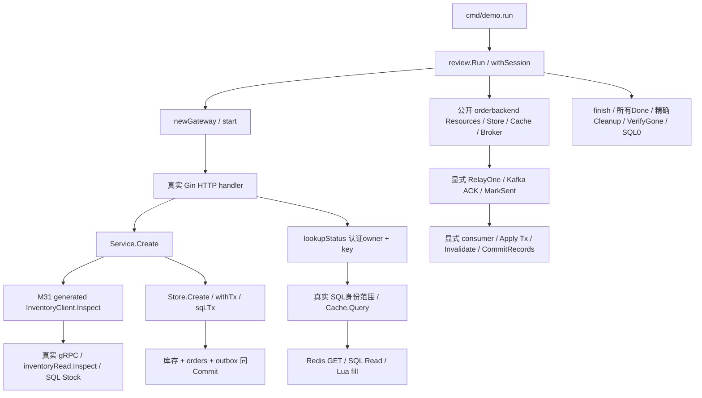

# M39：接手订单状态切片，审查 AI 候选并交付一个小修复

这次接手的业务是“按原 request key 查询订单状态”。Alice、Bob 都能创建订单，同一个 key 在各自账号下合法。一个看起来完整的候选 handler 只按 key 查 SQL，再使用查出来的订单 owner 查询 Redis：SQL、缓存、HTTP 都成功，Bob 却得到 Alice 的完整订单。本课先把这个问题变成实际失败，再用两个很小的授权范围修改恢复业务不变量。

**不变量：同 request key，authenticated Bob 永远拿不到 Alice 的订单。** 实验中的 `assertOrder` 同时检查 ID、owner、SKU、quantity、299 分单价、CNY、ACCEPTED、v1；状态码不是验收目标。固定合成数据为 Alice/shared/qty1 和 Bob/shared/qty2，权威 SQL 两行，库存 7。

没有提供 Shopee 内部源码，因此使用当前综合项目 M37 的唯一公开 `orderbackend`，加本课新的 Gin 状态网关切片。锁定公开框架 **Gin v1.12.0**，按 M32 的“先入口、签名、caller、真实副作用、最终 owner”方法读源码；没有关于公司使用此框架、内部表设计或上线架构的推断。M38 的故障矩阵作为前置事实边界，本课不重复它的代理和跨 OS 强杀。

## 10～20 分钟核心阅读

从仓库根目录执行，`-C` 切进独立 module。需要已登记 READY 的真实服务；凭据仍由 M37 `LoadConfig` 只在内存读取。普通默认入口实际全量 Live；普通测试的 SKIP 不算证明。

```powershell
# 2分钟运行最小PR及其SQL/Redis/API回归。
go -C lessons/m39_takeover_code_review run ./cmd/demo -scenario isolation

# 专门复跑先失败用例：预期exit1，Bob得到Alice的完整订单断言失败；仍完成owner清理。
go -C lessons/m39_takeover_code_review run ./cmd/demo -scenario isolation -candidate bad

# 完整课程：6类短审查、UNKNOWN原key恢复、提前error/panic/cancel收尾。
go -C lessons/m39_takeover_code_review run ./cmd/demo
go -C lessons/m39_takeover_code_review test -v -count=1 ./...
go -C lessons/m39_takeover_code_review vet ./...

# 显式启用实库与Windows兼容race；脚本只设置当前进程环境，finally精确恢复。
& ./lessons/m39_takeover_code_review/scripts/test-race.ps1 -Integration
& ./lessons/m39_takeover_code_review/scripts/verify-deps.ps1
& ./lessons/m39_takeover_code_review/scripts/source-map.ps1
```

建议先读本节和下方调用图（3分钟），看 `gateway.go` 的 `lookupStatus` 和 `cases.go` 的 `Isolation`（5分钟），运行 isolation、对照 R01 日志（2分钟），最后读 [PR_REVIEW.md](PR_REVIEW.md) 的最小 diff 和被拒候选（4分钟）。想理解等待和恢复，再运行 `-scenario offsets` / `unknown` / `owners`，其逐步解析都在本文；没有额外 exercise。

现在必须理解：认证 owner 的来源和逐层传递、`:=` 作用域、具名结果与 defer、真实 Tx 指针、request ctx 与后台 owner、最终 Done、Kafka 连续前缀、SQL/Redis 的真实副作用。可以延后：完整 Gin 路由树算法、生成 descriptor 构建、Kafka coordinator 内部状态机、HTTP2 流控、生产 TLS/SSO、跨分区并行、多副本故障、lease/fencing。同 key 用户隔离需要现在理解；“换个缓存前缀”不能替代 SQL 授权条件。

## 先收集事实，再缩小阅读范围

| 接手问题 | 本课实际定位与证据 |
| --- | --- |
| 版本与 module | `go version` 为 go1.27.0/windows/amd64；本课 `go 1.27.0`，无 toolchain / go.work；`go list -m` 锁 Gin1.12.0、GORM1.31.2、mysql driver1.10.1、go-redis9.23.0、franz-go1.22.1/kadm1.19.0、gRPC1.84.0 |
| 是否真的完成硬前置 | 已读 M32、M38 README/STATUS 和直接调用/owner源码；当前基线 `cf11684d94745063faf6e2c34bf345205e562853` 是已验第5层；不把 prompt 存在当完成 |
| 生成代码从哪来 | 明确 local replace M31、M37；只复用 M31 已生成 `Inventory.Inspect` 消息/注册/客户端，不手改或重新生成；M31 `Reserve/Watch` 在本切片未实现 |
| 启动与配置 | `cmd/demo.run → review.Run → withSession → LoadConfig/OpenResources/Provision → newGateway/start`；所有 listener 都 `127.0.0.1:0` |
| 一个请求实际做什么 | POST同步 gRPC只读库存 → MySQL同Tx库存/订单/outbox；GET 状态先 SQL按owner/key找到ID → Redis数据缓存/SQL视图；relay/consumer是实验显式有限调用 |
| 谁能配置故障 | 只有本机 CLI/scenario 的可信实验代码提供 Hooks/门。没有公网监听、公司资料上传或外部PR；candidate路径只是有限本机反例 |
| 数据归谁 | M37 random namespace不表示所有权；精确不存在预检、发送前attempt账本才获得课程合成对象；`owned.json` 保留创建/清理责任 |
| 上线约束 | 合成 Bearer 映射不是生产认证；单SKU、单broker ISR1/PLAINTEXT、单partition、创建v1，没有支付/发货/多版本投影/fencing；202只表示进程内接纳，无持久异步队列承诺 |

服务是 MySQL8.4.11/127.0.0.1:13306/课程库、共享 Redis8.2.8/127.0.0.1:16389/DB0、Kafka4.3.1/127.0.0.1:19192。没有安装、重启、改 ACL/全局配置、FLUSH、扫描删除、reset 其他 group。M37 构造日志先打印其默认 max4，本课构造后立即固定 max3 并打印 `M39_BUDGET sql_max_open=3`；只有这一业务池，没有额外 observer 池。独立清理复核 sequential fresh max1，不与已关闭的业务池并存。

## 文件与真实调用图

| 文件 / 符号 | 责任、输入、结果去向 |
| --- | --- |
| [cmd/demo/main.go](cmd/demo/main.go) `main/run` | CLI选择有限范围，150s总观察预算；run所有defer后main才可能退出 |
| [internal/review/run.go](internal/review/run.go) `Run` | 串行选择8组证据，SafeWriter保护共享Writer，不承诺偶然日志顺序 |
| [owner.go](internal/review/owner.go) `withSession/session.finish/task/gate/Verify` | 创建者账本、业务生命周期、任务最终Done、屏障、独立读回与最后关池 |
| [gateway.go](internal/review/gateway.go) `newGateway/start/router/lookupStatus` | 新Gin状态切片、真实gRPC装配、认证owner、最小PR位置 |
| 同文件 `admission/stop/close/startJob` | 封入站、观察实际handler退出、后台任务借用/最终join；不让请求取消接管relay或反过来 |
| [cases.go](internal/review/cases.go) `request/Isolation/assertOrder/counts` | 实际HTTP及SQL/Redis授权回归，检查完整协议内容 |
| 同文件 `shadowTx/Transactions/Contexts/Pools/Helpers` | 真实短缺陷、对照修复；语言辅助与实库证明明确分开 |
| [offsets.go](internal/review/offsets.go) `consumer/poll/applyOnly/prefix.mark/offsetCase` | 有界两worker、实际broker进度、连续前缀collector与fresh重启探针 |
| 同文件 `Unknown` | 真实提交后取消，保留UNKNOWN，原key/payload查账，续原event |
| [early.go](internal/review/early.go) `EarlyOwners` | 真实未提交Tx门处owner提前失败；所有Done后、删数据前独立SQL断言 |
| [review_test.go](internal/review/review_test.go) | 3项辅助、3项Live测试；辅助只证明对应算法/语言/任务错误身份 |
| [scripts](scripts/test-race.ps1) | race三态环境恢复、实际依赖图校验、锁定源码符号/hash采集 |

`*b.Resources`、`*b.Store`、`*b.Cache`、`*gateway` 是共享具体指针：传参复制指针值，仍引用同一池、账本、对象。Go不自动做Spring Bean管理，Close由组合根决定。`b.Command`/`Order`/`View`字段是字符串、整数和内嵌值，本课复制它们不共享可写map/slice；Hooks复制函数值，闭包仍引用实验门。`context.Context`复制接口值仍共享取消树；`Background()`换父对象会切断请求生命周期，并不自动获得业务owner。



## 一条锁定框架链：不是靠名字猜路由

第三方源码位置由 `go list -m -f '{{.Dir}}' github.com/gin-gonic/gin` 找到。实际本机哈希与符号见 `.local/logs/source-map.txt`，换版本应重新定位。M32的Kratos读法在这里用于Gin，不把Kratos的middleware链混进Gin。

| 顺序 | caller → callee | 当前对象 / 等待 / 返回 |
| --- | --- | --- |
| 启动 | `withSession → newGateway → gin.New → router → Engine.Use/GET/POST` | 普通同步构造；route保存handler闭包，本课没有Wire或扫描注册 |
| 网络 | `gateway.start → http.Server.Serve → net/http handler → admission.enter` | Serve单独任务等listener；每个实际网络handler登记借用 |
| 框架 | Gin `gin.go:662 Engine.ServeHTTP → pool.Get`(667) `→ Context.reset`(`context.go:103`) | 新请求借同一可复用Context对象，设置当前Request；不是可逃逸的业务DTO |
| 路由 | `Engine.handleHTTPRequest`(`gin.go:690`) `→ root.getValue → Context.Next`(`context.go:188`) | 按实际method/path选handler列表；Next同goroutine同步调用链 |
| 中间件 | `CustomRecoveryWithWriter → 认证middleware → c.Next → route handler` | 先trusted owner，派生4s requestctx；defer cancel在后续handler返回后执行 |
| 状态业务 | `handler → lookupStatus(ctx,Resources,authenticatedOwner,key,false)` | ctx接口沿同一请求范围；SQL必须带当前身份，不能拿查出来owner代替认证 |
| 真缓存 | `lookupStatus → Cache.Query → keys → Redis GET` | 精确owner/order/schema键；miss读SQL，Lua检查generation再SET；hit核验owner/ID |
| 状态返回 | `lookupStatus → c.JSON → Next返回 → handleHTTPRequest.WriteHeaderNow → pool.Put`(674) | JSON完整成功仍早于外层handler最后leave；c已可能被复用 |
| POST分支 | `decode → Service.Create → generated inventoryClient.Inspect → ClientConn.Invoke` | protobuf指针仅属于这次RPC；gRPC真实TCP等待，不是函数替身 |
| RPC服务器 | 生成 `_Inventory_Inspect_Handler`(`inventory_grpc.pb.go:142`) `→ owner unary interceptor → inventoryRead.Inspect → Store.Stock` | dec填消息，interceptor同步调用真实service；SQL库存只读观察不是锁 |
| 持久写 | `Service.Create → Store.Create → withTx → GORM Begin → *sql.Tx → SELECT FOR UPDATE/Update/orders/outbox → Commit` | 所有SQL借同Tx；真实写点不在Gin或RPC框架里 |
| 清理 | handler `defer admission.leave`；root `stop/close`；session `finish` | 封账、取消、放门、handler idle/Serve/jobs done、client Close，之后才删表/键/topic/group并读回 |

[Gin v1.12.0 gin.go](https://github.com/gin-gonic/gin/blob/v1.12.0/gin.go)、[Context与Next](https://github.com/gin-gonic/gin/blob/v1.12.0/context.go)、[Recovery](https://github.com/gin-gonic/gin/blob/v1.12.0/recovery.go)是实际锁定链。第一次网页抓取gin.go超时，随后本地已校验module cache源码成功读取/哈希，不把网页失败当版本不存在。本课按实际Consume模块图核对，不升级前置。

## 从签名标责任、err作用域和边界

| 实际符号 | 审查结论与可核对证据 |
| --- | --- |
| `lookupStatus(ctx,r,owner,key,bad)` | `r`借用共享池；`owner`是认证值副本；候选Where仅key，正确Where再带owner，Cache.Query继续用认证owner。R01实际Bob→Alice和修复对照 |
| `Store.Create(ctx,c,h)(o Order,err error)` | 输入Command值副本，返回原订单；`withTx(body func(*gorm.DB) error)`同步传同Tx。M37 `tx.Statement.ConnPool`真实为`*sql.Tx`，TX_WRITES日志+权威SQL验证 |
| `shadowTx(...)(observed error,err error)` | `err=`写具名结果；`if err:=...`声明内层新err；bad返回nil把真实1062吞掉，defer看到外层nil误Commit。R02库存10→9，修复仍9 |
| `withSession(...)(err error)` / `task.join` | defer闭包退出时读最终槽，用errors.Join保留主因与清理因。recover仅当前goroutine；动态error panic用%w，TestTaskPanicIdentity证明errors.Is |
| `Helpers`两种defer | defer函数实参注册时复制旧err，闭包退出时读后来err，实际false/true；不能用旧值决定Tx结果 |
| `gateway.startJob` / `session.launch` | go之前保存Done句柄。`command`不含可写引用；不用`*gin.Context`逃逸，requestCtx复制仍引用已结束请求。R03已202实际Canceled→0单 |
| `admission.enter/leave/seal/wait` | Mutex只保护计数/idle，放锁后等channel；seal与enter同锁，最后leave才idle。独立handlerJoinErr不会被最后Conn.Close结果覆盖 |
| `offsetCase` / `prefix.mark` | workers做真实SQL/失效；只有collector决定连续完成next。单partition高1commit意味next2，包括未完成0。R04真实fresh首offset2与低PENDING |
| `Broker.ProcessRecord` | Apply同Tx提交→每次包括duplicate都失效→CommitRecords→AllowRebalance。没有自动提交；Kafka进度与SQL效果是两个事实 |
| `Unknown` | 已Commit后hook真实观察Canceled，返回UNKNOWN+原cause；原key查权威payload，续同event。不能用取消、1062或普通错误把unknown归一成功 |
| `Pools` / `Resources.Close` | 3条Conn被owner持有，第4次等许可而Deadline；归还后InUse0恢复，最后Close的OpenConnections/InUse0；不是把池设大来掩盖泄漏 |

Go的短变量规则看[语言规范](https://go.dev/ref/spec#Short_variable_declarations)；Context沿真实调用链传递、goroutine生命周期需要明确，见[Go Review Comments](https://go.dev/wiki/CodeReviewComments)。这些语言/审查原则不替代本课的数据库和broker断言。[诊断指南](https://go.dev/doc/diagnostics)提供进一步排查方向；本课用实际等待屏障、DB.Stats、group offset和精确最终Done，不宣称已做所有pprof/长期性能测试。

## R01：漏掉身份范围，两个“成功”凑成越权

问题代码就在 `lookupStatus` 的 `candidateBad` 路径：`Where("request_key=?",key)` 后 `Take(&o)`，然后 `Cache.Query(...,o.Owner,o.ID)`。本课加 `Order("owner ASC")` 只是使复现稳定选择Alice，不将数据库偶然顺序当保证。问题本质是认证owner没约束SQL和缓存链。

| 时间 | 参与者 / 等待点 | 真实事实与下一步 |
| --- | --- | --- |
| 1 | Alice POST /orders →同步Create | qty1同Tx提交，stock9，order/outbox各1 |
| 2 | Bob POST /orders →同步Create | 相同key但owner不同，qty2合法，stock7，order/outbox各2 |
| 3 | Bob GET candidate/status/shared | SQL按key选择Alice；真实Redis miss→SQL读Alice→Lua填Alice键→HTTP200 Alice完整View |
| 4 | 独立`assertOrder`要求Bob/qty2 | 专用bad命令exit1；不是“预计会失败”的纸面例子 |
| 5 | fixed状态route | SQL同时绑定owner与key，缓存继续认证owner；Alice得到qty1/Bob得到qty2，各第二次真实CacheHit |
| 6 | 影响范围回归 | Bob同key不同payloadPOST409；未认证401；无原key404；SQL仍stock7/orders2/outbox2/effects0 |

日志 `R01_BAD http=200 authenticated=bob returned=alice quantity=1` 显示协议已成功但授权失败。修复日志 `R01_FIXED owner=bob returned=bob qty=2 cache_hit=true` 来自完整HTTP内容且已核对权威SQL两行。只改缓存身份会把SQL错选Alice变成查询失败，仍拿不到Bob自己的订单；只靠缓存内部校验也不可能知道上层认证owner已经被替换。具体最小diff、候选审查与限制见PR文档。

## R02：if err遮蔽、defer误提交与panic

`shadowTx`是新切片内的短坏例，直接使用真实stock表；它不是对M37生产函数的修改。第一次UPDATE quantity-1尚未提交，第二次INSERT相同SKU返回真实 MySQL1062。bad里的if `err:=`是新变量；`return observed,nil`又明确写外层nil。退出defer于是Commit，独立SQL读stock9/orders0。这是业务已错误改变而返回成功，gofmt/vet不会替你决定业务的正确不变量。

修复只把错误写回外层槽并返回该错误，defer不Commit、Rollback，stock仍9。注意不能把修复期望写回10：坏例已真提交，修复不能穿越时间撤销它。此实验用同一账本保留这项历史效果，最终清理是fixture结束，绝不标成恢复了错误库存。

之后M37真正的Create在未提交写后返回error和panic，各自回滚，仍stock9/orders0/outbox0。panic在本goroutine被外层recover转换后保留原error身份；通过真实HTTP再触发同一Tx hook，Gin Recovery返回500/UNKNOWN，SQL独立仍0单。Recovery只保证控制流可收尾，不保证所有已经提交事实自动撤销；提交后的边界见R07。

日志按顺序是 `R02_BAD inner_error=1062 outer_error=nil stock=9 committed=true`，随后 `R02_FIXED ... rollback=true`，再实际 `TX_WRITES → GATEWAY_RECOVER → SQL_FACT stock=9 orders=0`。Java事务异常拦截器类比到这里失效：Go返回`error`与`panic`是不同控制流，`if`局部变量不会自动变成上层异常，defer具体读取哪个槽决定真实动作。

## R03：handler返回后的Context，谁拥有异步写

坏handler从当前请求取requestCtx、复制Command，启动go并返回202。业务worker先等真实requestCtx.Done（middleware返回时cancel，net/http返回也会结束入站context），再进入实验门；驱动读202、确认实际Canceled，放门后Service.Create用已经结束的ctx调用真实gRPC，得到Canceled且SQL0单。它没有保存Gin Context，因此这个例子专门展示生命周期丢失，没有人为制造数据race。

修复worker借明确网关owner的ctx，派生每job **10秒** workCtx，任务defer cancel释放timer；Command是独立业务值，网络返回不取消它。驱动等真实门、放行、最后job.Done后SQLstock9/orders1/outbox1。这不是生产“异步下单必须可靠”的完整方案：当前202只接纳在进程内，进程崩溃可能丢任务，生产需另定义持久接纳协议。`context.WithoutCancel`或随手Background只切断取消，不会给你资源owner或可靠性。

| 参与者 | 当前等待 / 状态 | 谁通知 / 谁最终等待 |
| --- | --- | --- |
| HTTP handler | decode→登记job→202返回 | net/http/Gin owner；outer leave进入idle |
| bad worker | requestCtx.Done→badGate→真实gRPC Canceled | 请求结束触发取消；root.tasks最后join |
| fixed worker | goodGate→gRPC Inspect→SQL Create | gate创建者放行、10sdeadline/root.stop取消；root最后join |
| 实验驱动 | 真实202完整body→Canceled/entered→job.done | session发生提前失败也先cancel/放门，再独立join |

日志 `R03_BAD handler_returned=202 request_ctx_observed=Canceled orders=0` 对照 `R03_FIXED explicit_owner=true ... orders=1`。ctx通知不等于退出，ctx超时不撤销已提交SQL，带数据指针也不是深复制。[Request.Context契约](https://pkg.go.dev/net/http#Request.Context)与[CancelFunc](https://pkg.go.dev/context#CancelFunc)能核对这些区别。

## R04：并发worker完成顺序不是可提交的前缀

真实Kafka收到两条v1订单事件，offset0/1。低worker在真实业务前的门等待，高worker先完成。bad把生产串行`ProcessRecord`放进各worker，让高worker在SQL效果/失效完成后直接CommitRecords(record1)。库会确认 **offset+1**，故broker next2，而不是“单独确认1”。

| 步骤 | 低worker | 高worker / collector | SQL / broker事实 |
| --- | --- | --- | --- |
| 1 | `lowGate.wait`，0未Apply | 已poll0/1 | stock8/orders2，effects0，next-1 |
| 2 坏例 | 仍未Apply | 真Apply1→Invalidate→Commit1 | effects1，low PENDING，next2 |
| 3 坏例 | 取消、真实Done，没有效果 | 高Done，旧consumer.Close | 原状态保留，不reset offset |
| 4 坏例重启 | 已退出 | 发布相同高event作offset2探针，fresh真实首条2 | raw3/effects1/next2；offset0已被跳过 |
| 2 修复 | 仍等门 | `applyOnly(1)`无确认权；collector `mark(1)`=0 | effects1，broker next仍-1 |
| 3 修复 | 放门→Apply0→Invalidate→Done | collector `mark(0)`=2，统一CommitRecords(record1) | effects2，所有offset<2都完成，next2 |
| 4 修复重启 | 已Done | 旧client先Close，再同event探针/fresh首条2 | raw3/effects2/next2，fetch探针不自动commit |

日志 `R04_BAD ... broker_next=2`、`R04_RESTART bad=true first_offset=2 ... effects=1` 证明实际重启跳过低业务，不是mock错误或“等不到消息”的猜测。修复第一阶段日志 `contiguous_next=0 broker_next=-1`，最终同样首条2却已effects2，业务含义不同。raw第1/2两条（offset1/2）Key/Value完全相同，探针没有新增订单或消费效果。

`prefix.mark`的map由唯一collector修改，workers不共享它；channel Done建立结果可见性。锁住每一次Commit并不能填低业务缺口；加WaitGroup但已提前提交也不能追回已经跳过的事实。此方案仅覆盖当前单partition有限batch、同group串行确认；没有旧generation在途SQL fencing、跨分区统一watermark或多版本乱序证明。M37只有创建v1，这些风险仍未实现。

[franz-go v1.22.1 CommitRecords](https://github.com/twmb/franz-go/blob/v1.22.1/pkg/kgo/consumer_group.go)实际位于3094，3107生成offset+1；底层同步提交与本地业务完成不是同一事实。MQ不通过panic/recover或事务自动获得正确ack顺序。

## R05/R06：nil接口与池耗尽

`nilBad`返回`var concrete *typedFault=nil`装进error，接口仍含动态类型`*typedFault`，所以`err!=nil`。`nilFixed`直接返回nil接口。nil接收者的方法是否panic取决于它是否解引用；本课Error明确处理nil，所以可以安全观察字符串，但不能据此说所有typed nil都安全。`Helpers`还实际比较defer参数旧值false/闭包晚读true。R05和3项辅助测试仅语言/算法/任务证据，不冒称实库。

`Pools`拥有并持住3个实际`sql.Conn`，第4次QueryRow等数据库连接许可，120ms自身deadline到期，真实Stats.InUse3/WaitCount delta1。这个deadline是等待连接的预算，不是服务端慢SQL取消。每次Conn取得即加入defer账本；归还后SELECT1正常、InUse0，最后Resources.Close核对Open0/InUse0。没有Rows/Tx逃逸，也没有通过增大池隐藏owner泄漏。[SetMaxOpenConns](https://pkg.go.dev/database/sql#DB.SetMaxOpenConns)只配置许可上限，数据库max_connections仍是独立共享约束。

## R07：已提交后Canceled仍UNKNOWN，原key安全恢复

这是实际Go取消窗口，不是网络截断或跨进程强杀；M38的真实COMMIT响应截断证据仍属于M38。`Store.Create`已经完成真实Commit，AfterOrderCommit的可信hook才调用当前request的cancel，等待同ctx.Done，再返回ctx.Err。业务返回同时包含UNKNOWN与Canceled，SQL却是stock9/orders1/outbox1。

安全顺序是：同步Create已经返回、旧执行者已结束 → 独立未取消ctx按原owner+key查权威SQL → 核对完整payload/订单ID → 读取同原order缓存PENDING → RelayOne续已持久的原outbox/原event → 真Kafka ACK→MarkSent → 同group Poll原event → Apply同Tx inbox/receipt→失效→offset → 再读原order RECORDED。没有新key，没有第二次下单，没有删中间状态或reset进度。

日志 `R07_UNKNOWN ... blind_create_retry=false` 对应真实原cause；之后 `KAFKA_ACK → OUTBOX_SENT → CONSUMER_DB_COMMIT → CACHE_INVALIDATED → OFFSET_COMMIT next=1 → CACHE_FILL delivery=RECORDED`。独立读raw只有1条，Value等于`EventFor(original)`完整JSON，Key是原orderID；SQL effects1、qty1、金额299分CNY保持。完整恢复通过后原预期cause才标为已处理；任何提前观察失败仍Join原UNKNOWN，不能被cleanup成功覆盖。

如果权威查询没有找到：只知道本次查询时没有记录；还必须证明旧writer最终Done或进入服务既定对账流程。不能换key盲重写。若查到同key不同payload，应保留冲突，不重新定价覆盖原订单。若consumer曾提交SQL而offset未确认，按原event重投由持久inbox去重，重复仍要失效缓存；M38已验更广的窗口，本课R07只续原创建事件一次。

## 每个owner的最终结局

| owner / 资源 | 创建时登记 / 实际等待 | 收尾顺序与最终证明 |
| --- | --- | --- |
| session | Resources客户端→defer finish→Provision attempt | 停入站/cancel生命周期，再放自己的门；所有使用者Done后才精确Cleanup/VerifyGone/SQL0 |
| gateway | listener、grpc.Conn构造即guard；Serve go前task保存 | HTTP独立Background5s Shutdown，必要Close；gRPC Stop；还要handler admission idle和Serve真正done |
| async任务 | `startJob`登记，Command值、10s workCtx | root.stop通知→自己gate/IO返回→defer workCancel→task.done；root.join读最终err |
| offset workers / early caller | `session.launch`立即登记task | 先取消低worker/旧生命周期，再join所有Done，之后才能Close consumer/fresh；未消费err保留 |
| Kafka clients | `consumer`创建即登记 | 最后工作Done后Leave/Close最终done；Records审计reader由M37公开入口内部defer拥有；不推进业务group |
| HTTP request helper | 一次独占Transport，响应Body取得即defer | 完整读/关闭Body→关闭idle；helper同步返回不代替server handler退出 |
| SQL Conn | Pools取得即append/defer Close | 归还全部3条；InUse0；SQL池最后Close，真实Open0/InUse0 |
| 恢复/维护fresh | `Verify`只开client不Provision，max1 | 只读caller指明账本，defer Close；不接管清理权、不扫描命名空间 |

`EarlyOwners`在真实未提交TX_WRITES门分别让owner提前error、panic、取消。finish先stop/cancel，让同Tx的ctx真实结束，再放门；即使门与取消同时可选，M37 withTx还检查同ctx.Err后才可能Commit。所有caller/gateway/handler Done以后，**beforeCleanup用独立Background查询stock10/orders0/outbox0**，确认才删fixture；原panic error通过%w仍可errors.Is，所有cause保留。观察或事实断言失败会保留对象，不把DROP后的不存在写成回滚证明。

`SESSION_DONE cleanup_ok=true returned_error_present=true` 在提前退出组是有意区分：对象/client清理成功，但原工作Canceled仍在error树中。`REVIEW_PASS owners`表示独立检查“预期失败身份存在、实际Tx已回滚、所有owner收尾、无ErrCleanup”通过，绝不表示提前失败被改成nil。任何未Done都保留对象/池和ErrCleanup，禁止先删数据。

最终 `.local/<namespace>/owned.json` 为无秘密精确attempt账本，测试cwd的账本在 `internal/review/.local`，均忽略。可以独立复核一份：

```powershell
go -C lessons/m39_takeover_code_review run ./cmd/demo -verify-cleanup '<本课精确owned.json绝对路径>'
```

此命令只读真实表、键、topic、group/offset，不执行修复、写业务或清理。随机名称/合法格式不证明对象归属；本课没有收编未知已有对象。最终结果、原失败和冻结清单见 [STATUS.md](STATUS.md)；可复跑命令、AI候选diff与上线限制见 [PR_REVIEW.md](PR_REVIEW.md)。本课没有生产SLA、服务节点宕机、多副本耐久性、所有库内部goroutine零泄漏或长期压测承诺。
